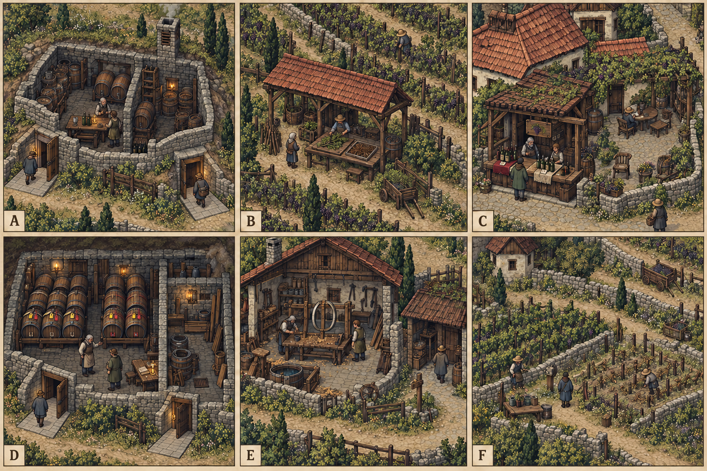

# 空间_MNS_曼郡

所属 [[聚落_MNS_曼郡]]；地域主章 [[台本_CM-MNS_没有年份的酒]]。

> [!info] 制作口径
> 本卡把原来的工作间／侧室替换为逐街区独立空间方案。仅定义相对布局、观察与行动，未定瓦片比例、像素原点、碰撞和原资源索引；不是可导入房间。没有要求玩家走遍所有室内。私密信息按具体任务的授权守卫处理，观察不自动写解决方案。

**地域区别**：重建的酒香里，也有没回来的人。受战争损伤的葡萄酒地区，倾斜架、石墙小院、空酒窖与新苗。

[[原素材参考与城市概念图]]给出风貌；下列布局优先于画面中偶然生成的门数、床数、轨道和水岸。图中人物只是占位，实际人物弧线和方法以各台本为准。

## MNS-D01 葡架外坡

**相对布局**：长坡葡架分成存活旧枝与新苗两段，辨芽棚不堵采果径；租亭朝坡留回村踏道。

入口／返街节点 `MNS-D01`，A `MNS-D01-A` 与B `MNS-D01-B` 各自有返街门。两间不能共用一把剧情钥锁住普通回程；路径不穿私卧房或危险作业区。这里只表示出口意图，实际宽度、碰撞和高度待制作核。

### MNS-D01-A 旧枝辨芽棚

**可观察物**：活芽、死枝与新苗绑线的不同颜色。

**实际交互**：实际比对断产原因和本季可用枝量，不能用旧酒名声宣称酒园已全恢复。

### MNS-D01-B 葡坡租议亭

**可观察物**：一季枝租筹与两家分别存的接枝刀。

**实际交互**：由原户和迁居户决定借一季、买断有限枝或各保一段；下个春天不在本次默示授权内。

**入场权限与证据替代**：不采走枝苗作任务交件；拒入葡架可看公共样枝和移苗前见证，租亭不控制田坡通路。

**相关任务**：[[台本_CM-MNS_没有年份的酒]] · [[台本_CS-MNS-03_葡影的种枝]]。地域主章的街区用途是按现选方案查对应责任，不是多加必访进度；支线只读本案范围。

## MNS-D02 共用酒窖

**相对布局**：酒窖两端地面出入口以短坡相连，通风井不当梯门；温度槽隔开旧封酒与新酒，没有单门锁梯。

入口／返街节点 `MNS-D02`，A `MNS-D02-A` 与B `MNS-D02-B` 各自有返街门。两间不能共用一把剧情钥锁住普通回程；路径不穿私卧房或危险作业区。这里只表示出口意图，实际宽度、碰撞和高度待制作核。

### MNS-D02-A 封桶通风廊

**可观察物**：旧蜡封、无年份新瓶和实际可售量牌。

**实际交互**：核瓶中酒与瓶外旧名分开，选择说明断层、有限旧名或新名出售；不把品鉴判定设技能硬门槛。

### MNS-D02-B 双名保桶室

**可观察物**：同批桶的酒户绳签与护理点绳签。

**实际交互**：现场确认双重预订，有限分桶或退一方押金；护理桶和饮酒桶卫生用途不能混。

**入场权限与证据替代**：拒开窖仍可用封存时留下的公示数，现场桶仅核已授权批；两出口都回酒市，不以酒户认可锁回程。

**相关任务**：[[台本_CM-MNS_没有年份的酒]] · [[台本_CS-MNS-01_空桶有两个名字]]。地域主章的街区用途是按现选方案查对应责任，不是多加必访进度；支线只读本案范围。

## MNS-D03 工棚后街

**相对布局**：试箍屋一侧干木料、一侧浸箍盆；临作棚从后街单独开门，离坊工人不需穿师傅内室。

入口／返街节点 `MNS-D03`，A `MNS-D03-A` 与B `MNS-D03-B` 各自有返街门。两间不能共用一把剧情钥锁住普通回程；路径不穿私卧房或危险作业区。这里只表示出口意图，实际宽度、碰撞和高度待制作核。

### MNS-D03-A 刻线试箍屋

**可观察物**：大刻线旁的小刻线与两种箍接样件。

**实际交互**：比较谁的改法能承压，技术来源与师傅名誉分开；不抹小刻线换常驻折扣。

### MNS-D03-B 学徒临作棚

**可观察物**：学徒自带工具与已结清的有限工钱筹。

**实际交互**：允许分署续作或付有限使用费独立作；已受教养不能扣工具和之后所有收入。

**入场权限与证据替代**：断样固定保留在公共试架，师傅拒会可独立验证；不强迫学徒离乡才证明有成长。

**相关任务**：[[台本_CM-MNS_没有年份的酒]] · [[台本_CS-MNS-02_师傅的第二条刻线]]。地域主章的街区用途是按现选方案查对应责任，不是多加必访进度；支线只读本案范围。

## MNS-D04 酒市小院

**相对布局**：售廊临市，纪念灶退进小院但不拦采购；留空席旁有普通吃饭位，纪念和做生意不互作前置。

入口／返街节点 `MNS-D04`，A `MNS-D04-A` 与B `MNS-D04-B` 各自有返街门。两间不能共用一把剧情钥锁住普通回程；路径不穿私卧房或危险作业区。这里只表示出口意图，实际宽度、碰撞和高度待制作核。

### MNS-D04-A 新酒小售廊

**可观察物**：有限新瓶、旧名签与无名卖样。

**实际交互**：让买者知旧名和今酿来源，定同一批不同标注的实际收益；不给无限酿酒套利。

### MNS-D04-B 空席纪念灶

**可观察物**：旧酒户杯与未归亲人的空席。

**实际交互**：由亲人决定留席、分时纪念或只存杯；拒纪念活动仍可买生活粮。

**入场权限与证据替代**：未归者不生成肯定死亡或归来的新事实；品鉴在售廊可做，私人空席陈述可不公开。

**相关任务**：[[台本_CM-MNS_没有年份的酒]] · [[台本_CS-MNS-03_葡影的种枝]]。地域主章的街区用途是按现选方案查对应责任，不是多加必访进度；支线只读本案范围。

## 周边现场与逐任务出入点

调查聚落不再按支线序号轮换。每条CS的触发街区、现场聚落、处置／回访街区都显式指定；现场有原固定回城环路。城内A/B为可选交互处，不能因列了两间就要求全访。

|任务|触发→调查→处置／回访|地方关联|
|---|---|---|
|[[台本_CS-MNS-01_空桶有两个名字]]|`MNS-D02` 共用酒窖 → `MNS-S02-3` 双用途验桶台 → `MNS-D02` 共用酒窖|[[聚落_MNS-S02_桶石驿]]；酒桶、营地与短泊；同批旧桶被酒户与护理点都预订。|
|[[台本_CS-MNS-02_师傅的第二条刻线]]|`MNS-D03` 工棚后街 → `MNS-S02-3` 双用途验桶台 → `MNS-D03` 工棚后街|[[聚落_MNS-S02_桶石驿]]；酒桶、营地与短泊；木工作品多出学徒的独立改法，师傅要求抹掉小刻线。|
|[[台本_CS-MNS-03_葡影的种枝]]|`MNS-D01` 葡架外坡 → `MNS-S01-3` 两期葡架台 → `MNS-D04` 酒市小院|[[聚落_MNS-S01_葡影村]]；残田复种与季工；旧户要收回分给迁居户的葡枝，称当年只是借。|

## 周边住户与独立生活场景

- [[聚落_MNS-S01_葡影村]]：旧藤坡与新苗田分两段，辨芽棚在中间公共道；住屋退出径不经过原户收枝台。 当地住户 [[人物_MNS-S01-NPC_赛芙]]；比较有限枝的来处与本季成活风险；不把旧户当年一句借变成永久回收权。
- [[聚落_MNS-S02_桶石驿]]：桶堆放在铺石中院，酒用与清水用分架；短宿檐有陆路出口，验桶不必进入饮酒储窖。 当地住户 [[人物_MNS-S02-NPC_凯诺]]；核酒户和护理点的真实预订，有限分桶、退押或换已有合格桶；不凭洗过一次就保证清水用途。

## 信息、行动、资源分别提交

先见物只记录本案可知的观察；开柜、入私屋、公布信息另核当事人授权；实际付费、移料、交还或停止危险段之后才提交对应方法。关菜单、拒绝或退出不写resolve。固定脱体样／公共痕／事前有限记录支持独立核验，不能凭替代证据伪造本人同意。

维修、磨谷、搬粮和普通运输交给实际工班；玩家参与的是归属、调查、监督、真实代价与人物选择，不以收十件材料当多解。各项付钱与库存由现有任务记账，本卡不增加paid、NE或N17资格。

[[任务空间与地点关联审查]] · [[城市篇章与跨区域任务网]] · [[城市与聚落设计总索引]]

丹布里／曼郡八篇当前对白与住处、转运、来源及有限产业交叉见[[丹布里与曼郡人物演出审查]]；修屋未验不造床，酒工与桶工分别署记。

<!-- SHORE-VINE-TASK-ART-20261012:BEGIN -->
## 任务场所概念图（2026-10-12）

[[曼郡任务场所概念与台本映射]]说明A—F的任务、空间与制作约束。面板不是任务顺序或官方相邻关系；画中人物、库存和门仅为原创构图，未实现交互。
<!-- SHORE-VINE-TASK-ART-20261012:END -->
