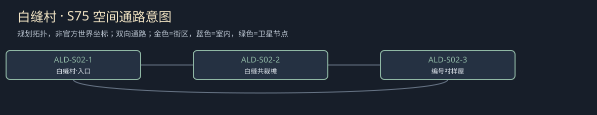

# 聚落_ALD-S02_白缝村

所属：[[聚落_ALD_奥尔德文]]。名称、位置和内部空间均Mod原创，规划小聚落不是原作已确认新城。

## 存在理由与气质

护具衬布和患者家属。矛盾：对技术价值的署名也涉及身份风险。

**生活布局**：衬布屋绕清水天井，交样窗朝公共道，家中护理间另门；技术样与病史不放同柜。

**固定观察物**：可去名的针距样、旧姓名签和有限事故布片。

**实际交互**：由衬工决定技术署记与公开姓名的各自范围；拒伤情展示仍能认工与索赔。

## 入口、生活与现场

- `ALD-S02-1` 白缝村·入口：固定路牌与回城旁路。
- `ALD-S02-2` 白缝共裁檐：护具衬布和患者家属；两份短宿床、一个普通服务班，不是无限补给。
- `ALD-S02-3` 编号衬样屋：由衬工决定技术署记与公开姓名的各自范围；拒伤情展示仍能认工与索赔。。

**当地人物**：[[人物_ALD-S02-NPC_芬珂]]，衬布返修者。

**人物弧线**：多年把作品藏在甲壳里面，也替家人隐去姓名。她要功劳但不必为此献上家门：技术代号公开会令师傅不快，私存来源则错过部分新订单。她可以选择承受哪一种损失，家属的担心不会替她答。

**生活话**：「外面那层叫护甲，里面这一针也有做的人。」

实际任务当事人仍用下面台本；当地住户只能说自己的观察与立场，不替缺席者提供新同意，不自动知道所有关联案结果。

**关联任务**：[[台本_CS-ALD-01_白缝的姓]] · [[台本_CS-ALD-05_师傅没有失去的手]]；地域线 [[台本_CM-ALD_护甲里面的名字]]。处理方法改变本地住户/劳作关系，不让聚落只充当交件点。

**服务与回程**：两床、一班服务仅是设计容量；白天普通服务、夜间短宿，现钱短缺仍保基本避难。入口—服务院—现场形成小环，入口固定双向回所属城市；拥床改等下一班，不瞬移覆盖人物存档。委托、回访、现场均用原生鼠标交互，未制作。

[[城市与聚落设计总索引]] · [[城市篇章与跨区域任务网]]

<!-- CITY-ART-S74:BEGIN -->
## 原素材参考概念（S74）

本聚落对应下方 `ALD-S02` 面板；整板上方是所属城市／地域，不能当本镇规模。 以用户原素材的材质、轮廓和相机为参考生成；人物、场景组合、灯光/季节属于Mod美术提案，不证明原作地理和阵营。来源、任务对应和制作限制见[[原素材参考与城市概念图]]。
<!-- CITY-ART-S74:END -->

<!-- CITY-SPACES-S75:BEGIN -->
## 任务空间细化（S75）

[[空间_ALD_奥尔德文]]列出本地域的独立室内、观察物与可执行交互、权限替代和安全回程；[[任务空间与地点关联审查]]记录逐任务地点修订。已有方法、证据和奖励所有者保持，各室内不是新必访清单。

<!-- CITY-SPACES-S75:END -->
