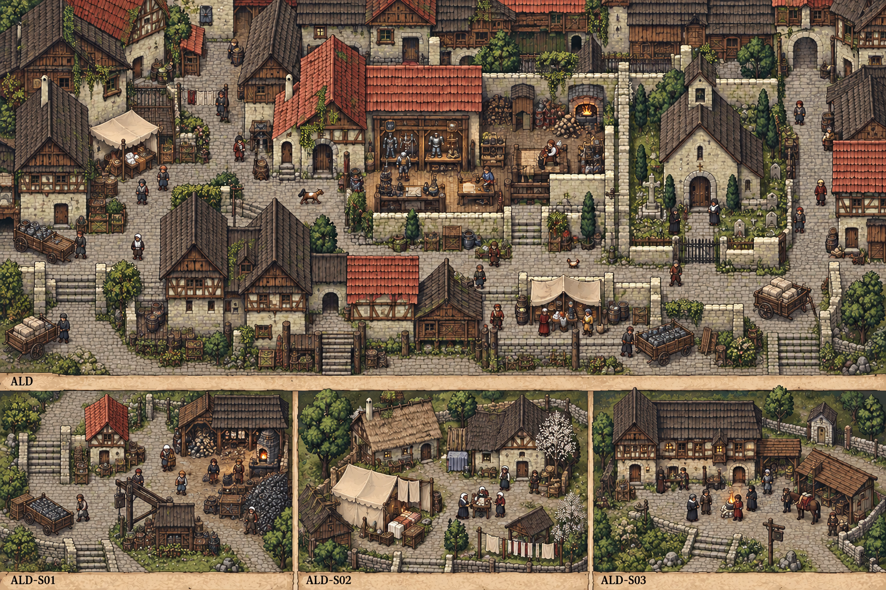

# 聚落_ALD-S03_石礼驿

所属：[[聚落_ALD_奥尔德文]]。名称、位置和内部空间均Mod原创，规划小聚落不是原作已确认新城。

## 存在理由与气质

不同礼仪参与者的过夜。矛盾：私人信仰与公共护理不互作代价。

**生活布局**：驿院两侧设不同礼具凳，普通过夜灶在中间；货箱台靠干道，不生成海岸转船豁免。

**固定观察物**：有附句的赠礼单、两套礼具与中立外箱的内来源牌。

**实际交互**：区分私人礼仪、普通补助、赠甲广告和货物来源；换空箱不改既有贸易限制。

## 入口、生活与现场

- `ALD-S03-1` 石礼驿·入口：固定路牌与回城旁路。
- `ALD-S03-2` 无礼普通灶：不同礼仪参与者的过夜；两份短宿床、一个普通服务班，不是无限补给。
- `ALD-S03-3` 礼单与货箱檐：区分私人礼仪、普通补助、赠甲广告和货物来源；换空箱不改既有贸易限制。。

**当地人物**：[[人物_ALD-S03-NPC_萝铎]]，接待不同礼仪旅人的驿主。

**人物弧线**：最初用同一礼规维持秩序，还把赞助感谢当人人该说。分开接待会增加她一班费用；坚持某项私人礼规也不能扣普通护理款。她若拒灰色转货，会真失去运商生意，不靠玩家口头劝善免代价。

**生活话**：「借我一晚屋檐，不必借我整套活法。」

实际任务当事人仍用下面台本；当地住户只能说自己的观察与立场，不替缺席者提供新同意，不自动知道所有关联案结果。

**关联任务**：[[台本_CS-ALD-02_两种送别]] · [[台本_CS-ALD-03_一件太合身的礼]] · [[台本_CS-ALD-06_往布林的空箱]]；地域线 [[台本_CM-ALD_护甲里面的名字]]。处理方法改变本地住户/劳作关系，不让聚落只充当交件点。

**服务与回程**：两床、一班服务仅是设计容量；白天普通服务、夜间短宿，现钱短缺仍保基本避难。入口—服务院—现场形成小环，入口固定双向回所属城市；拥床改等下一班，不瞬移覆盖人物存档。委托、回访、现场均用原生鼠标交互，未制作。

[[城市与聚落设计总索引]] · [[城市篇章与跨区域任务网]]

<!-- CITY-ART-S74:BEGIN -->
## 原素材参考概念（S74）

本聚落对应下方 `ALD-S03` 面板；整板上方是所属城市／地域，不能当本镇规模。 以用户原素材的材质、轮廓和相机为参考生成；人物、场景组合、灯光/季节属于Mod美术提案，不证明原作地理和阵营。来源、任务对应和制作限制见[[原素材参考与城市概念图]]。
<!-- CITY-ART-S74:END -->

<!-- CITY-SPACES-S75:BEGIN -->
## 任务空间细化（S75）

[[空间_ALD_奥尔德文]]列出本地域的独立室内、观察物与可执行交互、权限替代和安全回程；[[任务空间与地点关联审查]]记录逐任务地点修订。已有方法、证据和奖励所有者保持，各室内不是新必访清单。

<!-- CITY-SPACES-S75:END -->
