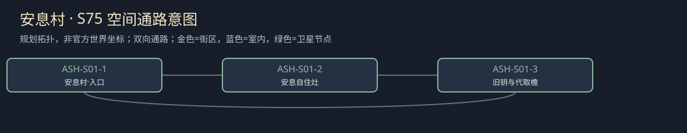

# 聚落_ASH-S01_安息村

所属：[[聚落_ASH_寒凉盆地与护理村]]。名称、位置和内部空间均Mod原创，规划小聚落不是原作已确认新城。

## 存在理由与气质

已设Mod本地患者住所。矛盾：留村还是去护理营由本人选。

**生活布局**：旧屋钥窗和患者生活灶同在干村路，回营路留在屋外；基本住所不设只能观察员开启的锁。

**固定观察物**：本人屋钥、家属送来的包与有限取物条。

**实际交互**：允许本人留村、去营或仅代取物；家属关心不当然授权收回患者住所。

## 入口、生活与现场

- `ASH-S01-1` 安息村·入口：固定路牌与回城旁路。
- `ASH-S01-2` 安息自住灶：已设Mod本地患者住所；两份短宿床、一个普通服务班，不是无限补给。
- `ASH-S01-3` 旧钥与代取檐：允许本人留村、去营或仅代取物；家属关心不当然授权收回患者住所。。

**当地人物**：[[人物_ASH-S01-NPC_妮蔻]]，仍想住旧屋的患者。

**人物弧线**：怕承认需要帮忙就永远不能回家，所以最初拒任何陪护。限定代取让她可以承认部分需要而保旧钥；暂住营则仍保以后回村选择。她可继续不相信观察者，不必痊愈或迁出才算任务有好结局。

**生活话**：「帮我拿锅，别顺手把门也替我关了。」

实际任务当事人仍用下面台本；当地住户只能说自己的观察与立场，不替缺席者提供新同意，不自动知道所有关联案结果。

**关联任务**：[[台本_CS-ASH-01_安息村的旧钥匙]]；地域线 [[台本_CM-ASH_不是空床的村庄]]。处理方法改变本地住户/劳作关系，不让聚落只充当交件点。

**服务与回程**：两床、一班服务仅是设计容量；白天普通服务、夜间短宿，现钱短缺仍保基本避难。入口—服务院—现场形成小环，入口固定双向回所属城市；拥床改等下一班，不瞬移覆盖人物存档。委托、回访、现场均用原生鼠标交互，未制作。

[[城市与聚落设计总索引]] · [[城市篇章与跨区域任务网]]

<!-- CITY-ART-S74:BEGIN -->
## 原素材参考概念（S74）

本聚落对应下方 `ASH-S01` 面板；整板上方是所属城市／地域，不能当本镇规模。 以用户原素材的材质、轮廓和相机为参考生成；人物、场景组合、灯光/季节属于Mod美术提案，不证明原作地理和阵营。来源、任务对应和制作限制见[[原素材参考与城市概念图]]。
<!-- CITY-ART-S74:END -->

<!-- CITY-SPACES-S75:BEGIN -->
## 任务空间细化（S75）

[[空间_ASH_寒凉盆地与护理村]]列出本地域的独立室内、观察物与可执行交互、权限替代和安全回程；[[任务空间与地点关联审查]]记录逐任务地点修订。已有方法、证据和奖励所有者保持，各室内不是新必访清单。

<!-- CITY-SPACES-S75:END -->
