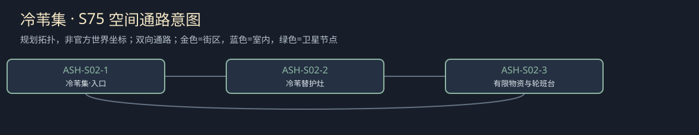

# 聚落_ASH-S02_冷苇集

所属：[[聚落_ASH_寒凉盆地与护理村]]。名称、位置和内部空间均Mod原创，规划小聚落不是原作已确认新城。

## 存在理由与气质

原创有限护理与小额采购。矛盾：照护资源不交换试验同意。

**生活布局**：普通护理灶和采购小柜分开，等候屋朝陆路；观察邀请桌在侧棚，不挡拿水和回家。

**固定观察物**：一班实到替护筹、护理物和独立观察邀请。

**实际交互**：先安排有限基本护理，家属休息不等于弃人；观察同意另问，不以最后一碗交换。

## 入口、生活与现场

- `ASH-S02-1` 冷苇集·入口：固定路牌与回城旁路。
- `ASH-S02-2` 冷苇替护灶：原创有限护理与小额采购；两份短宿床、一个普通服务班，不是无限补给。
- `ASH-S02-3` 有限物资与轮班台：先安排有限基本护理，家属休息不等于弃人；观察同意另问，不以最后一碗交换。。

**当地人物**：[[人物_ASH-S02-NPC_奥娅]]，疲惫的陪护人。

**人物弧线**：把从不停下来当爱人的证据，直到发现自己在发火又偷偷怕被看见。有限替护会让她承认累但不消除亏欠感；暂不能替班可缩研究留基本照护。她的弧线不靠患者安慰她，也不以玩家一席话治好疲劳。

**生活话**：「我想睡一班，不是想少爱他一班。」

实际任务当事人仍用下面台本；当地住户只能说自己的观察与立场，不替缺席者提供新同意，不自动知道所有关联案结果。

**关联任务**：[[台本_CS-ASH-02_陪护者也会累]] · [[台本_CS-ASH-03_冷苇的空碗]]；地域线 [[台本_CM-ASH_不是空床的村庄]]。处理方法改变本地住户/劳作关系，不让聚落只充当交件点。

**服务与回程**：两床、一班服务仅是设计容量；白天普通服务、夜间短宿，现钱短缺仍保基本避难。入口—服务院—现场形成小环，入口固定双向回所属城市；拥床改等下一班，不瞬移覆盖人物存档。委托、回访、现场均用原生鼠标交互，未制作。

[[城市与聚落设计总索引]] · [[城市篇章与跨区域任务网]]

<!-- CITY-ART-S74:BEGIN -->
## 原素材参考概念（S74）

本聚落对应下方 `ASH-S02` 面板；整板上方是所属城市／地域，不能当本镇规模。 以用户原素材的材质、轮廓和相机为参考生成；人物、场景组合、灯光/季节属于Mod美术提案，不证明原作地理和阵营。来源、任务对应和制作限制见[[原素材参考与城市概念图]]。
<!-- CITY-ART-S74:END -->

<!-- CITY-SPACES-S75:BEGIN -->
## 任务空间细化（S75）

[[空间_ASH_寒凉盆地与护理村]]列出本地域的独立室内、观察物与可执行交互、权限替代和安全回程；[[任务空间与地点关联审查]]记录逐任务地点修订。已有方法、证据和奖励所有者保持，各室内不是新必访清单。

<!-- CITY-SPACES-S75:END -->
