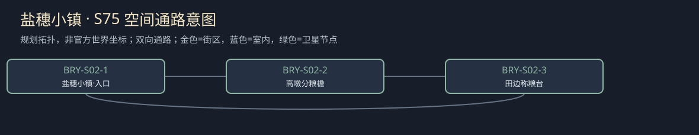

# 聚落_BRY-S02_盐穗小镇

所属：[[聚落_BRY_布林]]。名称、位置和内部空间均Mod原创，规划小聚落不是原作已确认新城。

## 存在理由与气质

有限粮船停靠与盐水田。矛盾：市内先买粮与镇内留种冲突。

**生活布局**：盐水田在低处，留种棚上高墩；小镇高径连两区水尺，称粮不必踏盐湿沟。

**固定观察物**：已收定金木筹、留种封袋和高低屋同日水尺。

**实际交互**：查有限粮已许给谁、水门怎样伤镇内留种；付定金不买走全部下一季。

## 入口、生活与现场

- `BRY-S02-1` 盐穗小镇·入口：固定路牌与回城旁路。
- `BRY-S02-2` 高墩分粮檐：有限粮船停靠与盐水田；两份短宿床、一个普通服务班，不是无限补给。
- `BRY-S02-3` 田边称粮台：查有限粮已许给谁、水门怎样伤镇内留种；付定金不买走全部下一季。。

**当地人物**：[[人物_BRY-S02-NPC_芮莎]]，镇粮保管人。

**人物弧线**：先把城市买价当全镇翻身机会，自己也拿了订金。保种方案会让她真退一笔钱并丢采购信用；继续有限出货则必须认出哪些家庭承担风险。她可以公开自己的签筹，也可退保管职位，镇民不被写成全部原谅。

**生活话**：「钱早到了。春天没到，不能把两样叫一件。」

实际任务当事人仍用下面台本；当地住户只能说自己的观察与立场，不替缺席者提供新同意，不自动知道所有关联案结果。

**关联任务**：[[台本_CS-BRY-04_报纸上没有这条街]] · [[台本_CS-BRY-05_盐穗没有余粮]] · [[台本_CS-BRY-09_谁关上水门]]；地域线 [[台本_CM-BRY_城墙之内]]。处理方法改变本地住户/劳作关系，不让聚落只充当交件点。

**服务与回程**：两床、一班服务仅是设计容量；白天普通服务、夜间短宿，现钱短缺仍保基本避难。入口—服务院—现场形成小环，入口固定双向回所属城市；拥床改等下一班，不瞬移覆盖人物存档。委托、回访、现场均用原生鼠标交互，未制作。

[[城市与聚落设计总索引]] · [[城市篇章与跨区域任务网]]

<!-- CITY-ART-S74:BEGIN -->
## 原素材参考概念（S74）

本聚落对应下方 `BRY-S02` 面板；整板上方是所属城市／地域，不能当本镇规模。 以用户原素材的材质、轮廓和相机为参考生成；人物、场景组合、灯光/季节属于Mod美术提案，不证明原作地理和阵营。来源、任务对应和制作限制见[[原素材参考与城市概念图]]。
<!-- CITY-ART-S74:END -->

<!-- CITY-SPACES-S75:BEGIN -->
## 任务空间细化（S75）

[[空间_BRY_布林]]列出本地域的独立室内、观察物与可执行交互、权限替代和安全回程；[[任务空间与地点关联审查]]记录逐任务地点修订。已有方法、证据和奖励所有者保持，各室内不是新必访清单。

<!-- CITY-SPACES-S75:END -->
