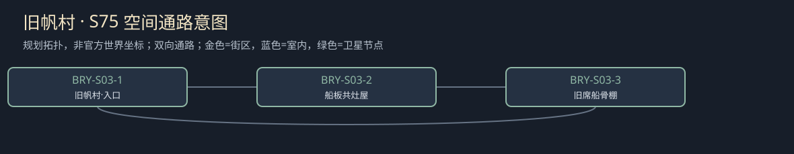

# 聚落_BRY-S03_旧帆村

所属：[[聚落_BRY_布林]]。名称、位置和内部空间均Mod原创，规划小聚落不是原作已确认新城。

## 存在理由与气质

旧船板再用与航次接应。矛盾：修船利润与未归家水手的家庭权利。

**生活布局**：旧船骨在浅院而非水中，普通灶屋接高岸路；空席棚能从村路和船工岸双向进入。

**固定观察物**：旧船板上保留的席名、未拆泊钉与实际可租位数。

**实际交互**：分开未归者姓名、家属占位和有限靠泊收益；不替未归者写死亡或返回。

## 入口、生活与现场

- `BRY-S03-1` 旧帆村·入口：固定路牌与回城旁路。
- `BRY-S03-2` 船板共灶屋：旧船板再用与航次接应；两份短宿床、一个普通服务班，不是无限补给。
- `BRY-S03-3` 旧席船骨棚：分开未归者姓名、家属占位和有限靠泊收益；不替未归者写死亡或返回。。

**当地人物**：[[人物_BRY-S03-NPC_米蕾]]，未归水手的姐姐。

**人物弧线**：靠留空席抵抗村里把弟弟视作已经消失，也借此拒任何谈租的人。保名合租会使她学会容许别人继续生活而不必放弃等候；独留席位则仍有每季费用，她可承认这是自己的选择，不能让另一家替她付。

**生活话**：「我留着他的名字，不是等谁来证明我傻。」

实际任务当事人仍用下面台本；当地住户只能说自己的观察与立场，不替缺席者提供新同意，不自动知道所有关联案结果。

**关联任务**：[[台本_CS-BRY-08_旧帆村的空船位]] · [[台本_CS-BRY-10_夜会之前]]；地域线 [[台本_CM-BRY_城墙之内]]。处理方法改变本地住户/劳作关系，不让聚落只充当交件点。

**服务与回程**：两床、一班服务仅是设计容量；白天普通服务、夜间短宿，现钱短缺仍保基本避难。入口—服务院—现场形成小环，入口固定双向回所属城市；拥床改等下一班，不瞬移覆盖人物存档。委托、回访、现场均用原生鼠标交互，未制作。

[[城市与聚落设计总索引]] · [[城市篇章与跨区域任务网]]

<!-- CITY-ART-S74:BEGIN -->
## 原素材参考概念（S74）

本聚落对应下方 `BRY-S03` 面板；整板上方是所属城市／地域，不能当本镇规模。 以用户原素材的材质、轮廓和相机为参考生成；人物、场景组合、灯光/季节属于Mod美术提案，不证明原作地理和阵营。来源、任务对应和制作限制见[[原素材参考与城市概念图]]。
<!-- CITY-ART-S74:END -->

<!-- CITY-SPACES-S75:BEGIN -->
## 任务空间细化（S75）

[[空间_BRY_布林]]列出本地域的独立室内、观察物与可执行交互、权限替代和安全回程；[[任务空间与地点关联审查]]记录逐任务地点修订。已有方法、证据和奖励所有者保持，各室内不是新必访清单。

<!-- CITY-SPACES-S75:END -->
