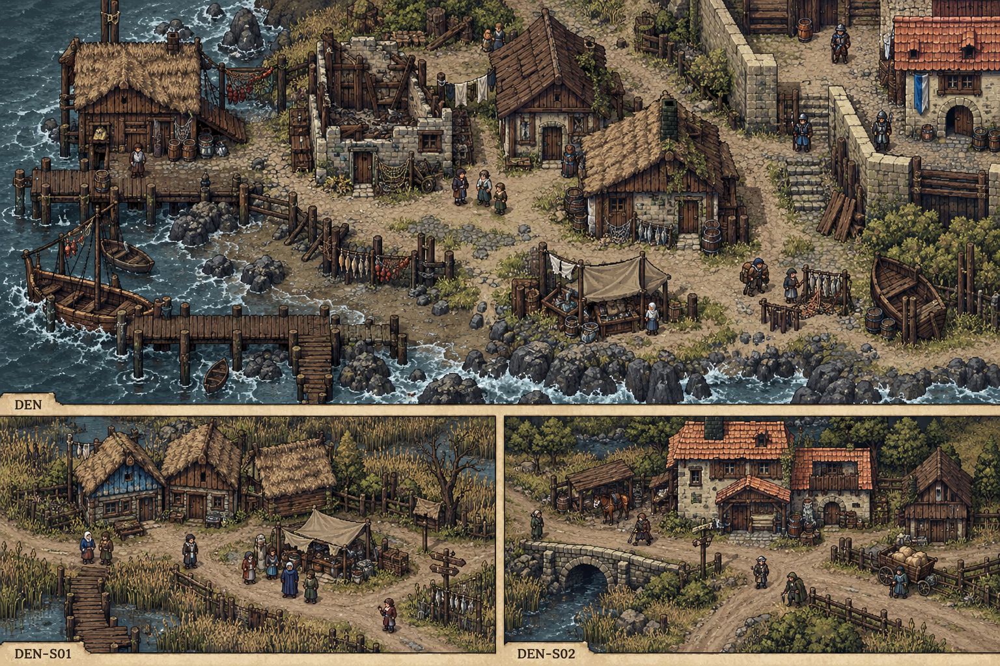

# 聚落_DEN-S01_苇背村

所属：[[聚落_DEN_丹布里]]。名称、位置和内部空间均Mod原创，规划小聚落不是原作已确认新城。

## 存在理由与气质

自愿患者接收的小村。矛盾：收留者是否可要求新住户改原来的生活方式。

**生活布局**：苇垫屋围干地小院，患者房有面向村路的独立门；礼台在旁院，不在取水入口。

**固定观察物**：户主礼具、患者自带碗与可不参加的空席。

**实际交互**：分别问照护、居住与仪式；入住不默认改信或把患者行李交户主。

## 入口、生活与现场

- `DEN-S01-1` 苇背村·入口：固定路牌与回城旁路。
- `DEN-S01-2` 普通接收灶：自愿患者接收的小村；两份短宿床、一个普通服务班，不是无限补给。
- `DEN-S01-3` 两种生活院：分别问照护、居住与仪式；入住不默认改信或把患者行李交户主。。

**当地人物**：[[人物_DEN-S01-NPC_伊蕾]]，接收患者的户主。

**人物弧线**：曾靠同一仪式熬过失亲，真心相信新住户照做会好。允许不同生活方式时，她须面对自己的安慰没有普遍答案；若坚持家中礼规，双方可结束有限短租并安排普通接收，她承担失去住伴的后果但不成为恶教主。

**生活话**：「这只碗是他的。我家吃饭的声响，也可以多一种。」

实际任务当事人仍用下面台本；当地住户只能说自己的观察与立场，不替缺席者提供新同意，不自动知道所有关联案结果。

**关联任务**：[[台本_CS-DEN-01_船上的第四个人]] · [[台本_CS-DEN-03_苇背的新邻居]]；地域线 [[台本_CM-DEN_潮水退去以后]]。处理方法改变本地住户/劳作关系，不让聚落只充当交件点。

**服务与回程**：两床、一班服务仅是设计容量；白天普通服务、夜间短宿，现钱短缺仍保基本避难。入口—服务院—现场形成小环，入口固定双向回所属城市；拥床改等下一班，不瞬移覆盖人物存档。委托、回访、现场均用原生鼠标交互，未制作。

[[城市与聚落设计总索引]] · [[城市篇章与跨区域任务网]]

<!-- CITY-ART-S74:BEGIN -->
## 原素材参考概念（S74）

本聚落对应下方 `DEN-S01` 面板；整板上方是所属城市／地域，不能当本镇规模。 以用户原素材的材质、轮廓和相机为参考生成；人物、场景组合、灯光/季节属于Mod美术提案，不证明原作地理和阵营。来源、任务对应和制作限制见[[原素材参考与城市概念图]]。
<!-- CITY-ART-S74:END -->

<!-- SHORE-VINE-TASK-ART-20261012:BEGIN -->
## 任务场所概念图（2026-10-12）

[[丹布里任务场所概念与台本映射]]说明A—F的任务、空间与制作约束。面板不是任务顺序或官方相邻关系；画中人物、库存和门仅为原创构图，未实现交互。
<!-- SHORE-VINE-TASK-ART-20261012:END -->

<!-- CITY-SPACES-S75:BEGIN -->
## 任务空间细化（S75）

[[空间_DEN_丹布里]]列出本地域的独立室内、观察物与可执行交互、权限替代和安全回程；[[任务空间与地点关联审查]]记录逐任务地点修订。已有方法、证据和奖励所有者保持，各室内不是新必访清单。

<!-- CITY-SPACES-S75:END -->
