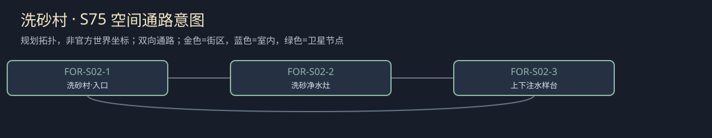

# 聚落_FOR-S02_洗砂村

所属：[[聚落_FOR_佛尔霍特]]。名称、位置和内部空间均Mod原创，规划小聚落不是原作已确认新城。

## 存在理由与气质

少量尾料与生活水。矛盾：金价不补污染家庭的同意。

**生活布局**：尾料台在低地封护，饮水灶在上游干院；封样路径沿高边走，不让孩子在金色积水里玩。

**固定观察物**：不同时段的封水样、尾料沉积与一次给付款。

**实际交互**：先核生活水风险与实际替水，再谈有限赔付，金币不买所有后续同意；病因不确定就保未知。

## 入口、生活与现场

- `FOR-S02-1` 洗砂村·入口：固定路牌与回城旁路。
- `FOR-S02-2` 洗砂净水灶：少量尾料与生活水；两份短宿床、一个普通服务班，不是无限补给。
- `FOR-S02-3` 上下注水样台：先核生活水风险与实际替水，再谈有限赔付，金币不买所有后续同意；病因不确定就保未知。。

**当地人物**：[[人物_FOR-S02-NPC_蓓娜]]，洗砂住户。

**人物弧线**：最初只求拿钱换走家人，后来发现拿一次钱可能被写作全体此后不准再说水。有限和解可以接受这次款又保未来问责；拒和解则仍有净水安排但失去快速迁居钱。她不必须留下替整个村作英雄。

**生活话**：「拿了这袋钱，我明天还是会口渴。」

实际任务当事人仍用下面台本；当地住户只能说自己的观察与立场，不替缺席者提供新同意，不自动知道所有关联案结果。

**关联任务**：[[台本_CS-FOR-02_洗砂村没有金色的水]]；地域线 [[台本_CM-FOR_金价之外]]。处理方法改变本地住户/劳作关系，不让聚落只充当交件点。

**服务与回程**：两床、一班服务仅是设计容量；白天普通服务、夜间短宿，现钱短缺仍保基本避难。入口—服务院—现场形成小环，入口固定双向回所属城市；拥床改等下一班，不瞬移覆盖人物存档。委托、回访、现场均用原生鼠标交互，未制作。

[[城市与聚落设计总索引]] · [[城市篇章与跨区域任务网]]

<!-- CITY-ART-S74:BEGIN -->
## 原素材参考概念（S74）

本聚落对应下方 `FOR-S02` 面板；整板上方是所属城市／地域，不能当本镇规模。 以用户原素材的材质、轮廓和相机为参考生成；人物、场景组合、灯光/季节属于Mod美术提案，不证明原作地理和阵营。来源、任务对应和制作限制见[[原素材参考与城市概念图]]。
<!-- CITY-ART-S74:END -->

<!-- CITY-SPACES-S75:BEGIN -->
## 任务空间细化（S75）

[[空间_FOR_佛尔霍特]]列出本地域的独立室内、观察物与可执行交互、权限替代和安全回程；[[任务空间与地点关联审查]]记录逐任务地点修订。已有方法、证据和奖励所有者保持，各室内不是新必访清单。

<!-- CITY-SPACES-S75:END -->
