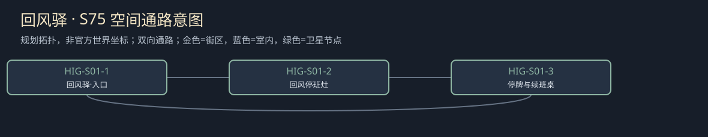

# 聚落_HIG-S01_回风驿

所属：[[聚落_HIG_无名修院山地]]。名称、位置和内部空间均Mod原创，规划小聚落不是原作已确认新城。

## 存在理由与气质

原创山路维护者住处。矛盾：谁能说停工。

**生活布局**：回风住棚藏在山口内侧，停牌檐对主路，危险观景台另围；回驿路不经旧钟下的裂阶。

**固定观察物**：独立停段牌、实付一班筹与未续约空位。

**实际交互**：先认停止危险段再核检查，结真实已做工钱；终局后未续签的人不算永久自愿维护者。

## 入口、生活与现场

- `HIG-S01-1` 回风驿·入口：固定路牌与回城旁路。
- `HIG-S01-2` 回风停班灶：原创山路维护者住处；两份短宿床、一个普通服务班，不是无限补给。
- `HIG-S01-3` 停牌与续班桌：先认停止危险段再核检查，结真实已做工钱；终局后未续签的人不算永久自愿维护者。。

**当地人物**：[[人物_HIG-S01-NPC_赫珀]]，山路维护者。

**人物弧线**：过去靠让每个探索者顺利通过挣名声，第一次挂停牌被说成胆小。保停会丢小费和一部分客人，实付检查后有限开放也不须赔上未来每班。他仍想听旅人带来的远方故事，停牌不等于仇视探索。

**生活话**：「我想听你回来讲，不想让你去给这块牌添个名字。」

实际任务当事人仍用下面台本；当地住户只能说自己的观察与立场，不替缺席者提供新同意，不自动知道所有关联案结果。

**关联任务**：[[台本_CS-HIG-01_回风驿的停牌]] · [[台本_CS-HIG-03_留下的人]]；地域线 [[台本_CM-HIG_回程也是答案]]。处理方法改变本地住户/劳作关系，不让聚落只充当交件点。

**服务与回程**：两床、一班服务仅是设计容量；白天普通服务、夜间短宿，现钱短缺仍保基本避难。入口—服务院—现场形成小环，入口固定双向回所属城市；拥床改等下一班，不瞬移覆盖人物存档。委托、回访、现场均用原生鼠标交互，未制作。

[[城市与聚落设计总索引]] · [[城市篇章与跨区域任务网]]

<!-- CITY-ART-S74:BEGIN -->
## 原素材参考概念（S74）

本聚落对应下方 `HIG-S01` 面板；整板上方是所属城市／地域，不能当本镇规模。 以用户原素材的材质、轮廓和相机为参考生成；人物、场景组合、灯光/季节属于Mod美术提案，不证明原作地理和阵营。来源、任务对应和制作限制见[[原素材参考与城市概念图]]。
<!-- CITY-ART-S74:END -->

<!-- CITY-SPACES-S75:BEGIN -->
## 任务空间细化（S75）

[[空间_HIG_无名修院山地]]列出本地域的独立室内、观察物与可执行交互、权限替代和安全回程；[[任务空间与地点关联审查]]记录逐任务地点修订。已有方法、证据和奖励所有者保持，各室内不是新必访清单。

<!-- CITY-SPACES-S75:END -->
