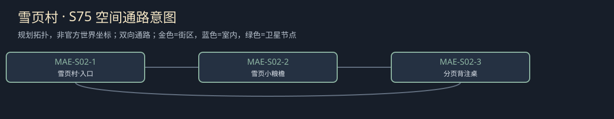

# 聚落_MAE-S02_雪页村

所属：[[聚落_MAE_曼恩]]。名称、位置和内部空间均Mod原创，规划小聚落不是原作已确认新城。

## 存在理由与气质

原创抄写人与小粮点。矛盾：保存来源与家门风险。

**生活布局**：抄写桌靠亮窗，人名柜在小屋另一门内；原页副注分层存，旁边小粮点不以交出家名换粮。

**固定观察物**：来源人的原背注、摘要副页与混页订线。

**实际交互**：分开技术与人名，有限更正不能扩成全体贵族名单；保页不用复造第二晶石证据。

## 入口、生活与现场

- `MAE-S02-1` 雪页村·入口：固定路牌与回城旁路。
- `MAE-S02-2` 雪页小粮檐：原创抄写人与小粮点；两份短宿床、一个普通服务班，不是无限补给。
- `MAE-S02-3` 分页背注桌：分开技术与人名，有限更正不能扩成全体贵族名单；保页不用复造第二晶石证据。。

**当地人物**：[[人物_MAE-S02-NPC_薇榆]]，整理残页的抄写人。

**人物弧线**：曾以为替逃亡者改掉来源是保护，结果让另一人功劳被抹。保技术代号并更正会认自己伤过人；限定私存则仍可能错失公开订单。她怕记录害人也想记录可信，两种愿望不能靠全烧一箱就同时实现。

**生活话**：「少写一个名字，有时也会让人无处说是自己做的。」

实际任务当事人仍用下面台本；当地住户只能说自己的观察与立场，不替缺席者提供新同意，不自动知道所有关联案结果。

**关联任务**：[[台本_CS-MAE-02_烧掉之前]] · [[台本_CS-MAE-05_凯姆没能改掉的字]]；地域线 [[台本_CM-MAE_留下来的城]]。处理方法改变本地住户/劳作关系，不让聚落只充当交件点。

**服务与回程**：两床、一班服务仅是设计容量；白天普通服务、夜间短宿，现钱短缺仍保基本避难。入口—服务院—现场形成小环，入口固定双向回所属城市；拥床改等下一班，不瞬移覆盖人物存档。委托、回访、现场均用原生鼠标交互，未制作。

[[城市与聚落设计总索引]] · [[城市篇章与跨区域任务网]]

<!-- CITY-ART-S74:BEGIN -->
## 原素材参考概念（S74）

本聚落对应下方 `MAE-S02` 面板；整板上方是所属城市／地域，不能当本镇规模。 以用户原素材的材质、轮廓和相机为参考生成；人物、场景组合、灯光/季节属于Mod美术提案，不证明原作地理和阵营。来源、任务对应和制作限制见[[原素材参考与城市概念图]]。
<!-- CITY-ART-S74:END -->

<!-- CITY-SPACES-S75:BEGIN -->
## 任务空间细化（S75）

[[空间_MAE_曼恩]]列出本地域的独立室内、观察物与可执行交互、权限替代和安全回程；[[任务空间与地点关联审查]]记录逐任务地点修订。已有方法、证据和奖励所有者保持，各室内不是新必访清单。

<!-- CITY-SPACES-S75:END -->
