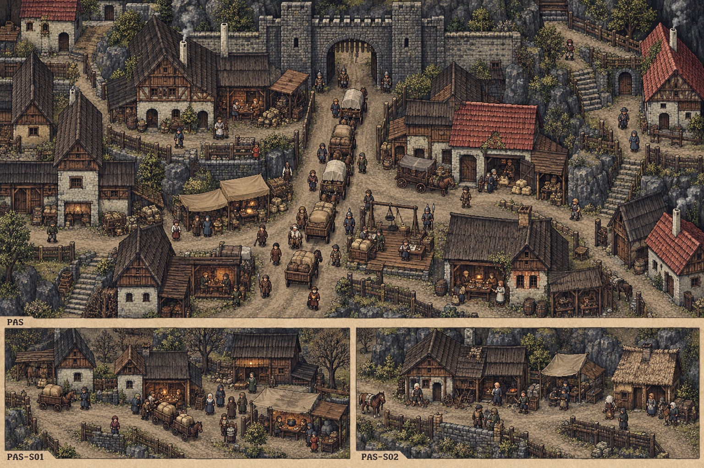

# 聚落_PAS-S02_石角驿

所属：[[聚落_PAS_柏石关与关外聚落]]。名称、位置和内部空间均Mod原创，规划小聚落不是原作已确认新城。

## 存在理由与气质

维修工和路人。矛盾：欠工钱不能借边关需要无限拖延。

**生活布局**：石匠试重架离行路一臂，停工牌挂在未完段；已稳旁路连驿灶，欠薪不让工人困在关内。

**固定观察物**：实际做完的石段、未付班薪和稳定绕段。

**实际交互**：付已做工资、保有限绕行或缩工程，军事急需不替无限欠薪辩护；修路由真正工班执行。

## 入口、生活与现场

- `PAS-S02-1` 石角驿·入口：固定路牌与回城旁路。
- `PAS-S02-2` 石角收工灶：维修工和路人；两份短宿床、一个普通服务班，不是无限补给。
- `PAS-S02-3` 欠薪停段亭：付已做工资、保有限绕行或缩工程，军事急需不替无限欠薪辩护；修路由真正工班执行。。

**当地人物**：[[人物_PAS-S02-NPC_乌珀]]，旁路石匠。

**人物弧线**：年轻时把不说累当专业，如今带班者也用同一句逼他。保停牌会失去一个军需客户却保同伴安全；付薪续做也只能一班，不是归军队永久调用。他能为好桥自豪，同时承认自己想收工。

**生活话**：「路能先开到这里。账不能永远说下一段。」

实际任务当事人仍用下面台本；当地住户只能说自己的观察与立场，不替缺席者提供新同意，不自动知道所有关联案结果。

**关联任务**：[[台本_CS-PAS-01_石角的停工]]；地域线 [[台本_CM-PAS_关口两边]]。处理方法改变本地住户/劳作关系，不让聚落只充当交件点。

**服务与回程**：两床、一班服务仅是设计容量；白天普通服务、夜间短宿，现钱短缺仍保基本避难。入口—服务院—现场形成小环，入口固定双向回所属城市；拥床改等下一班，不瞬移覆盖人物存档。委托、回访、现场均用原生鼠标交互，未制作。

[[城市与聚落设计总索引]] · [[城市篇章与跨区域任务网]]

<!-- CITY-ART-S74:BEGIN -->
## 原素材参考概念（S74）

本聚落对应下方 `PAS-S02` 面板；整板上方是所属城市／地域，不能当本镇规模。 以用户原素材的材质、轮廓和相机为参考生成；人物、场景组合、灯光/季节属于Mod美术提案，不证明原作地理和阵营。来源、任务对应和制作限制见[[原素材参考与城市概念图]]。
<!-- CITY-ART-S74:END -->

<!-- CITY-SPACES-S75:BEGIN -->
## 任务空间细化（S75）

[[空间_PAS_柏石关与关外聚落]]列出本地域的独立室内、观察物与可执行交互、权限替代和安全回程；[[任务空间与地点关联审查]]记录逐任务地点修订。已有方法、证据和奖励所有者保持，各室内不是新必访清单。

<!-- CITY-SPACES-S75:END -->
