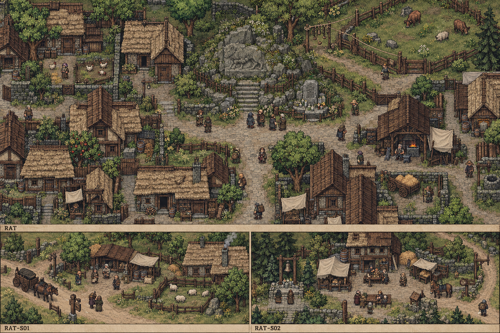

# 聚落_RAT-S01_鹿栅村

所属：[[聚落_RAT_拉滕]]。名称、位置和内部空间均Mod原创，规划小聚落不是原作已确认新城。

## 存在理由与气质

畜损后人和新居民。矛盾：旧赔偿名册漏下迁来者。

**生活布局**：旧户和新户畜栏沿同一平路，核损棚不在祭坡上；普通援助队不穿纪念仪式队。

**固定观察物**：不同姓的实际畜损、旧援助缺项与新兽齿痕。

**实际交互**：只核今损与有限补助，不把旧村姓当领取资格；真兽痕与纪念旧兽分开。

## 入口、生活与现场

- `RAT-S01-1` 鹿栅村·入口：固定路牌与回城旁路。
- `RAT-S01-2` 鹿栅分助檐：畜损后人和新居民；两份短宿床、一个普通服务班，不是无限补给。
- `RAT-S01-3` 新旧畜损栏：只核今损与有限补助，不把旧村姓当领取资格；真兽痕与纪念旧兽分开。。

**当地人物**：[[人物_RAT-S01-NPC_芬罗]]，迁来的养畜人。

**人物弧线**：为进援助册曾想借用旧村姓，怕说真名就一无所有。改名单让他能用真名但未必得到全额；另核新损则慢且可能错过一批出售。他可感谢旧村救援而不参加其纪念仪式，仍担心下一回被漏。

**生活话**：「我的羊不是旧姓，丢了也不是假的。」

实际任务当事人仍用下面台本；当地住户只能说自己的观察与立场，不替缺席者提供新同意，不自动知道所有关联案结果。

**关联任务**：[[台本_CS-RAT-01_鹿栅之外]]；地域线 [[台本_CM-RAT_兽死之后]]。处理方法改变本地住户/劳作关系，不让聚落只充当交件点。

**服务与回程**：两床、一班服务仅是设计容量；白天普通服务、夜间短宿，现钱短缺仍保基本避难。入口—服务院—现场形成小环，入口固定双向回所属城市；拥床改等下一班，不瞬移覆盖人物存档。委托、回访、现场均用原生鼠标交互，未制作。

[[城市与聚落设计总索引]] · [[城市篇章与跨区域任务网]]

<!-- CITY-ART-S74:BEGIN -->
## 原素材参考概念（S74）

本聚落对应下方 `RAT-S01` 面板；整板上方是所属城市／地域，不能当本镇规模。 以用户原素材的材质、轮廓和相机为参考生成；人物、场景组合、灯光/季节属于Mod美术提案，不证明原作地理和阵营。来源、任务对应和制作限制见[[原素材参考与城市概念图]]。
<!-- CITY-ART-S74:END -->

<!-- CITY-SPACES-S75:BEGIN -->
## 任务空间细化（S75）

[[空间_RAT_拉滕]]列出本地域的独立室内、观察物与可执行交互、权限替代和安全回程；[[任务空间与地点关联审查]]记录逐任务地点修订。已有方法、证据和奖励所有者保持，各室内不是新必访清单。

<!-- CITY-SPACES-S75:END -->
