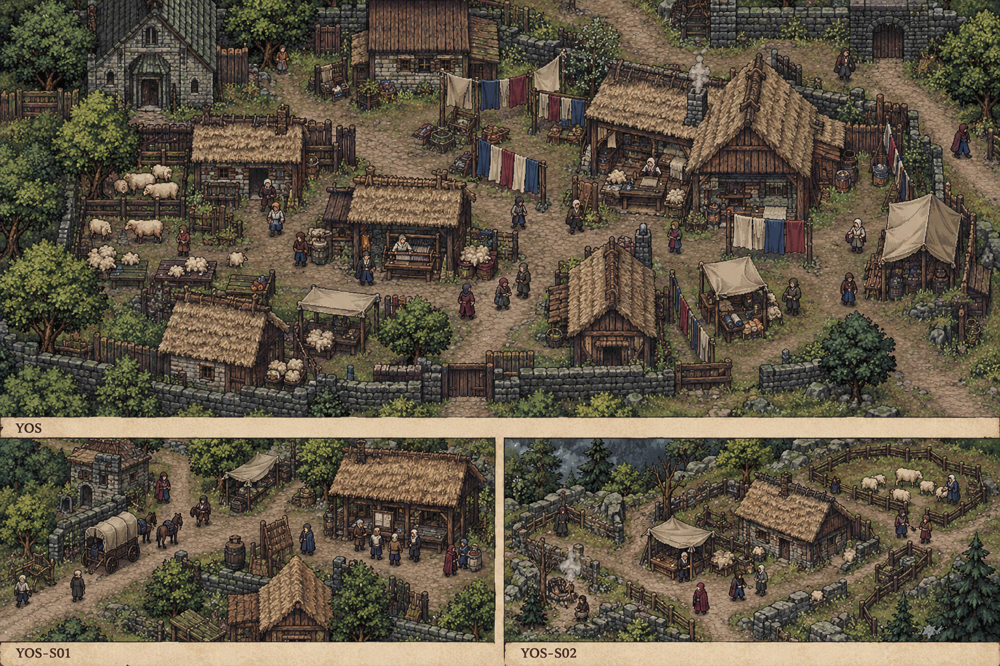

# 聚落_YOS-S02_羊坡村

所属：[[聚落_YOS_约斯特文]]。名称、位置和内部空间均Mod原创，规划小聚落不是原作已确认新城。

## 存在理由与气质

有限牧户与冬衣需求。矛盾：卖料与留冬毛。

**生活布局**：羊圈与留冬棚分侧，清毛台在圈外干地，售料路不穿家庭冬衣柜；高坡路固定回城。

**固定观察物**：留冬绳结、答应护理的毛捆与有限可售羊毛。

**实际交互**：核所谓余量是否已占家用，按户有限出售或留料；买价高不代表每户愿卖。

## 入口、生活与现场

- `YOS-S02-1` 羊坡村·入口：固定路牌与回城旁路。
- `YOS-S02-2` 牧户分毛檐：有限牧户与冬衣需求；两份短宿床、一个普通服务班，不是无限补给。
- `YOS-S02-3` 留冬称捆台：核所谓余量是否已占家用，按户有限出售或留料；买价高不代表每户愿卖。。

**当地人物**：[[人物_YOS-S02-NPC_尤尔]]，羊坡年轻牧户。

**人物弧线**：想摆脱被看作贫穷村人的羞耻，起初主动夸大全村余毛。留料令他失去一次体面大单，有限出售则须向外客承认不是全村授权。他仍想赚好价，不需要把商业野心全删掉才算成长。

**生活话**：「我想卖得贵，不想让他们冷着替我显得阔。」

实际任务当事人仍用下面台本；当地住户只能说自己的观察与立场，不替缺席者提供新同意，不自动知道所有关联案结果。

**关联任务**：[[台本_CS-YOS-01_冬毛的最后一捆]]；地域线 [[台本_CM-YOS_最后一匹家纹]]。处理方法改变本地住户/劳作关系，不让聚落只充当交件点。

**服务与回程**：两床、一班服务仅是设计容量；白天普通服务、夜间短宿，现钱短缺仍保基本避难。入口—服务院—现场形成小环，入口固定双向回所属城市；拥床改等下一班，不瞬移覆盖人物存档。委托、回访、现场均用原生鼠标交互，未制作。

[[城市与聚落设计总索引]] · [[城市篇章与跨区域任务网]]

<!-- CITY-ART-S74:BEGIN -->
## 原素材参考概念（S74）

本聚落对应下方 `YOS-S02` 面板；整板上方是所属城市／地域，不能当本镇规模。 以用户原素材的材质、轮廓和相机为参考生成；人物、场景组合、灯光/季节属于Mod美术提案，不证明原作地理和阵营。来源、任务对应和制作限制见[[原素材参考与城市概念图]]。
<!-- CITY-ART-S74:END -->

<!-- CITY-TASK-ART-20261012:BEGIN -->
## 任务场所概念图（2026-10-12）

[[约斯特文任务场所概念与台本映射]]说明A—F的任务、空间与制作约束。面板不是任务顺序或官方相邻关系；画中人物、库存和门仅为原创构图，未实现交互。
<!-- CITY-TASK-ART-20261012:END -->

<!-- CITY-SPACES-S75:BEGIN -->
## 任务空间细化（S75）

[[空间_YOS_约斯特文]]列出本地域的独立室内、观察物与可执行交互、权限替代和安全回程；[[任务空间与地点关联审查]]记录逐任务地点修订。已有方法、证据和奖励所有者保持，各室内不是新必访清单。

<!-- CITY-SPACES-S75:END -->
