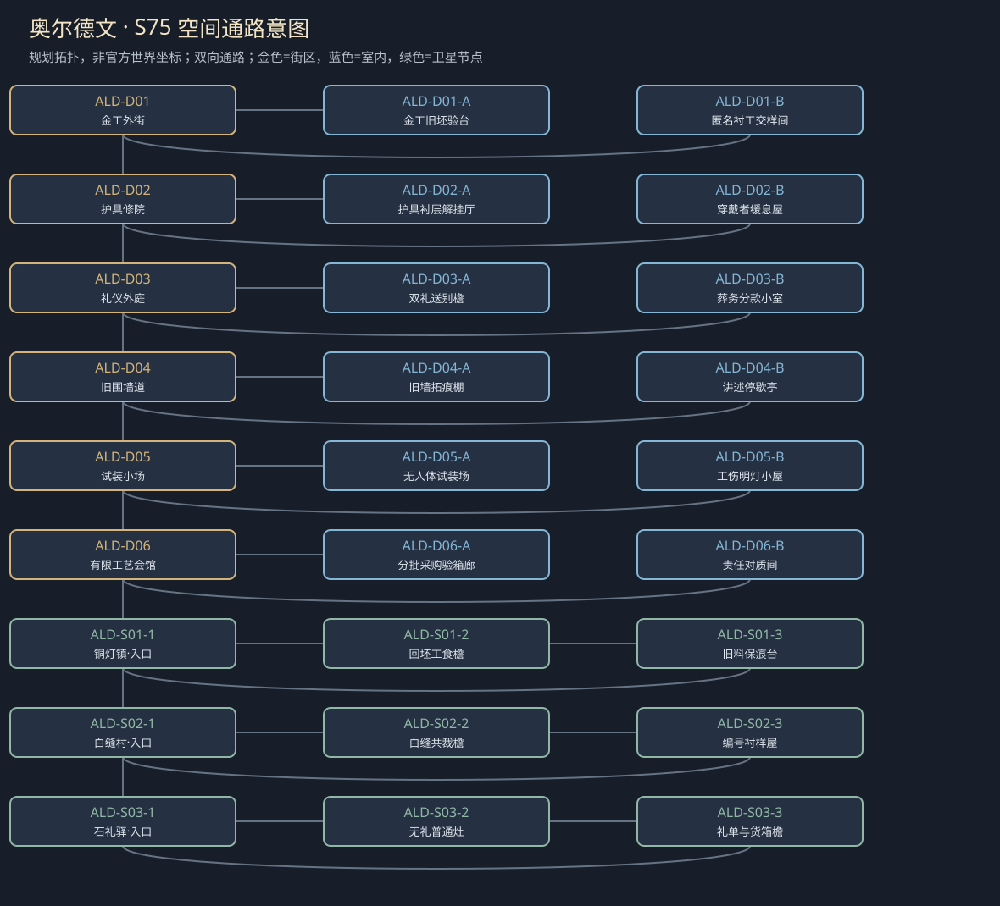

# 聚落_ALD_奥尔德文

> [!info] 范围
> S63原创规划。大城/城镇/村庄标签表示本Mod内容密度，不替原作确认规模。内部建筑及卫星位置待技术小样核实；概念图不代表可玩地图。

**主题**：被珍惜的手艺，也会替权力遮住伤痕。

**基线**：[[地点基线_奥尔德文]]。原作事实、讲述者观点与原创现代街区分开。

## 城市气质与空间

精金工局部与沉旧石街，作坊陈列光亮，护具内衬磨破；宗教争议用邻里礼仪体现，不画未核王宫。

原创工艺街、修护小院、礼仪外庭与旧围墙路径四段环；禁画首府宫廷。

**经济压力**：局部金工、装配与旧军需，布林进口限制保留；地方库存有限。

## 街区、建筑与任务用途

|节点|地点与用途|相关行动|
|---|---|---|
|ALD-D01|金工外街：师徒来源与旧采购。A：金工旧坯验台；B：匿名衬工交样间；各有回本街区的出口。|[[台本_CS-ALD-01_白缝的姓]] · [[台本_CS-ALD-06_往布林的空箱]]；追护具修护来源而不凭姓氏认师门；对样件的技术认功不等于公开本人姓名。 允许限权核验、独立编号或实名公开各自代价；家属反对不能替衬工永久决定。|
|ALD-D02|护具修院：穿戴者与内衬工匠。A：护具衬层解挂厅；B：穿戴者缓息屋；各有回本街区的出口。|[[台本_CM-ALD_护甲里面的名字]] · [[台本_CS-ALD-01_白缝的姓]]；拆下已授权旧样，分清铆扣、内衬与错误穿戴各自责任；不让患者再次受伤验证。 由穿戴者选择仅样件、私下说明或公开事故；补偿、续作与疗效承诺分别问。|
|ALD-D03|礼仪外庭：葬礼和自愿仪式。A：双礼送别檐；B：葬务分款小室；各有回本街区的出口。|[[台本_CS-ALD-02_两种送别]] · [[台本_CS-ALD-03_一件太合身的礼]]；允许家庭各自选仪式或不举行，区别历史教义与本案补助条件；不替全国教派定论。 把援助和公开赞美脱钩；有条件赠甲可拒，受赠也不抹赞助者责任。|
|ALD-D04|旧围墙道：历史记述不等于现时城毁。A：旧墙拓痕棚；B：讲述停歇亭；各有回本街区的出口。|[[台本_CS-ALD-04_旧墙不是新围城]]；比较修补先后，拆穿把古痕讲成新陷落的说辞；固定样块不用玩家凿坏城墙取证。 分别更正年代与认赞助条件；赠礼不能购买受赠者的新官方历史证词。|
|ALD-D05|试装小场：不伤人体的固定支架测试。A：无人体试装场；B：工伤明灯小屋；各有回本街区的出口。|[[台本_CS-ALD-05_师傅没有失去的手]]；检旧护具失效和广告遮去伤工的做法；支架承担试验，完整的手不证明无人受伤。 选择公布样件/修改广告/独立署记，学徒是否继续本业另问；伤工不被安排用痛证明价值。|
|ALD-D06|有限工艺会馆：地方采购与问责。A：分批采购验箱廊；B：责任对质间；各有回本街区的出口。|[[台本_CM-ALD_护甲里面的名字]] · [[台本_CS-ALD-03_一件太合身的礼]] · [[台本_CS-ALD-05_师傅没有失去的手]] · [[台本_CS-ALD-06_往布林的空箱]]；查中立箱掩来源的说辞，确认数量与来源责任；不能让换箱标绕过原布林贸易限制。 选择分批问责、独立复核或受限赞助，并说明便利与监督缺口；一笔付款不能抵三种义务。|

## 周边聚落

- [[聚落_ALD-S01_铜灯镇]]：修护工与旧材料回收；不能把伤痕抛光后当新军械。
- [[聚落_ALD-S02_白缝村]]：护具衬布和患者家属；对技术价值的署名也涉及身份风险。
- [[聚落_ALD-S03_石礼驿]]：不同礼仪参与者的过夜；私人信仰与公共护理不互作代价。

## 地域主线与支线

[[台本_CM-ALD_护甲里面的名字]]：查清一批旧护具的失效与未署名修护，决定技术责任和人的身份怎样公开。

- [[台本_CS-ALD-01_白缝的姓]]：衬工想认技术功劳，家属怕真名公开被追索。
- [[台本_CS-ALD-02_两种送别]]：礼仪助手要求家属参加统一仪式才能领葬务补助。
- [[台本_CS-ALD-03_一件太合身的礼]]：赞助者要赠一副精工护具，条件是受赠者公开赞他无过。
- [[台本_CS-ALD-04_旧墙不是新围城]]：游客要把旧墙毁痕讲成今日奥尔德文再次陷落。
- [[台本_CS-ALD-05_师傅没有失去的手]]：工场广告只展示师傅完好的手，学徒受伤被要求藏在后间。
- [[台本_CS-ALD-06_往布林的空箱]]：运商称中立箱可以合法免去布林对奥尔德文货的限制。

## 人物与关系

- [[人物_ALD-NPC-HEL_赫莲·金]]：装配师；相信好作品会证明好人，曾用学徒的手伤遮掩供货。
- [[人物_ALD-NPC-EMO_埃墨·衬]]：衬工；想被承认技术，不想家族被调查找到。
- [[人物_ALD-NPC-SIN_司诺·庭]]：地方礼仪助手；想让人一起哀悼，却总代不愿祷告的人说话。

## 日夜、服务、危险与回程

白天普通工作间开放、傍晚侧室会面；夜间保入口与有限短宿，不把NPC缺席变永久卡关。每城只新设一个普通有偿服务班，一批案件结束前不刷新库存；支线能改价格、授权范围或工期，不能凭声望无限抽物资。危险段独立警示、保已验旁路；谈崩、停工、负声望不关闭双向回程。城市原生商店、原主线与声望服务照旧，各新服务不能冒称原角色官署授权。

## 接入旧任务与跨城后果

不是把柏石关改名；独立工艺责任线为装置旧部件提供有限来源，原作王室未知不补。

[[台本_N7_军需账上的空名]] · [[台本_N14_可以回去的路]] · [[台本_N15_回声不等于真相]] · [[台本_SQ02_被征用的冬粮]]

[[城市篇章与跨区域任务网]]记录具体回执和回应；城市收束不以本城所有支线完成为条件。[[城市与聚落设计总索引]] · [[城市设计与原作避让审查]]

<!-- CITY-ART-S74:BEGIN -->
## 原素材参考概念（S74）

上方是代表性核心街区，下方按卫星ID排列周边构图；不是整座城市总平面。 以用户原素材的材质、轮廓和相机为参考生成；人物、场景组合、灯光/季节属于Mod美术提案，不证明原作地理和阵营。来源、任务对应和制作限制见[[原素材参考与城市概念图]]。
<!-- CITY-ART-S74:END -->

<!-- CITY-SPACES-S75:BEGIN -->
## 任务空间细化（S75）

[[空间_ALD_奥尔德文]]列出本地域的独立室内、观察物与可执行交互、权限替代和安全回程；[[任务空间与地点关联审查]]记录逐任务地点修订。已有方法、证据和奖励所有者保持，各室内不是新必访清单。

<!-- CITY-SPACES-S75:END -->

当前奥尔德文逐角色对白、先后顺序回应与演出范围见[[奥尔德文人物对白与交叉演出审查]]；S78为原创台本初稿，未导入游戏。
