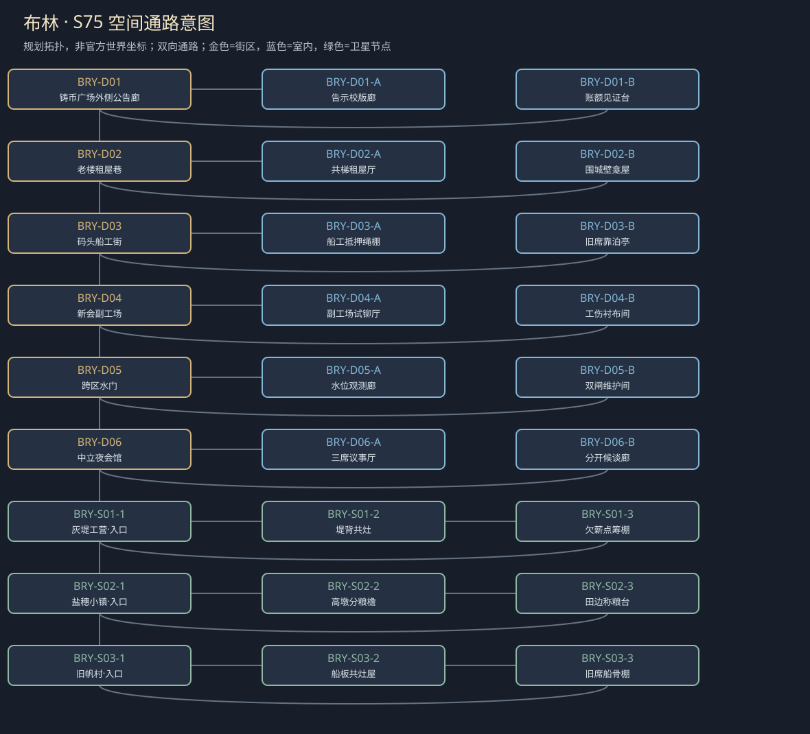

# 聚落_BRY_布林

> [!info] 范围
> S63原创规划。大城/城镇/村庄标签表示本Mod内容密度，不替原作确认规模。内部建筑及卫星位置待技术小样核实；概念图不代表可玩地图。

**主题**：自由的价格不是所有人都付得起。

**基线**：[[城市设计与原作避让审查]]。原作事实、讲述者观点与原创现代街区分开。

## 城市气质与空间

四城区保留：铸币广场石铺与明亮店窗，老楼窄巷与高墙影，码头潮线与多语招牌，新会区炉光与脚手架。城联物质繁荣与战后人口压力并存。

城内两环步行：广场—老楼—码头—新会区—广场；每区两处新侧巷接原街，剧情危险在新增局部，不把全城变刷怪地牢。

**经济压力**：港货、手工业和服务的收益集中，居住与劳动门槛由本案具体合同体现；无全国银行改革、无免费原生库存。

## 街区、建筑与任务用途

|节点|地点与用途|相关行动|
|---|---|---|
|BRY-D01|铸币广场外侧公告廊：公共舆论与有限账户，原银行不冒称可进入。A：告示校版廊；B：账额见证台；各有回本街区的出口。|[[台本_CS-BRY-01_一年之后]] · [[台本_CS-BRY-04_报纸上没有这条街]]；把漏掉的街名放回版面，核版长与实际印数；免费读告示不要求替印工跑送纸。 当面分开告示支出、调查费和赞助；拒绝赞助也保公共告示阅读。|
|BRY-D02|老楼租屋巷：租住、失踪证人和旧围城居室。A：共梯租屋厅；B：围城壁龛屋；各有回本街区的出口。|[[台本_CM-BRY_城墙之内]] · [[台本_CS-BRY-01_一年之后]] · [[台本_CS-BRY-02_围城时的房间]] · [[台本_CS-BRY-06_一个没被授勋的人]]；比对连续住用痕与搬巷说辞；仅观察公共门框，不搜整楼住户。 让两家各指出自己记得的位置，决定同屋分时或另设双龛；痕迹不自动证明谁有全部产权。|
|BRY-D03|码头船工街：靠泊与人身抵押，接R01。A：船工抵押绳棚；B：旧席靠泊亭；各有回本街区的出口。|[[台本_CS-BRY-05_盐穗没有余粮]] · [[台本_CS-BRY-08_旧帆村的空船位]]；辨清欠货款与人身扣留被混算的地方；可付有限货押、改雇班或揭开不当扣人。 演示保名不占整泊位、限期合租或独留席位的占用差异；不要求寻找失踪者尸体交差。|
|BRY-D04|新会副工场：订单、工伤、独立工人席，原督工服务保留。A：副工场试铆厅；B：工伤衬布间；各有回本街区的出口。|[[台本_CM-BRY_城墙之内]] · [[台本_CS-BRY-03_学徒的印]] · [[台本_CS-BRY-07_药瓶上的商标]]；用无人体支架比较作品署名及失效位置；不凭师傅一张订单判学徒无功。 由工人决定是否展示伤处；可看有授权的脱体样件，比较给药前后有限观察。|
|BRY-D05|跨区水门：新支线水位机关与两出口。A：水位观测廊；B：双闸维护间；各有回本街区的出口。|[[台本_CM-BRY_城墙之内]] · [[台本_CS-BRY-05_盐穗没有余粮]] · [[台本_CS-BRY-09_谁关上水门]]；在同一水况对照货区与低屋，验证谁先受损；只看痕迹不自动触发开闸。 先用砂盘列分时排放或护货代价，再由有权维护者实操；任何方案都写出真实受损者。|
|BRY-D06|中立夜会馆：不同派系地方代理有限协商。A：三席议事厅；B：分开候谈廊；各有回本街区的出口。|[[台本_CM-BRY_城墙之内]] · [[台本_CS-BRY-06_一个没被授勋的人]] · [[台本_CS-BRY-07_药瓶上的商标]] · [[台本_CS-BRY-10_夜会之前]]；核谁授权代理、谁只被声称代表；允许拆成逐案会谈，没坐席也有书面与当面见证。 让证人选择单谈、代理或退场；顺序改变下一场愿说的话，不强迫共席和解。|

## 周边聚落

- [[聚落_BRY-S01_灰堤工营]]：港工与渠修者暂住，接旧R01；活人登记与欠薪由本人授权。
- [[聚落_BRY-S02_盐穗小镇]]：有限粮船停靠与盐水田；市内先买粮与镇内留种冲突。
- [[聚落_BRY-S03_旧帆村]]：旧船板再用与航次接应；修船利润与未归家水手的家庭权利。

## 地域主线与支线

[[台本_CM-BRY_城墙之内]]：查清一名租客为何从劳动与居住记录同时消失，并让几种城市利益真正面对当事人。

- [[台本_CS-BRY-01_一年之后]]：租屋者快住满一年，房东要求搬到另一巷重算租期。
- [[台本_CS-BRY-02_围城时的房间]]：老楼两家同时要求一间旧屋纪念亲人。
- [[台本_CS-BRY-03_学徒的印]]：新会副工场师傅想把所有作品按家印出售。
- [[台本_CS-BRY-04_报纸上没有这条街]]：原创印工副坊要印一则断水告示，商户只愿登有付钱的街。
- [[台本_CS-BRY-05_盐穗没有余粮]]：城市采购方要镇内全部新粮，镇里有人已经收过定金。
- [[台本_CS-BRY-06_一个没被授勋的人]]：退役值夜者想找回失踪同班的获奖名字。
- [[台本_CS-BRY-07_药瓶上的商标]]：原创医药代理想买出患者新观察，付钱条件是不再提副作用。
- [[台本_CS-BRY-08_旧帆村的空船位]]：船工家属要保存未归水手的席位，船主缺可租船位。
- [[台本_CS-BRY-09_谁关上水门]]：两片低屋住户要同时开排水，商货区怕新货浸水。
- [[台本_CS-BRY-10_夜会之前]]：夜会馆准备让富商、工场和退役者各推一名代理。

## 人物与关系

- [[人物_BRY-NPC-RENA_蕾娜·维尔]]：租屋记录员；靠登记保住住客，却怕承认自己删过未缴费者。
- [[人物_BRY-NPC-OSIN_奥辛·锤]]：副工场班长；保护工人，也想借停工做全城发言人。
- [[人物_BRY-NPC-MIRO_米罗·账]]：商户联络员；想留交易秩序，家族收益里有错误扣款。
- [[人物_BRY-NPC-VIT_薇特·灰]]：退役值夜者；想证明围城时的选择有意义，却没有全军授权。

## 日夜、服务、危险与回程

白天普通工作间开放、傍晚侧室会面；夜间保入口与有限短宿，不把NPC缺席变永久卡关。每城只新设一个普通有偿服务班，一批案件结束前不刷新库存；支线能改价格、授权范围或工期，不能凭声望无限抽物资。危险段独立警示、保已验旁路；谈崩、停工、负声望不关闭双向回程。城市原生商店、原主线与声望服务照旧，各新服务不能冒称原角色官署授权。

## 接入旧任务与跨城后果

旧灰堤与工坊是城市篇前段证据与人物入口，不能再被当作整个布林。

[[台本_N2_灰堤没有墓碑]] · [[台本_N3_听审前的灯]] · [[台本_N4_第一张空白债票]] · [[台本_SQ01_港税与自由]] · [[台本_DT03_无人认领的墓标]] · [[台本_DT07_一箱不该开封的货]]

[[城市篇章与跨区域任务网]]记录具体回执和回应；城市收束不以本城所有支线完成为条件。[[城市与聚落设计总索引]] · [[城市设计与原作避让审查]]

<!-- CITY-ART-S74:BEGIN -->
## 原素材参考概念（S74）

上方是代表性核心街区，下方按卫星ID排列周边构图；不是整座城市总平面。 以用户原素材的材质、轮廓和相机为参考生成；人物、场景组合、灯光/季节属于Mod美术提案，不证明原作地理和阵营。来源、任务对应和制作限制见[[原素材参考与城市概念图]]。
<!-- CITY-ART-S74:END -->

<!-- CITY-SPACES-S75:BEGIN -->
## 任务空间细化（S75）

[[空间_BRY_布林]]列出本地域的独立室内、观察物与可执行交互、权限替代和安全回程；[[任务空间与地点关联审查]]记录逐任务地点修订。已有方法、证据和奖励所有者保持，各室内不是新必访清单。

<!-- CITY-SPACES-S75:END -->

<!-- CITY-DRAMA-S76:BEGIN -->
当前布林逐角色对白、条件回访、演员位置与未终审范围见[[布林人物对白与网状演出审查]]。S76为Mod原创台本，未导入游戏。
<!-- CITY-DRAMA-S76:END -->

六处场所的原素材参考图与逐任务用途见[[布林任务场所概念与台本映射]]；画板分格不是任务必访顺序。

<!-- BRYNN-CONTINUATION-S85:BEGIN -->
## S85布林新增六案（当前登记）

[[布林续篇任务与伏笔回收总表]] · [[布林背景复核与续篇创作边界]] · [[布林续篇逻辑与人物弧光审查]]。布林追加6支线，原1主章+10支线保留，现共17篇；城市总计基线73+扩展6=79篇；原314单方法回执与新增15组回收桥/45方法版本分别计；71篇逐角色草稿，8篇待深化。原51篇晶石任务另计。原作神秘夜船/旧市长案不揭底，六案独立入口，不是N16/主线前置；本轮不部署。

新任务：[[台本_CS-BRY-11_不写船名的夜泊]] · [[台本_CS-BRY-12_两种火候]] · [[台本_CS-BRY-13_页边的另一个名字]] · [[台本_CS-BRY-14_地窖之外]] · [[台本_CS-BRY-15_招募告示的背面]] · [[台本_CS-BRY-16_空椅不是赞成]]
<!-- BRYNN-CONTINUATION-S85:END -->
