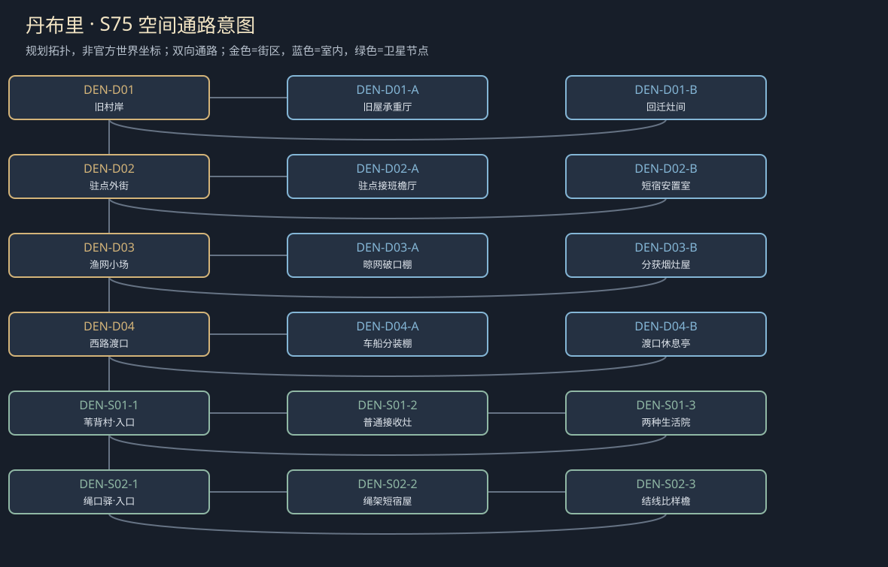

# 聚落_DEN_丹布里

> [!info] 范围
> S63原创规划。大城/城镇/村庄标签表示本Mod内容密度，不替原作确认规模。内部建筑及卫星位置待技术小样核实；概念图不代表可玩地图。

**主题**：守住一座村庄之后，谁有权说它已经重建。

**基线**：[[城市设计与原作避让审查]]。原作事实、讲述者观点与原创现代街区分开。

## 城市气质与空间

损坏的驻军渔村；盐灰墙、断屋骨架、潮湿木桩，渔火与旧岗哨分开。

岸路与安全高堤并行，残屋侧路通旧渡口；浅滩只行人、小船有潮次。

**经济压力**：有限渔获、短泊与修屋；军需优先与原村人租住冲突，不推全村现任官职。

## 街区、建筑与任务用途

|节点|地点与用途|相关行动|
|---|---|---|
|DEN-D01|旧村岸：回迁家庭与残屋。A：旧屋承重厅；B：回迁灶间；各有回本街区的出口。|[[台本_CM-DEN_潮水退去以后]] · [[台本_CS-DEN-01_船上的第四个人]]；确认只剩两处可住空间，分开先住、旧居经历和现时护理需求；不能从记得旧屋推第三张床。 当户主在场时讨论轮住或短租，写明谁暂住别处及实际接收人；玩家不被派去补十块木头。|
|DEN-D02|驻点外街：普通服务与地方指令。A：驻点接班檐厅；B：短宿安置室；各有回本街区的出口。|[[台本_CM-DEN_潮水退去以后]] · [[台本_CS-DEN-03_苇背的新邻居]]；核本班伤情与家船载重需求；驻点身份不使额外乘客当然有权挤走家人。 逐人核入住、照护和离开安排，仪式另问；接收不是重新招募驻点劳力。|
|DEN-D03|渔网小场：渔获和留村生活。A：晾网破口棚；B：分获烟灶屋；各有回本街区的出口。|[[台本_CM-DEN_潮水退去以后]] · [[台本_CS-DEN-02_渔网留下的洞]]；在网主在场时比较人为割痕与过载破口；只凭迁来身份不能认定破坏者。 决定网的赔付、共用期限和鱼获分额；既有鱼量有限，不以刷新渔获填平矛盾。|
|DEN-D04|西路渡口：接R02，船路与车路分开。A：车船分装棚；B：渡口休息亭；各有回本街区的出口。|[[台本_CS-DEN-01_船上的第四个人]]；用石重模拟第四乘客，区分能再载一人和只有冒险超载能载；不把伤者本人当砝码。 列等下一班、付有限车位或留村护理的具体执行者；不强制患者参加宗教仪式换渡位。|

## 周边聚落

- [[聚落_DEN-S01_苇背村]]：自愿患者接收的小村；收留者是否可要求新住户改原来的生活方式。
- [[聚落_DEN-S02_绳口驿]]：桥工与旅行者过夜；地方接应不能成为强制归返。

## 地域主线与支线

[[台本_CM-DEN_潮水退去以后]]：解决三户同时认一处可住旧屋的争议，让重建不只意味着岗哨再次亮灯。

- [[台本_CS-DEN-01_船上的第四个人]]：三人约定的家船被要求再载一位受伤驻点工。
- [[台本_CS-DEN-02_渔网留下的洞]]：一张共用网被割，原村人要赶走新来者。
- [[台本_CS-DEN-03_苇背的新邻居]]：接收患者的户主想要求患者参加自家仪式。

## 人物与关系

- [[人物_DEN-NPC-SEF_瑟芬·网]]：原村渔者；要家回岸上，却曾替驻点选可优先回迁的名单。
- [[人物_DEN-NPC-KAR_卡蕾·棚]]：回迁者；要重回旧家，却不能替丈夫决定回驻点工作。

## 日夜、服务、危险与回程

白天普通工作间开放、傍晚侧室会面；夜间保入口与有限短宿，不把NPC缺席变永久卡关。每城只新设一个普通有偿服务班，一批案件结束前不刷新库存；支线能改价格、授权范围或工期，不能凭声望无限抽物资。危险段独立警示、保已验旁路；谈崩、停工、负声望不关闭双向回程。城市原生商店、原主线与声望服务照旧，各新服务不能冒称原角色官署授权。

## 接入旧任务与跨城后果

旧渡口与西路接入丹布里回迁线；船路不是全村的唯一主题。

[[台本_N1_无钟之夜]] · [[台本_N5_渡口的三种说法]] · [[台本_N9_把证据摆上桌]] · [[台本_N18_誓约之后]] · [[台本_SQ04_一条不卖人的路]] · [[台本_SQ05_渡口与姓名]] · [[台本_DT01_粮车的最后一段]] · [[台本_DT06_迷路者的路标]] · [[台本_DT08_修好第二块桥板]] · [[台本_DT13_一锅够分的热汤]]

[[城市篇章与跨区域任务网]]记录具体回执和回应；城市收束不以本城所有支线完成为条件。[[城市与聚落设计总索引]] · [[城市设计与原作避让审查]]

<!-- CITY-ART-S74:BEGIN -->
## 原素材参考概念（S74）

上方是代表性核心街区，下方按卫星ID排列周边构图；不是整座城市总平面。 以用户原素材的材质、轮廓和相机为参考生成；人物、场景组合、灯光/季节属于Mod美术提案，不证明原作地理和阵营。来源、任务对应和制作限制见[[原素材参考与城市概念图]]。
<!-- CITY-ART-S74:END -->

<!-- SHORE-VINE-TASK-ART-20261012:BEGIN -->
## 任务场所概念图（2026-10-12）

[[丹布里任务场所概念与台本映射]]说明A—F的任务、空间与制作约束。面板不是任务顺序或官方相邻关系；画中人物、库存和门仅为原创构图，未实现交互。
<!-- SHORE-VINE-TASK-ART-20261012:END -->

<!-- CITY-SPACES-S75:BEGIN -->
## 任务空间细化（S75）

[[空间_DEN_丹布里]]列出本地域的独立室内、观察物与可执行交互、权限替代和安全回程；[[任务空间与地点关联审查]]记录逐任务地点修订。已有方法、证据和奖励所有者保持，各室内不是新必访清单。

<!-- CITY-SPACES-S75:END -->

丹布里与曼郡的逐角色对白、实际接收与来源交叉见[[丹布里与曼郡人物演出审查]]；S81为Mod原创初稿，未导入游戏。

<!-- SERVICE-REGISTRY-S90:BEGIN -->
## 本城服务与信任（S90）

本城普通有偿服务班：**网具修补与短泊登记班**（Net-Mending and Short-Berth Desk，经办：瑟芬·网）；范围与库存见[[城市服务班与有限库存]]，档位语义见[[城镇声望与信任系统]]，人物细描见[[人物细描与随身物]]。
<!-- SERVICE-REGISTRY-S90:END -->
