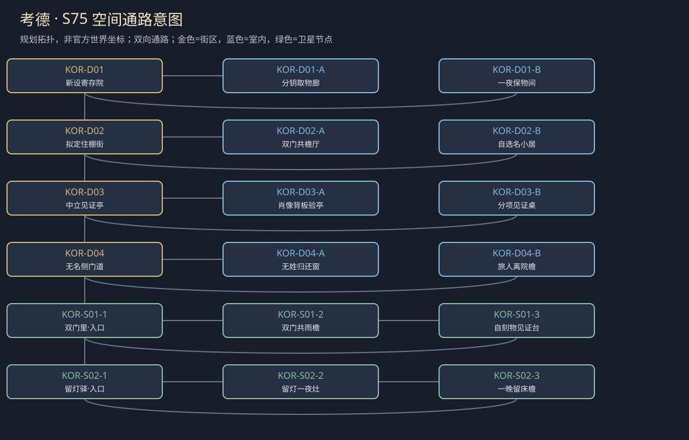
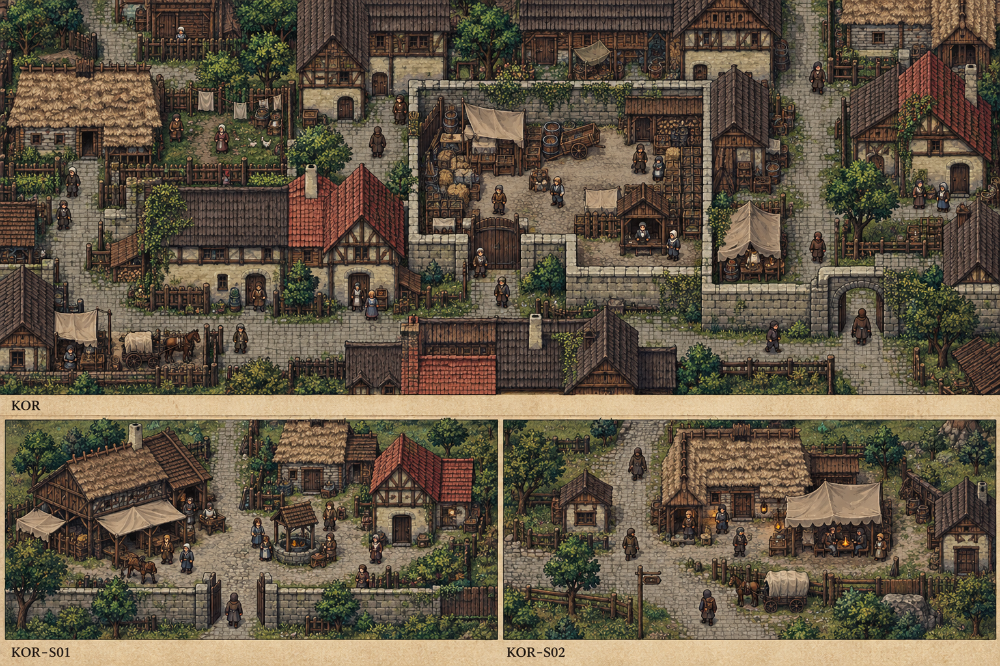

# 聚落_KOR_考德

> [!info] 范围
> S63原创规划。大城/城镇/村庄标签表示本Mod内容密度，不替原作确认规模。内部建筑及卫星位置待技术小样核实；概念图不代表可玩地图。

**主题**：在身份不明的地方，也不由别人替你定义归属。

**基线**：[[地点基线_考德]]。原作事实、讲述者观点与原创现代街区分开。

## 城市气质与空间

所有现代空间均Mod原创：内院小街、普通门牌与相邻临时住棚，不画海港/王宫/矿业作为官方身份。

拟定小环路与两出口；只是Mod布局，不确定原作全球方向。

**经济压力**：原创有限住房、旧物寄存与旅人服务，不当作已核城镇传统产业。

## 街区、建筑与任务用途

|节点|地点与用途|相关行动|
|---|---|---|
|KOR-D01|新设寄存院：取物与身份分项授权。A：分钥取物廊；B：一夜保物间；各有回本街区的出口。|[[台本_CM-KOR_不是你的姓]] · [[台本_CS-KOR-01_留灯的人]]；先核物件实际归属与单次代取，不把同姓当同家；姓名不足时固定旧刻记可替。 区分一夜保物、预留床和实际整月入住；缺席者没有新同意，不能由驿主续签。|
|KOR-D02|拟定住棚街：家人与自选名。A：双门共檐厅；B：自选名小居；各有回本街区的出口。|[[台本_CM-KOR_不是你的姓]] · [[台本_CS-KOR-02_双门里的孩子]]；让年轻人指出自己的物件刻记和所选称呼，分别核亲属关系与代领范围。 可留一家、独住或只寄物，家属的不悦保留为后续回应；不设隐藏贵族奖励真相。|
|KOR-D03|中立见证亭：有限归属证明。A：肖像背板验亭；B：分项见证桌；各有回本街区的出口。|[[台本_CM-KOR_不是你的姓]] · [[台本_CS-KOR-02_双门里的孩子]] · [[台本_CS-KOR-03_寄存的陌生画]]；验证画作出处能到哪一步，停止把未知脸认作官方城主；真旧画可以不带伪家族故事出售。 每项分别问本人，把已核物件和未核人身归属拆开；代理只拿本项筹。|
|KOR-D04|无名侧门道：不以姓氏封路。A：无姓归还窗；B：旅人离院檐；各有回本街区的出口。|[[台本_CS-KOR-01_留灯的人]] · [[台本_CS-KOR-03_寄存的陌生画]]；用单件凭证实际交还物件，不要求旅人领取所有家族义务才让开门。 结真实一夜费用，月租未授权不收；驿主可承认空床损失，不把损失转为人身债。|

## 周边聚落

- [[聚落_KOR-S01_双门里]]：原创小住户聚点；同姓人不是同一家。
- [[聚落_KOR-S02_留灯驿]]：原创旅人短宿；谁有权为缺席者签入住。

## 地域主线与支线

[[台本_CM-KOR_不是你的姓]]：核一份同姓归属误认，让取物、租住和代表权不再混作一件事。

- [[台本_CS-KOR-01_留灯的人]]：驿主替未到旅人签了入住同意，要其家属付整月租。
- [[台本_CS-KOR-02_双门里的孩子]]：两个同姓家庭都要求代表能表达意愿的年轻人领取旧物。
- [[台本_CS-KOR-03_寄存的陌生画]]：一张旧画被当地旅人称是城主肖像以抬售价。

## 人物与关系

- [[人物_KOR-NPC-NOD_诺妲·门]]：寄存院助手；怕地方无序，先用同姓替人作了假归属。
- [[人物_KOR-NPC-EV_埃文·行]]：旅人；要拿回旧物，却不愿承认委托人写的全权家属。

## 日夜、服务、危险与回程

白天普通工作间开放、傍晚侧室会面；夜间保入口与有限短宿，不把NPC缺席变永久卡关。每城只新设一个普通有偿服务班，一批案件结束前不刷新库存；支线能改价格、授权范围或工期，不能凭声望无限抽物资。危险段独立警示、保已验旁路；谈崩、停工、负声望不关闭双向回程。城市原生商店、原主线与声望服务照旧，各新服务不能冒称原角色官署授权。

## 接入旧任务与跨城后果

提供有限代理的另一叙事出口；不得把柏石关改名考德。

[[台本_SQ08_逃兵的家书]] · [[台本_DT11_两份抄本的交接]]

[[城市篇章与跨区域任务网]]记录具体回执和回应；城市收束不以本城所有支线完成为条件。[[城市与聚落设计总索引]] · [[城市设计与原作避让审查]]

<!-- CITY-ART-S74:BEGIN -->
## 原素材参考概念（S74）

上方是代表性核心街区，下方按卫星ID排列周边构图；不是整座城市总平面。 以用户原素材的材质、轮廓和相机为参考生成；人物、场景组合、灯光/季节属于Mod美术提案，不证明原作地理和阵营。来源、任务对应和制作限制见[[原素材参考与城市概念图]]。
<!-- CITY-ART-S74:END -->

<!-- CITY-SPACES-S75:BEGIN -->
## 任务空间细化（S75）

[[空间_KOR_考德]]列出本地域的独立室内、观察物与可执行交互、权限替代和安全回程；[[任务空间与地点关联审查]]记录逐任务地点修订。已有方法、证据和奖励所有者保持，各室内不是新必访清单。

<!-- CITY-SPACES-S75:END -->

寄存与关口两地的逐角色稿、缺席者／同人／原任务复用见[[考德与柏石关人物演出审查]]；S84为Mod原创初稿，未导入游戏。

<!-- SERVICE-REGISTRY-S90:BEGIN -->
## 本城服务与信任（S90）

本城普通有偿服务班：**旧物寄存与凭据对照班**（Deposit and Credential-Check Desk，经办：诺妲·门）；范围与库存见[[城市服务班与有限库存]]，档位语义见[[城镇声望与信任系统]]，人物细描见[[人物细描与随身物]]。
<!-- SERVICE-REGISTRY-S90:END -->
