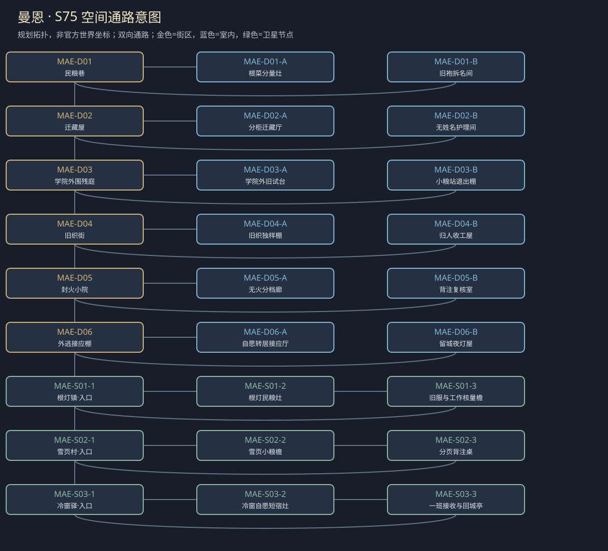
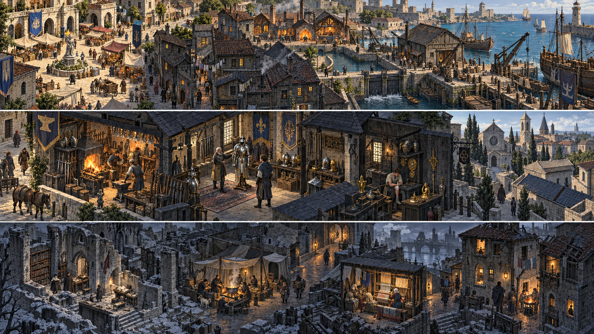

# 聚落_MAE_曼恩

> [!info] 范围
> S63原创规划。大城/城镇/村庄标签表示本Mod内容密度，不替原作确认规模。内部建筑及卫星位置待技术小样核实；概念图不代表可玩地图。

**主题**：留下知识不等于留下它曾压过的人。

**基线**：[[地点基线_曼恩]]。原作事实、讲述者观点与原创现代街区分开。

## 城市气质与空间

寒地受损城市，低屋藏档、学院外围残庭与难得暖灯，旧织物和首饰残余只作局部；不画正常营业大学。

受损片区通过民粮巷与外逃者侧路相接；学院外围封存柜与弃庭分开，至少两条回补给路线。

**经济压力**：寒地有限民粮、匿名护理与技术校验；权力碎片化，不写全灰军温和或统一保护学者。

## 街区、建筑与任务用途

|节点|地点与用途|相关行动|
|---|---|---|
|MAE-D01|民粮巷：生活供给与退出权。A：根菜分量灶；B：旧袍拆名间；各有回本街区的出口。|[[台本_CM-MAE_留下来的城]] · [[台本_CS-MAE-01_被留下的那件袍]] · [[台本_CS-MAE-03_根灯最后的座位]] · [[台本_CS-MAE-06_冷窗不等于空城]]；核实际工作与粮份，拒公议不等于没做照护；粮少就认缺口，不作采十棵菜委托。 卖材料、限定来源核验或保物各由本人决定，身份风险明确；卖袍不自动证本人贵族。|
|MAE-D02|迁藏屋：病历与身份分柜。A：分柜迁藏厅；B：无姓名护理间；各有回本街区的出口。|[[台本_CS-MAE-01_被留下的那件袍]] · [[台本_CS-MAE-02_烧掉之前]]；分出能公开技术与需本人同意的身份信息，保护来源不等于焚掉所有问责材料。 只传必要护理事实或代取物，不把患者名单交政治检查者；本人可拒全部名单合并。|
|MAE-D03|学院外围残庭：旧试验与技术来源。A：学院外旧试台；B：小粮站退出棚；各有回本街区的出口。|[[台本_CM-MAE_留下来的城]] · [[台本_CS-MAE-03_根灯最后的座位]]；核有限技术来源及旧试验留下的责任，不推定葛文涅尔去向；危险原机不重开取证。 能拒参议仍按实际照护领粮；留城者可以反对保存某种知识，不被写作愚昧障碍。|
|MAE-D04|旧织街：离乡者与技能署名。A：旧织独样棚；B：归人收工屋；各有回本街区的出口。|[[台本_CM-MAE_留下来的城]] · [[台本_CS-MAE-04_旧织街的归人]]；确认安置确有帮助同时核新技术来源，分署、有限授权或离坊都有具体收入代价。 归人可留下工作、转别班或离城，去留与感谢分别问；不默认战乱归人必须感激救援者。|
|MAE-D05|封火小院：焚档与保护的分界。A：无火分档廊；B：背注复核室；各有回本街区的出口。|[[台本_CM-MAE_留下来的城]] · [[台本_CS-MAE-02_烧掉之前]] · [[台本_CS-MAE-05_凯姆没能改掉的字]]；技术、病史、追索名分开定保留范围，没人点头不把整箱烧完；无火方案也能保护人。 核摘要是否错归具体段落，可附来源或限定更正；不由一个错字证明凯姆全人生恶意。|
|MAE-D06|外逃接应棚：自愿迁居和留城。A：自愿转居接应厅；B：留城夜灯屋；各有回本街区的出口。|[[台本_CM-MAE_留下来的城]] · [[台本_CS-MAE-06_冷窗不等于空城]]；只迁已选择者，名单限接收用途；无床等下一班，不虚写全体疏散完成。 写留城基本照护和真实班次，救援者可承认不完美结果；拒迁不会删已获救记录。|

## 周边聚落

- [[聚落_MAE-S01_根灯镇]]：有限根菜与外逃者住处；留城者不该被当成没被救的人。
- [[聚落_MAE-S02_雪页村]]：原创抄写人与小粮点；保存来源与家门风险。
- [[聚落_MAE-S03_冷窗驿]]：短泊与外部护理接续；安置名册不能变追索名单。

## 地域主线与支线

[[台本_CM-MAE_留下来的城]]：让剩下的人和记录各自有保留、离开与反对的权利，查明一场拟焚档冲突。

- [[台本_CS-MAE-01_被留下的那件袍]]：躲藏者家属想卖其旧贵服换粮，怕卖物会证明本人贵族身份。
- [[台本_CS-MAE-02_烧掉之前]]：看守想把混箱全部烧成无追索信息。
- [[台本_CS-MAE-03_根灯最后的座位]]：民粮站把拒参与公议的护工删去，称不愿坐桌就是不愿担责任。
- [[台本_CS-MAE-04_旧织街的归人]]：工头说安置过的工人必须把新技永留其棚。
- [[台本_CS-MAE-05_凯姆没能改掉的字]]：来源抄写者要查自己一段背注被凯姆摘要归作旁人所写。
- [[台本_CS-MAE-06_冷窗不等于空城]]：救援者要把所有留城者迁出，以便宣布疏散完成。

## 人物与关系

- [[人物_NPC-SENA_塞娜·里德]]：已有Mod藏档人；替朋友解释的习惯必须交出。
- [[人物_NPC-LYD_莉德]]：已有Mod来源抄写者；要自己的说话位置，不一定要公开真名。
- [[人物_NPC-MAYA_玛娅·禾]]：已有Mod民粮代理；保护自己人不能等于决定谁是自己人。
- [[人物_MAE-NPC-FIL_菲勒·火]]：原创旧织街工头；想保护离乡者，也想把他们技术永远留给自己的工棚。

## 日夜、服务、危险与回程

白天普通工作间开放、傍晚侧室会面；夜间保入口与有限短宿，不把NPC缺席变永久卡关。每城只新设一个普通有偿服务班，一批案件结束前不刷新库存；支线能改价格、授权范围或工期，不能凭声望无限抽物资。危险段独立警示、保已验旁路；谈崩、停工、负声望不关闭双向回程。城市原生商店、原主线与声望服务照旧，各新服务不能冒称原角色官署授权。

## 接入旧任务与跨城后果

旧曼恩边地成为城市外围入口，城内是受损且权力有限的多片区，不改战前正常学院。

[[台本_N6_被封存的页码]] · [[台本_N10_没有写下的见证]] · [[台本_SQ03_没有王旗的面包]] · [[台本_SQ06_抄本的背面]] · [[台本_DT04_收割前的空地]] · [[台本_DT10_别让狼靠近夜岗]] · [[台本_DT11_两份抄本的交接]]

[[城市篇章与跨区域任务网]]记录具体回执和回应；城市收束不以本城所有支线完成为条件。[[城市与聚落设计总索引]] · [[城市设计与原作避让审查]]

<!-- CITY-ART-S74:BEGIN -->
## 原素材参考概念（S74）

上方是代表性核心街区，下方按卫星ID排列周边构图；不是整座城市总平面。 以用户原素材的材质、轮廓和相机为参考生成；人物、场景组合、灯光/季节属于Mod美术提案，不证明原作地理和阵营。来源、任务对应和制作限制见[[原素材参考与城市概念图]]。
<!-- CITY-ART-S74:END -->

<!-- CITY-SPACES-S75:BEGIN -->
## 任务空间细化（S75）

[[空间_MAE_曼恩]]列出本地域的独立室内、观察物与可执行交互、权限替代和安全回程；[[任务空间与地点关联审查]]记录逐任务地点修订。已有方法、证据和奖励所有者保持，各室内不是新必访清单。

<!-- CITY-SPACES-S75:END -->

当前曼恩逐角色对白、共用人物与先后顺序回应见[[曼恩人物对白与去留交叉审查]]；S79为原创台本初稿，未导入游戏。
