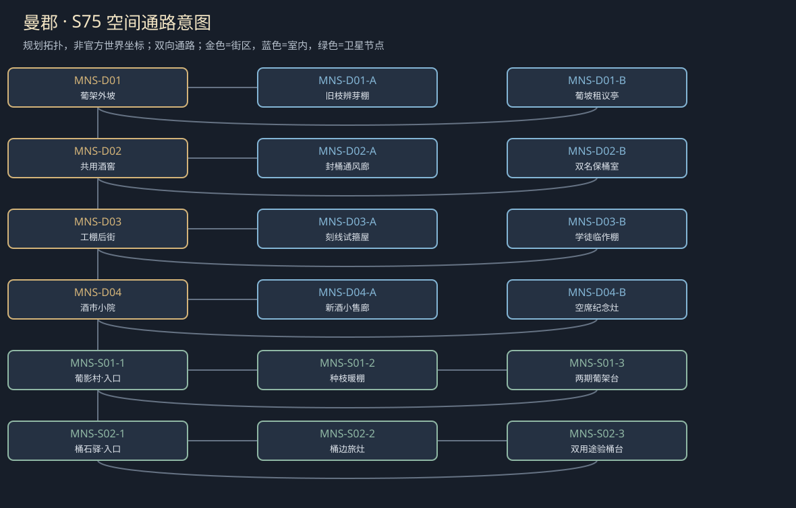

# 聚落_MNS_曼郡

> [!info] 范围
> S63原创规划。大城/城镇/村庄标签表示本Mod内容密度，不替原作确认规模。内部建筑及卫星位置待技术小样核实；概念图不代表可玩地图。

**主题**：重建的酒香里，也有没回来的人。

**基线**：[[城市设计与原作避让审查]]。原作事实、讲述者观点与原创现代街区分开。

## 城市气质与空间

受战争损伤的葡萄酒地区，倾斜架、石墙小院、空酒窖与新苗。

绕田小路接安全街，旧酒窖有独立排气出口，不复用工具铺怪物反转。

**经济压力**：有限葡萄、酒窖租用与木工修补；不把曼郡写成曼恩学院。

## 街区、建筑与任务用途

|节点|地点与用途|相关行动|
|---|---|---|
|MNS-D01|葡架外坡：旧枝与新租户。A：旧枝辨芽棚；B：葡坡租议亭；各有回本街区的出口。|[[台本_CM-MNS_没有年份的酒]] · [[台本_CS-MNS-03_葡影的种枝]]；实际比对断产原因和本季可用枝量，不能用旧酒名声宣称酒园已全恢复。 由原户和迁居户决定借一季、买断有限枝或各保一段；下个春天不在本次默示授权内。|
|MNS-D02|共用酒窖：限量瓶与保管。A：封桶通风廊；B：双名保桶室；各有回本街区的出口。|[[台本_CM-MNS_没有年份的酒]] · [[台本_CS-MNS-01_空桶有两个名字]]；核瓶中酒与瓶外旧名分开，选择说明断层、有限旧名或新名出售；不把品鉴判定设技能硬门槛。 现场确认双重预订，有限分桶或退一方押金；护理桶和饮酒桶卫生用途不能混。|
|MNS-D03|工棚后街：木匠出处可选，不借原NPC身世。A：刻线试箍屋；B：学徒临作棚；各有回本街区的出口。|[[台本_CS-MNS-02_师傅的第二条刻线]]；比较谁的改法能承压，技术来源与师傅名誉分开；不抹小刻线换常驻折扣。 允许分署续作或付有限使用费独立作；已受教养不能扣工具和之后所有收入。|
|MNS-D04|酒市小院：地方新酒与旧声誉。A：新酒小售廊；B：空席纪念灶；各有回本街区的出口。|[[台本_CM-MNS_没有年份的酒]] · [[台本_CS-MNS-03_葡影的种枝]]；让买者知旧名和今酿来源，定同一批不同标注的实际收益；不给无限酿酒套利。 由亲人决定留席、分时纪念或只存杯；拒纪念活动仍可买生活粮。|

## 周边聚落

- [[聚落_MNS-S01_葡影村]]：残田复种与季工；谁能取旧藤，谁承担失败。
- [[聚落_MNS-S02_桶石驿]]：酒桶、营地与短泊；同一批旧桶用于酒或护理清水。

## 地域主线与支线

[[台本_CM-MNS_没有年份的酒]]：恢复有限酒业收益并决定旧声誉如何承认战争断层。

- [[台本_CS-MNS-01_空桶有两个名字]]：同批旧桶被酒户与护理点都预订。
- [[台本_CS-MNS-02_师傅的第二条刻线]]：木工作品多出学徒的独立改法，师傅要求抹掉小刻线。
- [[台本_CS-MNS-03_葡影的种枝]]：旧户要收回分给迁居户的葡枝，称当年只是借。

## 人物与关系

- [[人物_MNS-NPC-ROS_罗莎·藤]]：酿酒人；要让家名回来，却借旧年份标新酒。
- [[人物_MNS-NPC-TIO_提奥·桶]]：归乡学徒；要认师傅，也想自己的新工艺有名字。

## 日夜、服务、危险与回程

白天普通工作间开放、傍晚侧室会面；夜间保入口与有限短宿，不把NPC缺席变永久卡关。每城只新设一个普通有偿服务班，一批案件结束前不刷新库存；支线能改价格、授权范围或工期，不能凭声望无限抽物资。危险段独立警示、保已验旁路；谈崩、停工、负声望不关闭双向回程。城市原生商店、原主线与声望服务照旧，各新服务不能冒称原角色官署授权。

## 接入旧任务与跨城后果

来源署名与保存记录的平民镜像，不能把地方产业只写成往任务里送酒。

[[台本_SQ06_抄本的背面]] · [[台本_DT09_药师指认的草]]

[[城市篇章与跨区域任务网]]记录具体回执和回应；城市收束不以本城所有支线完成为条件。[[城市与聚落设计总索引]] · [[城市设计与原作避让审查]]

<!-- CITY-ART-S74:BEGIN -->
## 原素材参考概念（S74）

上方是代表性核心街区，下方按卫星ID排列周边构图；不是整座城市总平面。 以用户原素材的材质、轮廓和相机为参考生成；人物、场景组合、灯光/季节属于Mod美术提案，不证明原作地理和阵营。来源、任务对应和制作限制见[[原素材参考与城市概念图]]。
<!-- CITY-ART-S74:END -->

<!-- SHORE-VINE-TASK-ART-20261012:BEGIN -->
## 任务场所概念图（2026-10-12）

[[曼郡任务场所概念与台本映射]]说明A—F的任务、空间与制作约束。面板不是任务顺序或官方相邻关系；画中人物、库存和门仅为原创构图，未实现交互。
<!-- SHORE-VINE-TASK-ART-20261012:END -->

<!-- CITY-SPACES-S75:BEGIN -->
## 任务空间细化（S75）

[[空间_MNS_曼郡]]列出本地域的独立室内、观察物与可执行交互、权限替代和安全回程；[[任务空间与地点关联审查]]记录逐任务地点修订。已有方法、证据和奖励所有者保持，各室内不是新必访清单。

<!-- CITY-SPACES-S75:END -->

丹布里与曼郡的逐角色对白、实际接收与来源交叉见[[丹布里与曼郡人物演出审查]]；S81为Mod原创初稿，未导入游戏。
