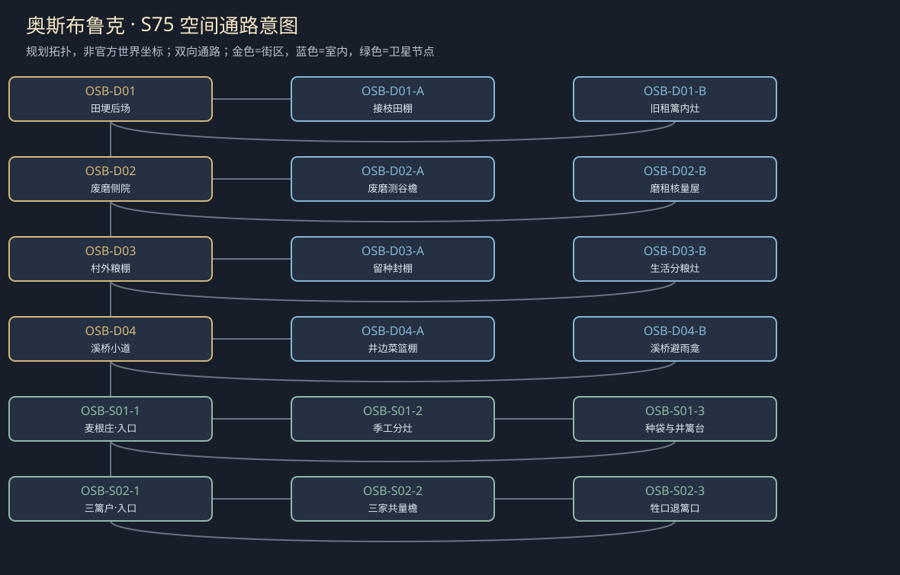
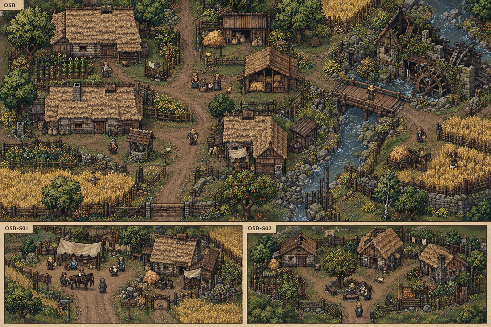

# 聚落_OSB_奥斯布鲁克

> [!info] 范围
> S63原创规划。大城/城镇/村庄标签表示本Mod内容密度，不替原作确认规模。内部建筑及卫星位置待技术小样核实；概念图不代表可玩地图。

**主题**：土地会生粮，旧关系却不自然长回来。

**基线**：[[城市设计与原作避让审查]]。原作事实、讲述者观点与原创现代街区分开。

## 城市气质与空间

低土屋、麦色田埂与可见粮仓小体量，秋泥和家门距离短。

田路有两支，仓场不挡原村服务，夜间危险只在新的废磨旁。

**经济压力**：小额农产、牲畜与有限租地；本案种粮权是原创，不替原村领主改政。

## 街区、建筑与任务用途

|节点|地点与用途|相关行动|
|---|---|---|
|OSB-D01|田埂后场：归来佃户与已种作物。A：接枝田棚；B：旧租篱内灶；各有回本街区的出口。|[[台本_CS-OSB-01_父亲没说的价格]] · [[台本_CS-OSB-02_三篱的门]]；说明归来者的旧租与后来者实际种植怎样重叠；观察不自动把一季作物判给一方。 面对父女分别谈既有债和未来劳动，允许有限一季借款或独立离村；不要求女儿证明孝顺。|
|OSB-D02|废磨侧院：磨租、家族旧债。A：废磨测谷檐；B：磨租核量屋；各有回本街区的出口。|[[台本_CM-OSB_留到来年的一袋]]；分开缺粮中的糠耗、旧磨租与实售部分；玩家演示核量，不接一批批磨谷日常。 在有限库存内折算本季租或改分粮，旧债与女儿路费另算；减一袋就说明谁承担。|
|OSB-D03|村外粮棚：有限库存。A：留种封棚；B：生活分粮灶；各有回本街区的出口。|[[台本_CM-OSB_留到来年的一袋]]；区分可播种量和当下可吃量，再核哪些已售；固定样粒支持基础查验，不需盗开粮仓。 列保种、有限预售或缩种后的口粮代价；已有定金仅占对应份额，不能同时付三家。|
|OSB-D04|溪桥小道：双向低风险旁路。A：井边菜篮棚；B：溪桥避雨龛；各有回本街区的出口。|[[台本_CS-OSB-02_三篱的门]] · [[台本_CS-OSB-03_那一口井不是嫁妆]]；核井的公共取水与井旁私人菜地为两件事，婚约不使水权一并转移。 让退出共田者保牲口出路，调共篱开口或另设独立门；不把玩家当修篱搬运工。|

## 周边聚落

- [[聚落_OSB-S01_麦根庄]]：留种与雇季工；镇里采购价与来年种粮。
- [[聚落_OSB-S02_三篱户]]：三个不同姓氏的邻里；共同围地与各自退出。

## 地域主线与支线

[[台本_CM-OSB_留到来年的一袋]]：让来年播种与眼前饥饿都有可执行安排，查明少粮并非单一盗匪所为。

- [[台本_CS-OSB-01_父亲没说的价格]]：女儿想离村学艺，父亲称路费只能借未来劳力。
- [[台本_CS-OSB-02_三篱的门]]：三个邻户共围田，其中一户要退却被堵牲口出口。
- [[台本_CS-OSB-03_那一口井不是嫁妆]]：订婚家庭各认为女方应把井旁菜地带入新家。

## 人物与关系

- [[人物_OSB-NPC-FUD_芙朵·谷]]：佃农女儿；要留种；她也偷偷卖过一袋救弟弟。
- [[人物_OSB-NPC-VAS_瓦森·磨]]：老磨租人；认为赊粮就是亲情，后来发现别人无权拒绝。

## 日夜、服务、危险与回程

白天普通工作间开放、傍晚侧室会面；夜间保入口与有限短宿，不把NPC缺席变永久卡关。每城只新设一个普通有偿服务班，一批案件结束前不刷新库存；支线能改价格、授权范围或工期，不能凭声望无限抽物资。危险段独立警示、保已验旁路；谈崩、停工、负声望不关闭双向回程。城市原生商店、原主线与声望服务照旧，各新服务不能冒称原角色官署授权。

## 接入旧任务与跨城后果

把原来只作粮源背景的奥斯布鲁克写成能拒城市采购的地方。

[[台本_DT04_收割前的空地]] · [[台本_DT13_一锅够分的热汤]]

[[城市篇章与跨区域任务网]]记录具体回执和回应；城市收束不以本城所有支线完成为条件。[[城市与聚落设计总索引]] · [[城市设计与原作避让审查]]

<!-- CITY-ART-S74:BEGIN -->
## 原素材参考概念（S74）

上方是代表性核心街区，下方按卫星ID排列周边构图；不是整座城市总平面。 以用户原素材的材质、轮廓和相机为参考生成；人物、场景组合、灯光/季节属于Mod美术提案，不证明原作地理和阵营。来源、任务对应和制作限制见[[原素材参考与城市概念图]]。
<!-- CITY-ART-S74:END -->

<!-- CITY-SPACES-S75:BEGIN -->
## 任务空间细化（S75）

[[空间_OSB_奥斯布鲁克]]列出本地域的独立室内、观察物与可执行交互、权限替代和安全回程；[[任务空间与地点关联审查]]记录逐任务地点修订。已有方法、证据和奖励所有者保持，各室内不是新必访清单。

<!-- CITY-SPACES-S75:END -->

粮村与纪念地域的逐角色对白、两户女儿、现时护栏和有限给付见[[奥斯布鲁克与拉滕人物演出审查]]；S83为Mod原创初稿，未导入游戏。

<!-- SERVICE-REGISTRY-S90:BEGIN -->
## 本城服务与信任（S90）

本城普通有偿服务班：**修筐与量粮校准班**（Basket Repair and Measure-Calibration Desk，经办：洛珊）；范围与库存见[[城市服务班与有限库存]]，档位语义见[[城镇声望与信任系统]]，人物细描见[[人物细描与随身物]]。
<!-- SERVICE-REGISTRY-S90:END -->
