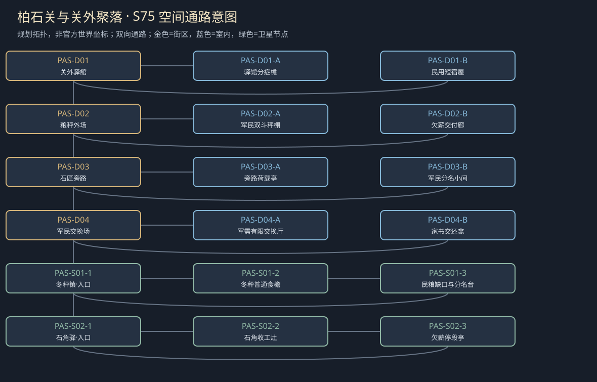

# 聚落_PAS_柏石关与关外聚落

> [!info] 范围
> S63原创规划。大城/城镇/村庄标签表示本Mod内容密度，不替原作确认规模。内部建筑及卫星位置待技术小样核实；概念图不代表可玩地图。

**主题**：真正的秩序经得起在印章外查问。

**基线**：[[区域_R04_王廷关隘与边城]]。原作事实、讲述者观点与原创现代街区分开。

## 城市气质与空间

原创关隘、长卸货轴、粮秤与拥挤民车；不是考德或王都。

主关道与石匠道双路，卸货亭与药库不一室复用。

**经济压力**：有限军民供给与维修，不授全国免税。

## 街区、建筑与任务用途

|节点|地点与用途|相关行动|
|---|---|---|
|PAS-D01|关外驿館：中立普通护理。A：驿馆分症檐；B：民用短宿屋；各有回本街区的出口。|[[台本_CM-PAS_关口两边]] · [[台本_CS-PAS-02_两份点名]]；核已亲历的本案症状与供给，不用军衔定病人真伪；研究同意和基本护理分问。 实际约定留关、转护理或等下一班，床不能军民各报一次；不作全边境收治承诺。|
|PAS-D02|粮秤外场：授权数量与实际数量。A：军民双斗秤棚；B：欠薪交付廊；各有回本街区的出口。|[[台本_CM-PAS_关口两边]] · [[台本_CS-PAS-01_石角的停工]]；对照同批数量，把军需损耗与民户缺粮分别核；缺一斗就保缺口不造等量已交。 当面付已做工钱或缩工程保旁路，军事紧急不自动使劳动无限无偿；普通修路不给玩家循环任务。|
|PAS-D03|石匠旁路：无官署也能步行。A：旁路荷载亭；B：军民分名小间；各有回本街区的出口。|[[台本_CS-PAS-01_石角的停工]] · [[台本_CS-PAS-02_两份点名]]；核哪段可安全步行，不凭一句军令取消停工；只测试无人的固定样段。 认确为同一患者时转一条必要事实，不把军役、护理和亲属权全合并；授权分别问。|
|PAS-D04|军民交换场：人身与物资回访。A：军需有限交换厅；B：家书交还龛；各有回本街区的出口。|[[台本_CM-PAS_关口两边]] · [[台本_CS-PAS-03_关外的最后一封]]；核交换真实发生的批次及监督范围，外检费不能购买患者去留或全国军需权。 本人选寄信、只交有限口信或暂存；代理不能因怕想家而扣住信，也不替本人续岗。|

## 周边聚落

- [[聚落_PAS-S01_冬秤镇]]：失粮民户的普通服务；军民同限与各家不一样的缺口。
- [[聚落_PAS-S02_石角驿]]：维修工和路人；欠工钱不能借边关需要无限拖延。

## 地域主线与支线

[[台本_CM-PAS_关口两边]]：核军需与民粮所受的不同损失，真正落实监督和有限通路。

- [[台本_CS-PAS-01_石角的停工]]：修路者要结欠工钱，关口称边境需要不许停。
- [[台本_CS-PAS-02_两份点名]]：军民床簿各把同一名当不存在，接收员想合成一簿。
- [[台本_CS-PAS-03_关外的最后一封]]：代理要拦自愿离岗者家书，称这样会让人想回去逃军需。

## 人物与关系

- [[人物_NPC-REY_雷奥·凯斯]]：已有Mod地方军需代理；相信封印，逐步接受外部监督。
- [[人物_NPC-MORREN_莫伦·海]]：已有Mod退役军医；补偿沉默，需交照护主持权。

## 日夜、服务、危险与回程

白天普通工作间开放、傍晚侧室会面；夜间保入口与有限短宿，不把NPC缺席变永久卡关。每城只新设一个普通有偿服务班，一批案件结束前不刷新库存；支线能改价格、授权范围或工期，不能凭声望无限抽物资。危险段独立警示、保已验旁路；谈崩、停工、负声望不关闭双向回程。城市原生商店、原主线与声望服务照旧，各新服务不能冒称原角色官署授权。

## 接入旧任务与跨城后果

地域章整合已有任务而不二次发N7/SQ02奖励或承诺。

[[台本_N7_军需账上的空名]] · [[台本_N11_关隘外的交换]] · [[台本_SQ02_被征用的冬粮]] · [[台本_SQ08_逃兵的家书]] · [[台本_DT05_驿馆的急用药]] · [[台本_DT14_锈印章与假凭证]]

[[城市篇章与跨区域任务网]]记录具体回执和回应；城市收束不以本城所有支线完成为条件。[[城市与聚落设计总索引]] · [[城市设计与原作避让审查]]

<!-- CITY-ART-S74:BEGIN -->
## 原素材参考概念（S74）

上方是代表性核心街区，下方按卫星ID排列周边构图；不是整座城市总平面。 以用户原素材的材质、轮廓和相机为参考生成；人物、场景组合、灯光/季节属于Mod美术提案，不证明原作地理和阵营。来源、任务对应和制作限制见[[原素材参考与城市概念图]]。
<!-- CITY-ART-S74:END -->

<!-- CITY-SPACES-S75:BEGIN -->
## 任务空间细化（S75）

[[空间_PAS_柏石关与关外聚落]]列出本地域的独立室内、观察物与可执行交互、权限替代和安全回程；[[任务空间与地点关联审查]]记录逐任务地点修订。已有方法、证据和奖励所有者保持，各室内不是新必访清单。

<!-- CITY-SPACES-S75:END -->

寄存与关口两地的逐角色稿、缺席者／同人／原任务复用见[[考德与柏石关人物演出审查]]；S84为Mod原创初稿，未导入游戏。
