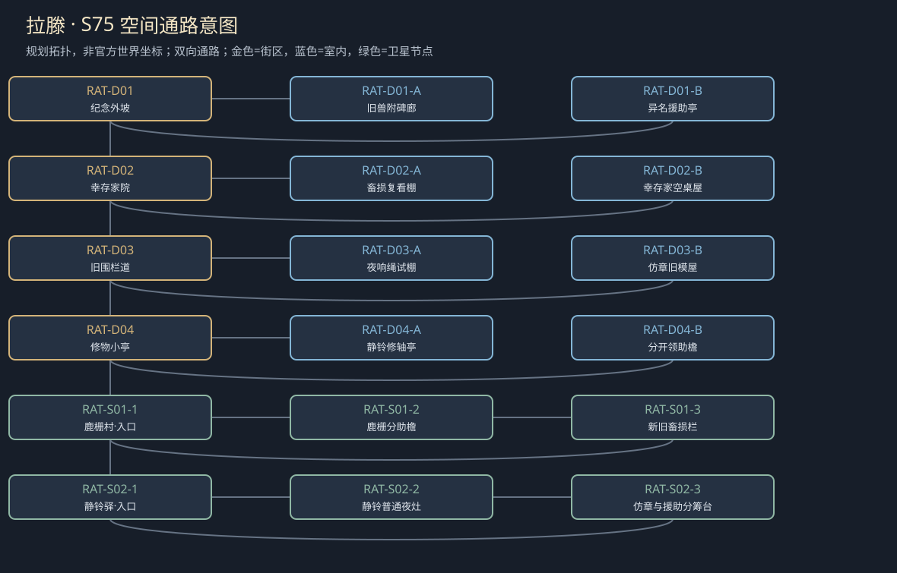

# 聚落_RAT_拉滕

> [!info] 范围
> S63原创规划。大城/城镇/村庄标签表示本Mod内容密度，不替原作确认规模。内部建筑及卫星位置待技术小样核实；概念图不代表可玩地图。

**主题**：被杀死的怪物，不会替幸存者把故事说完。

**基线**：[[地点基线_拉滕]]。原作事实、讲述者观点与原创现代街区分开。

## 城市气质与空间

纪念小坡、牲畜旧围栏与普通乡野；兽已死，新问题来自记忆、现时野兽和补偿。

两条纪念路径接居住院；夜响固定普通威胁或人为伪造，不复活狂兽。

**经济压力**：原创有限畜养与纪念物交易，非已核全镇畜牧构成。

## 街区、建筑与任务用途

|节点|地点与用途|相关行动|
|---|---|---|
|RAT-D01|纪念外坡：叙事与遗物。A：旧兽附碑廊；B：异名援助亭；各有回本街区的出口。|[[台本_CM-RAT_兽死之后]] · [[台本_CS-RAT-01_鹿栅之外]]；决定保原纪念、补不同见证或另设旁记；碑上旧兽只为地方雕刻，不作怪物复活线索。 核新损失而非先核是否旧村后裔；赔付不足就列真实缺口，不刷新无限救济。|
|RAT-D02|幸存家院：后人的现实缺口。A：畜损复看棚；B：幸存家空桌屋；各有回本街区的出口。|[[台本_CM-RAT_兽死之后]] · [[台本_CS-RAT-01_鹿栅之外]]；把今夜动物威胁与已死旧兽分开，固定痕支持独立追查；野兽击退不等于旧赔偿自动补齐。 允许家庭取有限补助而拒作英雄见证；仿章可真认修工工艺，不否定从前救人事实。|
|RAT-D03|旧围栏道：真实现时野兽痕。A：夜响绳试棚；B：仿章旧模屋；各有回本街区的出口。|[[台本_CM-RAT_兽死之后]] · [[台本_CS-RAT-02_一枚仿的纪念章]]；做无伤害昼间试响并比较真兽痕，不凭听见怪声就判旧兽复活；夜访是可选体验。 辨仿制、盗原章与否认历史是三件事，可改标售、退钱或禁用误导名；已卖的钱实际退。|
|RAT-D04|修物小亭：纪念物修复来源。A：静铃修轴亭；B：分开领助檐；各有回本街区的出口。|[[台本_CS-RAT-03_静铃的沉默]]；说明谁自愿修铃、何时停用，沉默不是拒认可旧救援；修理交普通工班不做搬零件任务。 允许参加、旁观、拒仪式三者领同类基本援助；有限纪念资助可另谈，不替全村许愿。|

## 周边聚落

- [[聚落_RAT-S01_鹿栅村]]：畜损后人和新居民；旧赔偿名册漏下迁来者。
- [[聚落_RAT-S02_静铃驿]]：纪念日来者与旅人；参加仪式不是领援助条件。

## 地域主线与支线

[[台本_CM-RAT_兽死之后]]：调查新夜响与旧赔偿缺口，让纪念不靠复活旧灾维持意义。

- [[台本_CS-RAT-01_鹿栅之外]]：补偿名册只认旧村姓，新住户也有新畜损。
- [[台本_CS-RAT-02_一枚仿的纪念章]]：修工卖仿章，被要求承认从未真有英雄事迹。
- [[台本_CS-RAT-03_静铃的沉默]]：纪念日组织者以不参加者不该领取家庭援助。

## 人物与关系

- [[人物_RAT-NPC-ALI_阿莉·铃]]：纪念物修工；靠英雄故事养家，却保管着不圆满的见证。
- [[人物_RAT-NPC-IME_伊默·栅]]：受灾家庭后人；要认损失，却把现时伤害也说成旧怪物。

## 日夜、服务、危险与回程

白天普通工作间开放、傍晚侧室会面；夜间保入口与有限短宿，不把NPC缺席变永久卡关。每城只新设一个普通有偿服务班，一批案件结束前不刷新库存；支线能改价格、授权范围或工期，不能凭声望无限抽物资。危险段独立警示、保已验旁路；谈崩、停工、负声望不关闭双向回程。城市原生商店、原主线与声望服务照旧，各新服务不能冒称原角色官署授权。

## 接入旧任务与跨城后果

不复活狂兽，地域核心是公共记忆与幸存后代。

[[台本_DT03_无人认领的墓标]] · [[台本_N18_誓约之后]]

[[城市篇章与跨区域任务网]]记录具体回执和回应；城市收束不以本城所有支线完成为条件。[[城市与聚落设计总索引]] · [[城市设计与原作避让审查]]

<!-- CITY-ART-S74:BEGIN -->
## 原素材参考概念（S74）

上方是代表性核心街区，下方按卫星ID排列周边构图；不是整座城市总平面。 以用户原素材的材质、轮廓和相机为参考生成；人物、场景组合、灯光/季节属于Mod美术提案，不证明原作地理和阵营。来源、任务对应和制作限制见[[原素材参考与城市概念图]]。
<!-- CITY-ART-S74:END -->

<!-- CITY-SPACES-S75:BEGIN -->
## 任务空间细化（S75）

[[空间_RAT_拉滕]]列出本地域的独立室内、观察物与可执行交互、权限替代和安全回程；[[任务空间与地点关联审查]]记录逐任务地点修订。已有方法、证据和奖励所有者保持，各室内不是新必访清单。

<!-- CITY-SPACES-S75:END -->

粮村与纪念地域的逐角色对白、两户女儿、现时护栏和有限给付见[[奥斯布鲁克与拉滕人物演出审查]]；S83为Mod原创初稿，未导入游戏。

<!-- SERVICE-REGISTRY-S90:BEGIN -->
## 本城服务与信任（S90）

本城普通有偿服务班：**纪念物修复与铭牌拓印班**（Memorial Repair and Plaque-Rubbing Desk，经办：佩菈）；范围与库存见[[城市服务班与有限库存]]，档位语义见[[城镇声望与信任系统]]，人物细描见[[人物细描与随身物]]。
<!-- SERVICE-REGISTRY-S90:END -->
