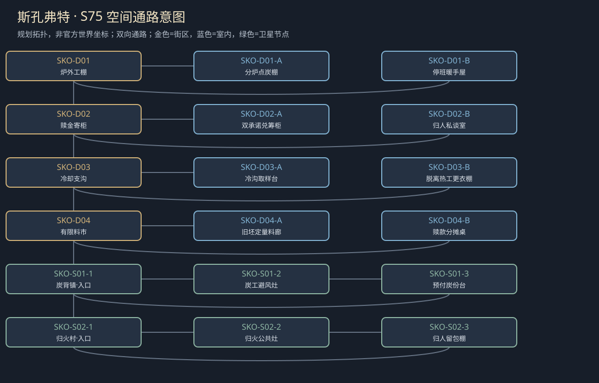
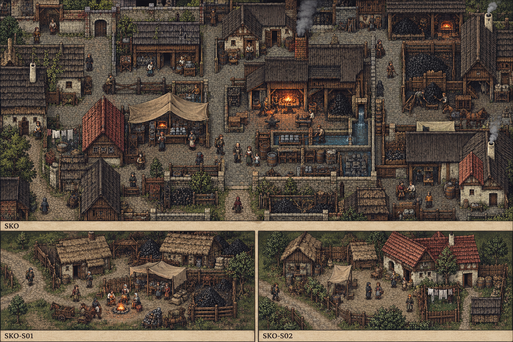

# 聚落_SKO_斯孔弗特

> [!info] 范围
> S63原创规划。大城/城镇/村庄标签表示本Mod内容密度，不替原作确认规模。内部建筑及卫星位置待技术小样核实；概念图不代表可玩地图。

**主题**：炉火续着，家里却有人一直在等赎金。

**基线**：[[地点基线_斯孔弗特]]。原作事实、讲述者观点与原创现代街区分开。

## 城市气质与空间

有限冶炼设施、烟黑砖和冷却水沟，归家衣物挂在工棚边。

炉外安全环与炭路分开，危险只在新废渣支沟；不规定官方地处山脚。

**经济压力**：局部铁工、炭料与赎金筹措；旧战俘是背景，不改原炭场人的经历。

## 街区、建筑与任务用途

|节点|地点与用途|相关行动|
|---|---|---|
|SKO-D01|炉外工棚：产量与轮班。A：分炉点炭棚；B：停班暖手屋；各有回本街区的出口。|[[台本_CS-SKO-01_炭背的预付款]] · [[台本_CS-SKO-02_回来以后]]；核缩炉的实际产量损失；同批坯不能许给奥尔德文后又卖给别人。 问归人愿再接工、转业或离开；取回家中旧物不等于答应作战偿赎金。|
|SKO-D02|赎金寄柜：同一个家两项承诺。A：双承诺兑筹柜；B：归人私谈室；各有回本街区的出口。|[[台本_CM-SKO_第二次赎回]] · [[台本_CS-SKO-01_炭背的预付款]] · [[台本_CS-SKO-02_回来以后]]；把重复抵押当场拆开，定先赎、缩炉或另找真实现钱；不是替管柜跑遍城市收款。 先听归人，再听家属对赎款的期待；其被赎事实不证明本人同意家族英雄叙事。|
|SKO-D03|冷却支沟：侧面物证与危险。A：冷沟取样台；B：脱离热工更衣棚；各有回本街区的出口。|[[台本_CS-SKO-03_冷沟的护符]]；先查接触先后和同班工况，再问护符说法；沟水只封样，不让玩家或工人再接触验证。 当事人可保私人信物同时认可减少暴露；换班、停沟或补防护各列工资与效果边界。|
|SKO-D04|有限料市：固定采购与普通修理。A：旧坯定量料廊；B：赎款分摊桌；各有回本街区的出口。|[[台本_CM-SKO_第二次赎回]]；核只有实际合格坯才可兑现，缩产就延期或换有限旧坯；工钱不是假想金属库存。 逐家选择出多少而非替全体签，拒捐仍有生活服务；实际到款后才解除对应抵押。|

## 周边聚落

- [[聚落_SKO-S01_炭背镇]]：炭工与家属；开炉用的预付款已抵赎金。
- [[聚落_SKO-S02_归火村]]：归来的新原创战俘家庭；返回者是否必须替家人继续作战还账。

## 地域主线与支线

[[台本_CM-SKO_第二次赎回]]：在公款、有限炉料和家属赎金冲突中，承认归来者仍有自己的人生。

- [[台本_CS-SKO-01_炭背的预付款]]：炭工发现同笔工钱被说既是赎金也是炉料预款。
- [[台本_CS-SKO-02_回来以后]]：归人家属要求公开他是英雄以证明赎款值得。
- [[台本_CS-SKO-03_冷沟的护符]]：工人将接触冷却支沟后不适说成旧护符失效。

## 人物与关系

- [[人物_SKO-NPC-NIS_妮莎·炉]]：工班会计；要弟弟回来却擅挪工人公款。
- [[人物_SKO-NPC-BOH_博赫·冷]]：归乡工匠；要重新做工，不能以赎回就归家族所有。

## 日夜、服务、危险与回程

白天普通工作间开放、傍晚侧室会面；夜间保入口与有限短宿，不把NPC缺席变永久卡关。每城只新设一个普通有偿服务班，一批案件结束前不刷新库存；支线能改价格、授权范围或工期，不能凭声望无限抽物资。危险段独立警示、保已验旁路；谈崩、停工、负声望不关闭双向回程。城市原生商店、原主线与声望服务照旧，各新服务不能冒称原角色官署授权。

## 接入旧任务与跨城后果

有限锻造与真实人身赎回连军需线，绝不是军需地窖的同名副本。

[[台本_SQ02_被征用的冬粮]] · [[台本_SQ08_逃兵的家书]] · [[台本_N14_可以回去的路]]

[[城市篇章与跨区域任务网]]记录具体回执和回应；城市收束不以本城所有支线完成为条件。[[城市与聚落设计总索引]] · [[城市设计与原作避让审查]]

<!-- CITY-ART-S74:BEGIN -->
## 原素材参考概念（S74）

上方是代表性核心街区，下方按卫星ID排列周边构图；不是整座城市总平面。 以用户原素材的材质、轮廓和相机为参考生成；人物、场景组合、灯光/季节属于Mod美术提案，不证明原作地理和阵营。来源、任务对应和制作限制见[[原素材参考与城市概念图]]。
<!-- CITY-ART-S74:END -->

<!-- CITY-TASK-ART-20261012:BEGIN -->
## 任务场所概念图（2026-10-12）

[[斯孔弗特任务场所概念与台本映射]]说明A—F的任务、空间与制作约束。面板不是任务顺序或官方相邻关系；画中人物、库存和门仅为原创构图，未实现交互。
<!-- CITY-TASK-ART-20261012:END -->

<!-- CITY-SPACES-S75:BEGIN -->
## 任务空间细化（S75）

[[空间_SKO_斯孔弗特]]列出本地域的独立室内、观察物与可执行交互、权限替代和安全回程；[[任务空间与地点关联审查]]记录逐任务地点修订。已有方法、证据和奖励所有者保持，各室内不是新必访清单。

<!-- CITY-SPACES-S75:END -->

当前冶炼／羊毛两地逐角色对白、共同采购人及实际去留见[[斯孔弗特与约斯特文人物演出审查]]；S80为原创初稿，不是已运行任务。

<!-- SERVICE-REGISTRY-S90:BEGIN -->
## 本城服务与信任（S90）

本城普通有偿服务班：**炭料过秤与炉位预约班**（Charcoal Weighing and Forge-Slot Desk，经办：布岚）；范围与库存见[[城市服务班与有限库存]]，档位语义见[[城镇声望与信任系统]]，人物细描见[[人物细描与随身物]]。
<!-- SERVICE-REGISTRY-S90:END -->
