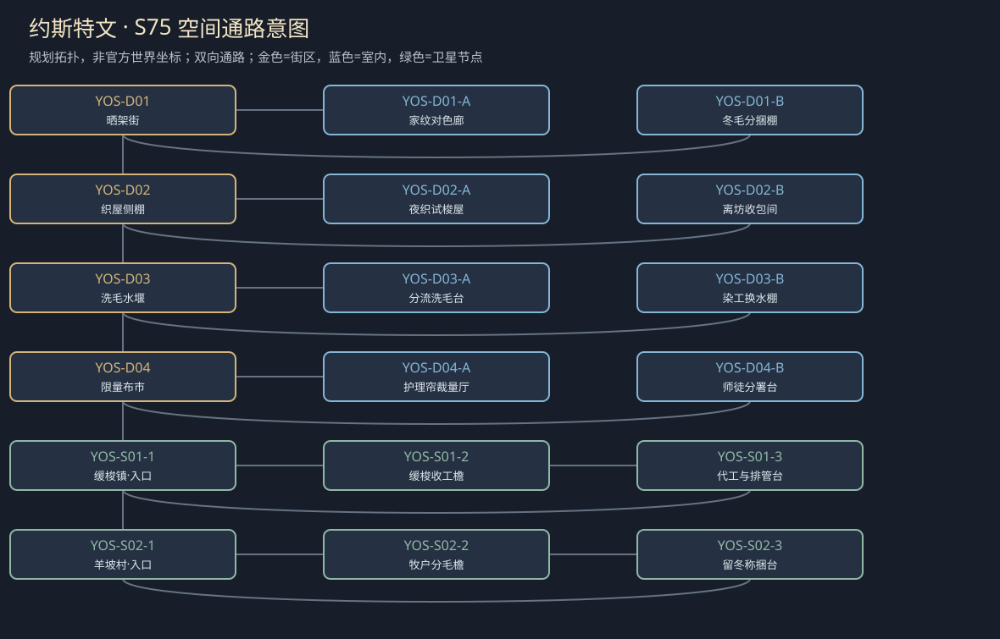

# 聚落_YOS_约斯特文

> [!info] 范围
> S63原创规划。大城/城镇/村庄标签表示本Mod内容密度，不替原作确认规模。内部建筑及卫星位置待技术小样核实；概念图不代表可玩地图。

**主题**：温暖织物里，谁被留在了背面。

**基线**：[[地点基线_约斯特文]]。原作事实、讲述者观点与原创现代街区分开。

## 城市气质与空间

羊毛工序的窄织屋、晒架和细颜色条，非已证实亚麻产业；冷风压着披料。

织屋街与洗毛水路构成不同视线，夜访人物在外工作棚不擅闯原宅。

**经济压力**：有限羊毛与织造，帐篷料不是军事身份；原作者籍贯不变为军镇。

## 街区、建筑与任务用途

|节点|地点与用途|相关行动|
|---|---|---|
|YOS-D01|晒架街：工序来源与染记。A：家纹对色廊；B：冬毛分捆棚；各有回本街区的出口。|[[台本_CM-YOS_最后一匹家纹]] · [[台本_CS-YOS-01_冬毛的最后一捆]]；翻看已授权样布，区分织、染和署名；分署可以保旧家纹，不要求证明师傅从无功劳。 点有限可售量，认可高价同时写出卖冬料者的具体损失；留料不要求玩家采满羊毛。|
|YOS-D02|织屋侧棚：夜班与迁居。A：夜织试梭屋；B：离坊收包间；各有回本街区的出口。|[[台本_CM-YOS_最后一匹家纹]] · [[台本_CS-YOS-02_徒弟要走的那天]]；核徒弟尚欠一单多少工，独立改法归谁；有限欠款可以偿，不把教养费无限追加。 归还本人路费或协商有限抵债，续作和离开分别问；玩家不给师傅买回其人身。|
|YOS-D03|洗毛水堰：污水与既有水权。A：分流洗毛台；B：染工换水棚；各有回本街区的出口。|[[台本_CS-YOS-03_水堰上的颜色]]；比对谁何时排何物，不凭颜色把全部迁来染工归罪；风险未知就保留未知。 定限时停排、独立处理或改班，写明责任工班；无涉工人不为证明清白交家庭住址。|
|YOS-D04|限量布市：普通帐篷与护理帘。A：护理帘裁量厅；B：师徒分署台；各有回本街区的出口。|[[台本_CM-YOS_最后一匹家纹]] · [[台本_CS-YOS-01_冬毛的最后一捆]]；按用途分料；帐篷单和护理帘不能用同一卷各自报足数。 选家纹分署、独立牌或有限授权旧名，离坊者已做工钱照付；付款不使未来技术归属永久转移。|

## 周边聚落

- [[聚落_YOS-S01_缓梭镇]]：季工与原工户；来者技术被写成无名代工。
- [[聚落_YOS-S02_羊坡村]]：有限牧户与冬衣需求；卖料与留冬毛。

## 地域主线与支线

[[台本_CM-YOS_最后一匹家纹]]：把来源、离乡与有限保暖需求分开，不让温暖等于服从家族。

- [[台本_CS-YOS-01_冬毛的最后一捆]]：外客要买本村全部余毛，牧户说这正好证明村富了。
- [[台本_CS-YOS-02_徒弟要走的那天]]：师傅藏徒弟路费，称教养费必须全还才许走。
- [[台本_CS-YOS-03_水堰上的颜色]]：下游以新染色水拒所有迁来染工。

## 人物与关系

- [[人物_YOS-NPC-TAY_塔雅·梭]]：师傅；希望徒弟接家印，不能接受她只想带自己的名字走。
- [[人物_YOS-NPC-TIN_缇娜·染]]：移居染工；需要衣料也怕署名被旧雇主找到。

## 日夜、服务、危险与回程

白天普通工作间开放、傍晚侧室会面；夜间保入口与有限短宿，不把NPC缺席变永久卡关。每城只新设一个普通有偿服务班，一批案件结束前不刷新库存；支线能改价格、授权范围或工期，不能凭声望无限抽物资。危险段独立警示、保已验旁路；谈崩、停工、负声望不关闭双向回程。城市原生商店、原主线与声望服务照旧，各新服务不能冒称原角色官署授权。

## 接入旧任务与跨城后果

原料、工艺署名与匿名患者记录互映；不把城镇只写成一次送布任务。

[[台本_N14_可以回去的路]] · [[台本_SQ06_抄本的背面]] · [[台本_SQ07_药不是赎罪券]] · [[台本_DT09_药师指认的草]]

[[城市篇章与跨区域任务网]]记录具体回执和回应；城市收束不以本城所有支线完成为条件。[[城市与聚落设计总索引]] · [[城市设计与原作避让审查]]

<!-- CITY-ART-S74:BEGIN -->
## 原素材参考概念（S74）

上方是代表性核心街区，下方按卫星ID排列周边构图；不是整座城市总平面。 以用户原素材的材质、轮廓和相机为参考生成；人物、场景组合、灯光/季节属于Mod美术提案，不证明原作地理和阵营。来源、任务对应和制作限制见[[原素材参考与城市概念图]]。
<!-- CITY-ART-S74:END -->

<!-- CITY-TASK-ART-20261012:BEGIN -->
## 任务场所概念图（2026-10-12）

[[约斯特文任务场所概念与台本映射]]说明A—F的任务、空间与制作约束。面板不是任务顺序或官方相邻关系；画中人物、库存和门仅为原创构图，未实现交互。
<!-- CITY-TASK-ART-20261012:END -->

<!-- CITY-SPACES-S75:BEGIN -->
## 任务空间细化（S75）

[[空间_YOS_约斯特文]]列出本地域的独立室内、观察物与可执行交互、权限替代和安全回程；[[任务空间与地点关联审查]]记录逐任务地点修订。已有方法、证据和奖励所有者保持，各室内不是新必访清单。

<!-- CITY-SPACES-S75:END -->

当前冶炼／羊毛两地逐角色对白、共同采购人及实际去留见[[斯孔弗特与约斯特文人物演出审查]]；S80为原创初稿，不是已运行任务。

<!-- SERVICE-REGISTRY-S90:BEGIN -->
## 本城服务与信任（S90）

本城普通有偿服务班：**素面染整与织期登记班**（Plain Dyeing and Loom-Queue Desk，经办：塔雅·梭）；范围与库存见[[城市服务班与有限库存]]，档位语义见[[城镇声望与信任系统]]，人物细描见[[人物细描与随身物]]。
<!-- SERVICE-REGISTRY-S90:END -->
