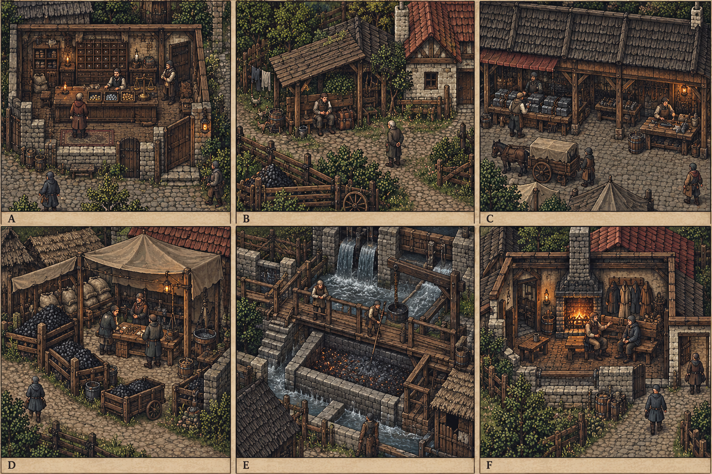

# 台本_CS-SKO-01_炭背的预付款

地点：[[聚落_SKO_斯孔弗特]]。主题：炉火续着，家里却有人一直在等赎金。

**需要**：炭工发现同笔工钱被说既是赎金也是炉料预款。

**转折**：会计擅将两份收入写同袋，不是炭工必须忠诚就多干一班。

## 入口与依赖

到本地入口得知实际事件；接受、旁观、拒绝均可。拒绝只暂停本案，原生服务/晶石主线保持。无跨城硬前置；现场固定基础线索足够进入。

## 场次与对白（S80当前稿）

以下替换S63三句询问模板，模型中的stages只保留原地理骨架。场景是可复入的对白素材，不是一口气自动播放的独白；玩家可先到后场看固定物，未获信息改用询问，不预知秘密。每句只在说话者存活、在场且具该句来源时显示。私下场另问授权；不生成第二个同名角色凑场。

### 场1：被许过两次的一袋

位置 `SKO-D01-A`；所属原场节点 `SKO-D01`。

**调度**：工棚将已做班与未做炉料约并列，同袋不开两份完成；古烈可拒未来续工，工资事实不受忠诚影响。

**知情边界**：布岚知道本班炭份与真实到款，不从下一炉预计收入填现钱。

[[人物_SKO-NPC-GOREN_古烈]]：「我做过的写工钱，家里又听这袋替他们付赎金。是谁把同一袋叫了两声？」

[[人物_SKO-NPC-NIS_妮莎·炉]]：「是我并过一部分。我怕只等，原来写得像两边都已经给了。」

[[人物_SKO-S01-NPC_布岚]]：「没烧的炭不能先挣两笔。开炉要另一份钱，缺就认缺。」

玩家：「这袋先答给了谁？别让古烈做过的一班，变成还得白做下一班。」

[[人物_SKO-NPC-GOREN_古烈]]：「我能关心没回的人，也要我做过那班。别逼我只剩一种在乎。」

**玩家可选询问与现场行动**：

- `CS-SKO-01-S1-cash` 「哪班已做过？这袋真正到过多少？」：`inspect`，[[人物_SKO-NPC-NIS_妮莎·炉]]回应「原袋多少只记多少，不挪未到赎约回来写成已补。」。
- `CS-SKO-01-S1-next` 「如果下一班有钱，你还愿意来吗？」：`ask`，[[人物_SKO-NPC-GOREN_古烈]]回应「等看新班资金，不拿旧欠逼我先答应。」。
- 「先停在这里」：关闭会话，保已核事实，不代缺席者答应、不写resolve或paid。

ask只获此人允许说的范围；inspect须实际完成对应安全观察且有权限，没看过不能抢先念核验答复。preview只展开已有方法条款，pause只关闭。以上都不提交解决方法、不把口头愿意写成款/人/物已到。

### 场2：炭份尚未出灶

位置 `SKO-S01-3`；所属原场节点 `SKO-S01-3`。

**调度**：炭背预付台列真实份额及授权，妮莎自有资产只按实际可售算；不能把弟弟的劳作作抵押。

**知情边界**：布岚认本案份，不代表所有工人准其款；缺额仍缺，不用账面重命名制造炭。

[[人物_SKO-S01-NPC_布岚]]：「这份还在棚，卖还是烧只能选实际一边，别两张纸都叫用了。」

[[人物_SKO-NPC-NIS_妮莎·炉]]：「自有这点能补，补不满的我认。不能把别人料份也叫我家的资产。」

[[人物_SKO-NPC-GOREN_古烈]]：「先封拆用途，或退未做的单，我都要实际到旧工资。」

玩家：「赎款缺的那份，找原来有权改约的人谈。工人拿回工资，不等于替家属答了。」

[[人物_SKO-S01-NPC_布岚]]：「退单会少一份生产。怕少真怕，不让原授权因为怕改成空白。」

**玩家可选询问与现场行动**：

- `CS-SKO-01-S2-authority` 「每份是谁的？谁准你替他们处置？」：`inspect`，[[人物_SKO-S01-NPC_布岚]]回应「我保管不等于我能替每户准赎金，未准的份不拿去抵。」。
- `CS-SKO-01-S2-refund` 「拆开保管和退掉未做的单，各会少掉什么？」：`preview`，[[人物_SKO-NPC-NIS_妮莎·炉]]回应「开炉延后与少单各留成本，不把一条写成谁也没损失。」。
- 「先停在这里」：关闭会话，保已核事实，不代缺席者答应、不写resolve或paid。

ask只获此人允许说的范围；inspect须实际完成对应安全观察且有权限，没看过不能抢先念核验答复。preview只展开已有方法条款，pause只关闭。以上都不提交解决方法、不把口头愿意写成款/人/物已到。

### 场3：旧欠不等新愿意

位置 `SKO-D02-A`；所属原场节点 `SKO-D02`。

**调度**：寄柜实际封拆或退款后再确认，家属赎约独立待议；同份工资只结一次。

**知情边界**：桑勒只给真退款状态，不给未归者保证；工人拒续工不回收已做工资。

[[人物_SKO-NPC-SALER_桑勒]]：「寄约那边还要另谈。这里款退哪笔，我只答到真实那笔。」

[[人物_SKO-NPC-GOREN_古烈]]：「先还做过的。以后肯来哪班再问，不替我写成已经愿意所有班。」

[[人物_SKO-NPC-NIS_妮莎·炉]]：「账少一种能讲圆的办法，我还得认谁的袋归谁。」

玩家：「哪笔付了就算哪笔。没到手的还欠，别让一句和解替你们把它清掉。」

[[人物_SKO-S01-NPC_布岚]]：「这袋拆过，下一案也不能把拆完的各份再合成一袋可用总数。」

**玩家可选询问与现场行动**：

- `CS-SKO-01-S3-settle` 「旧工资真到手了多少？还有哪笔欠着？」：`inspect`，[[人物_SKO-NPC-GOREN_古烈]]回应「少哪笔还留欠，拿到一部分不说全额收妥。」。
- `CS-SKO-01-S3-ransom` 「家属的赎约，得找谁重新谈？」：`ask`，[[人物_SKO-NPC-SALER_桑勒]]回应「本人或合法限权人逐笔准，不用工人这次拿工资就替家属答已经归人。」。
- 「先停在这里」：关闭会话，保已核事实，不代缺席者答应、不写resolve或paid。

ask只获此人允许说的范围；inspect须实际完成对应安全观察且有权限，没看过不能抢先念核验答复。preview只展开已有方法条款，pause只关闭。以上都不提交解决方法、不把口头愿意写成款/人/物已到。

## 可执行方案与回访

### a：封款拆用途

**实际行动**：中立柜封已到账款按原授权分，赎金不足用会计自有有限资产补。

**代价**：开炉延后

**地方结果**：CM-SKO repay需独立炉料资金，DT01同笔抵押守卫复用。

**本方法实际门槛**：真实已到款按各自原授权中立封拆，未准部分不挪，缺赎款只核妮莎自有有限资产；独立炉料资金缺则延后，同笔不两次抵押，不以归人劳力补。

**执行与提交**：逐项列出已核事实、本人范围、真实可用钱/料/班次及未付欠项 → 单独预览代价 → 玩家二次确认 → 对应实际交接/安全处置发生后提交本案唯一方法。缺一项即保pending，不捏造到账。预览可退，已结案不显示重选。

**实际完成后分角色回访**（人不在或死亡时停本人句；同意范围改变只影响未来）：

[[人物_SKO-NPC-GOREN_古烈]]：「袋里有多少就算多少。没还全的还欠，不让我拿一张封柜图当工资。」

[[人物_SKO-NPC-NIS_妮莎·炉]]：「我自己的补了这段，不让以后的炉替我先补一段不存在的。」

### b：退单保工资

**实际行动**：退未做炉料约，实际到账优先已做工资，赎约另与家属重谈。

**代价**：少生产订单

**地方结果**：炭工可拒续做，不自动复活未归人。

**本方法实际门槛**：真实退未做炉料约并实结已做工资，赎约另与有权家属重谈；未退欠项pending，炭工可拒续做，不写未归者已到或复活。

**执行与提交**：逐项列出已核事实、本人范围、真实可用钱/料/班次及未付欠项 → 单独预览代价 → 玩家二次确认 → 对应实际交接/安全处置发生后提交本案唯一方法。缺一项即保pending，不捏造到账。预览可退，已结案不显示重选。

**实际完成后分角色回访**（人不在或死亡时停本人句；同意范围改变只影响未来）：

[[人物_SKO-S01-NPC_布岚]]：「少了一单，炭没凭空消失，也没再预赚成两笔。」

[[人物_SKO-NPC-GOREN_古烈]]：「旧班钱结了，我下回肯不肯来仍能答不。」

## 状态、资源与奖励

`resolve_CS_SKO_01` 初值none，仅实际处置并二次确认后写一个方案；打开菜单、读纸、关闭均不写。`paid_CS_SKO_01` 由本案所有者记录。费用先列明真实来源、数量与已有抵押，不能用一笔钱/一床/一批材料承诺两次。纯传话不奖励；本案唯一剧情结算一次，补偿款归当事人、工钱归实际工作者，玩家只领取已约定有限调查费。金额和具体库存尚待经济核算，不标完成。

## 中断、缺席与不同到达顺序

死亡优先：停止该人新对白，保事前有限陈述与不可刷新的现场痕；替代代理不得伪造新同意。拒绝或失踪时，基础安全/独立寄存替代保持，公开合约分支可暂停。物件误卖由原固定柜的限权副件或现场双记号复核；不复制唯一奖励。已完成任务只增加未来回应，不能改选、重复领款或回滚伤害。强制控制历史与后续补救分记。不同路线是否可用逐次重算，未授权NPC不会知道外城秘密。

## 本案中断与到达顺序（S80）

**死亡**：经手者死亡保固定原授权与已做工资，未知家属新赎意愿不补；工人死亡已欠归合法限权处理，不领同项两次。

**拒绝／缺席**：拒续工不扣旧工资，拒家属新赎条件不取消普通炉料核验；不同意挪款者保本人份。

**先做本案**：回主章的是实封拆或退单的有限结果，不让同笔作为赎金又开炉款；不另发旧DT01奖励。

**城市章已结后做**：主章已缩产或售坯先扣实际已偿同项，本案只处未结欠项和新单，不能同笔重复退给各案。

## 有限回执的具体回应（S80）

必须来源方法实际完成、有可核回执且本人允许本次转述；接收者存活/在场/准接收。死亡、拒绝、保密、缺席优先，未收回执不演对应台词，不倒推出其它家庭秘密。接受回执不发奖、不移库存、不替当事人新签。目标未结只调整以后可做的有限行动；已结仅演晚到回访，不重选resolve、不改paid、不退回伤害史或N17快照。

### MG-CS-SKO-01-repay

**本次可知**：有限铁工仍供工具，但不假定全镇军工正常。。

**本案未结时**：支线封拆现存未结款或退未做单，主章已偿同项扣去；缩产后的新炉须独立料款。

[[人物_SKO-S01-NPC_布岚]]：「大炉已经少了那班。小修炉要的料留着，不拿它又许给这份新单。」

**本案已结时，仅下一次回应**：

[[人物_SKO-S01-NPC_布岚]]：「分期还过的不是第二袋预款。以后想再烧，问现钱和谁肯来，不问谁该体谅谁。」

### MG-CS-SKO-01-sale

**本次可知**：快速解决工人款，技术供应需另签有限量。。

**本案未结时**：支线只核未结工资／炉单及真实余款，扣已售坯和已偿同项，续班独立授权。

[[人物_SKO-NPC-GOREN_古烈]]：「卖坯退到我手的先记。我没多领一份，也没因为拿回工资就答应替赎约再干一班。」

**本案已结时，仅下一次回应**：

[[人物_SKO-NPC-GOREN_古烈]]：「旧款办过的仍办过。新的少单与欠项另问，不再把已经卖掉的坯放进这袋估价。」

周边场景：[[聚落_SKO-S01_炭背镇]]。

## 交叉影响

- `LX-CS-SKO-01-a` [[台本_CS-SKO-01_炭背的预付款]]（a）→ [[台本_CM-SKO_第二次赎回]]：地域章下一次会面承认此具体地方结果；方案仍核本人授权、真实费用，不以全部支线清单解锁。；回执仅含「CM-SKO repay需独立炉料资金，DT01同笔抵押守卫复用。」。
- `LX-CS-SKO-01-b` [[台本_CS-SKO-01_炭背的预付款]]（b）→ [[台本_CM-SKO_第二次赎回]]：地域章下一次会面承认此具体地方结果；方案仍核本人授权、真实费用，不以全部支线清单解锁。；回执仅含「炭工可拒续做，不自动复活未归人。」。
- `MG-CS-SKO-01-repay` [[台本_CM-SKO_第二次赎回]]（repay）→ [[台本_CS-SKO-01_炭背的预付款]]：已经执行「会计认挪款，缩产分期偿公款」：有限铁工仍供工具，但不假定全镇军工正常。。本案不能重新借走已付/已占的那笔资源；「封款拆用途」采用现存有限本地安排，「退单保工资」仍可独立执行，额外费用另外列账；不能替本人选择或改本案旧结果。；回执仅含「有限铁工仍供工具，但不假定全镇军工正常。」。
- `MG-CS-SKO-01-sale` [[台本_CM-SKO_第二次赎回]]（sale）→ [[台本_CS-SKO-01_炭背的预付款]]：已经执行「售非必需旧坯，先退公款」：快速解决工人款，技术供应需另签有限量。。本案不能重新借走已付/已占的那笔资源；「封款拆用途」采用现存有限本地安排，「退单保工资」仍可独立执行，额外费用另外列账；不能替本人选择或改本案旧结果。；回执仅含「快速解决工人款，技术供应需另签有限量。」。

[[城市篇章与跨区域任务网]] · [[城市与聚落设计总索引]] · [[网状叙事与条件对话规范]]

<!-- CITY-TASK-ART-20261012:BEGIN -->
## 任务场所概念图（2026-10-12）

[[斯孔弗特任务场所概念与台本映射]]说明A—F的任务、空间与制作约束。面板不是任务顺序或官方相邻关系；画中人物、库存和门仅为原创构图，未实现交互。
<!-- CITY-TASK-ART-20261012:END -->

<!-- CITY-SPACES-S75:BEGIN -->
## 任务空间细化（S75）

[[空间_SKO_斯孔弗特]]列出本地域的独立室内、观察物与可执行交互、权限替代和安全回程；[[任务空间与地点关联审查]]记录逐任务地点修订。已有方法、证据和奖励所有者保持，各室内不是新必访清单。

|场次|街区／聚落节点|可选空间|
|---|---|---|
|1|`SKO-D01`|`SKO-D01-A` 分炉点炭棚 / `SKO-D01-B` 停班暖手屋|
|2|`SKO-S01-3`|`SKO-S01-3` 预付炭份台|
|3|`SKO-D02`|`SKO-D02-A` 双承诺兑筹柜 / `SKO-D02-B` 归人私谈室|

观察仅支持该场既定反转，不自动写resolve、私下授权或物资到位；若物证不足则保留未知或用已有独立方案，不把所有房间搜一遍当进度。

**当地住户**：[[人物_SKO-S01-NPC_布岚]]，炭份保管人。现场生活话：「没烧的炭，不能先替我们挣两笔。」这里只作本人的有限立场与场面素材，不替台本当事人同意、发任务奖或提供外城秘密。
<!-- CITY-SPACES-S75:END -->

当前冶炼／羊毛两地逐角色对白、共同采购人及实际去留见[[斯孔弗特与约斯特文人物演出审查]]；S80为原创初稿，不是已运行任务。

<!-- RX-HEADER-S141:BEGIN -->
> [!note] R／X（S141 头部补齐）
> R（方法）：`a` 封款拆用途 · `b` 退单保工资
> X（后续）：写入键：`paid_CS_SKO_01`、`resolve_CS_SKO_01`；回访：古烈、妮莎·炉、布岚
> 本块由脚本内既有小节与键名生成，不新增设定、不改动既有文字。
<!-- RX-HEADER-S141:END -->

<!-- OPT-S201:BEGIN -->
## S201主线回流：HX21（L2）

**来源方案**：本案真实方法`a`，即`resolve_CS_SKO_01=a`；须实际做完，预览和口头答应不算。

**送达条件**：妮莎·炉活着、在场、肯谈，并亲口准了这一条，话才能带过去；牵涉别人的东西、用料或收不收，另问有权的人。人死了、不在、不肯或反悔，就不添新话，也不补造许可；旧回执照原来的权限留底。

**连接**：回流N13，级别L2；具体接收步骤、代价变化和失效出口只看[[城市主线回流S201#HX21]]。话没带到不碍主线推进；本案资源、奖励不因回执再算一遍，已结的选择和伤害留史，不新增NE，不改K01—K04与N17快照。

**HX21-L01｜妮莎·炉**：「封着的那份不是余钱。你拿去问账可以，拿去付另一件事，就又动了别人的那份。」
<!-- OPT-S201:END -->
