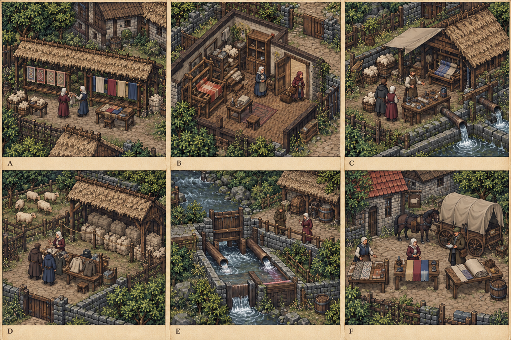

# 台本_CS-YOS-01_冬毛的最后一捆

地点：[[聚落_YOS_约斯特文]]。主题：温暖织物里，谁被留在了背面。

**需要**：外客要买本村全部余毛，牧户说这正好证明村富了。

**转折**：所谓余量包含已答给患者家的冬料，签字者想替全村提升价格。

## 入口与依赖

到本地入口得知实际事件；接受、旁观、拒绝均可。拒绝只暂停本案，原生服务/晶石主线保持。无跨城硬前置；现场固定基础线索足够进入。

## 场次与对白（S80当前稿）

以下替换S63三句询问模板，模型中的stages只保留原地理骨架。场景是可复入的对白素材，不是一口气自动播放的独白；玩家可先到后场看固定物，未获信息改用询问，不预知秘密。每句只在说话者存活、在场且具该句来源时显示。私下场另问授权；不生成第二个同名角色凑场。

### 场1：大单上的余字

位置 `YOS-D01-B`；所属原场节点 `YOS-D01`。

**调度**：尤尔拿全村余毛报价，呼蕾拿早先冬料绳筹；只查本案物料范围，不向外商交患者病史。

**知情边界**：牧户只准自家实际份，患者家承诺需实核，外客并无全村采购权。

[[人物_YOS-S02-NPC_尤尔]]：「一笔大单，别人就不再说村里穷。我说余量都能卖。」

[[人物_YOS-NPC-HURE_呼蕾]]：「这一捆，前几天答应给我家的。写个余字，就成了没人要的？」

[[人物_TRADE-NPC-LIQUI_莉葵]]：「我想买多，不让你的签字替每户都准了。也不因为写患者就能拿他们病史讲价。」

玩家：「别人答过留冬，你这里怎么成了余毛？先看每捆是谁的。」

[[人物_YOS-S02-NPC_尤尔]]：「我想看起来阔，拿别人冷的那份去添阔了。这句我认，不是从此就不想赚。」

**玩家可选询问与现场行动**：

- `CS-YOS-01-S1-claims` 「这捆毛真在吗？原来答给了哪户？」：`inspect`，[[人物_YOS-NPC-HURE_呼蕾]]回应「看准这笔物料，不给你们整户病史才能认已经答给我。」。
- `CS-YOS-01-S1-authority` 「尤尔，哪些份是你自己真能答应卖的？」：`ask`，[[人物_YOS-S02-NPC_尤尔]]回应「自家真余的，不再替全村把全部冷天都答好了。」。
- 「先停在这里」：关闭会话，保已核事实，不代缺席者答应、不写resolve或paid。

ask只获此人允许说的范围；inspect须实际完成对应安全观察且有权限，没看过不能抢先念核验答复。preview只展开已有方法条款，pause只关闭。以上都不提交解决方法、不把口头愿意写成款/人/物已到。

### 场2：拿来换的能穿吗

位置 `YOS-S02-3`；所属原场节点 `YOS-S02-3`。

**调度**：羊坡称台对照有限普通衣与毛，昂朵安全验尺寸和磨损；家属可拒不合用替代，不以交换好意逼接。

**知情边界**：采购人的实有旧衣按现场量，已运走的不能再借别案写在这；适用报告不是保证治病。

[[人物_YOS-NPC-ONDO_昂朵]]：「这件厚，但这个口破。修要一班，不能账写暖衣就当人现在暖。」

[[人物_YOS-NPC-HURE_呼蕾]]：「家里用不上的，我就不收。不是瞧不起你们送的普通东西。」

[[人物_TRADE-NPC-LIQUI_莉葵]]：「普通衣换有限毛，我也少利润。库存若已经给另一单，就不摆两次。」

[[人物_YOS-S02-NPC_尤尔]]：「留底量少那笔体面大单；换衣要验成本，不能我一口说全村都愿。」

玩家：「可以留原料，也可以换真合用的衣服。她不肯收，别拿你的好意逼她。」

**玩家可选询问与现场行动**：

- `CS-YOS-01-S2-fit` 「这几件真能用吗？修好要等多久？」：`inspect`，[[人物_YOS-NPC-ONDO_昂朵]]回应「只验这几件准用范围，不替家属答愿不愿交换。」。
- `CS-YOS-01-S2-preview` 「先留冬毛或拿合用衣服换，各会少哪份？」：`preview`，[[人物_TRADE-NPC-LIQUI_莉葵]]回应「先留原承诺，再列违约款谁真实出，不用另一城未到的钱凑现款。」。
- 「先停在这里」：关闭会话，保已核事实，不代缺席者答应、不写resolve或paid。

ask只获此人允许说的范围；inspect须实际完成对应安全观察且有权限，没看过不能抢先念核验答复。preview只展开已有方法条款，pause只关闭。以上都不提交解决方法、不把口头愿意写成款/人/物已到。

### 场3：底量不是剩下的

位置 `YOS-D04-A`；所属原场节点 `YOS-D04`。

**调度**：裁量厅只确认真交冬料或合用替代，有限帘料和帐料不共占同匹；普通服务不要求家属感谢。

**知情边界**：同款、同毛、同衣只占一次，外地需求不能无限扣本地冬料。

[[人物_YOS-NPC-HURE_呼蕾]]：「这份东西，屋里用得上我才收。远城那张护理采购单，可不能先拿来取暖。」

[[人物_YOS-S02-NPC_尤尔]]：「留村里的不是卖完剩下，是我先答过的那份。」

[[人物_TRADE-NPC-LIQUI_莉葵]]：「没有售走的余量仍按实报。上次答采购，不是以后每次都默认全村准。」

玩家：「衣毛先真的交到，钱还缺的仍缺。下次的买卖别替这一户先答了。」

[[人物_YOS-NPC-ONDO_昂朵]]：「这一批裁过了，再来需要另看料；旧合格记录不多裁一张帘。」

**玩家可选询问与现场行动**：

- `CS-YOS-01-S3-reserved` 「留冬的到了哪户？外卖的实际走了几捆？」：`inspect`，[[人物_YOS-S02-NPC_尤尔]]回应「卖到的真几捆，不让少的一捆只从字上改成多了。」。
- `CS-YOS-01-S3-exchange` 「这几件你真愿收吗？是谁验过合用的？」：`inspect`，[[人物_YOS-NPC-HURE_呼蕾]]回应「我答的是这几件，不把一次换衣变成以后必须收你们所有替代。」。
- 「先停在这里」：关闭会话，保已核事实，不代缺席者答应、不写resolve或paid。

ask只获此人允许说的范围；inspect须实际完成对应安全观察且有权限，没看过不能抢先念核验答复。preview只展开已有方法条款，pause只关闭。以上都不提交解决方法、不把口头愿意写成款/人/物已到。

## 可执行方案与回访

### a：底量限售

**实际行动**：各户认冬料与实际份，有限对外销售，违约款按经手者资产核。

**代价**：外商少量、价格下降

**地方结果**：ASH护理与N14帐篷各有有限量，不能无限扣料。

**本方法实际门槛**：各户本人或合法限权人认冬底量与实有份，已承诺底料实际保留，外售仅未占有限余量；违约款按真实经手者有限资产办理，未退欠留，不无限供ASH/N14。

**执行与提交**：逐项列出已核事实、本人范围、真实可用钱/料/班次及未付欠项 → 单独预览代价 → 玩家二次确认 → 对应实际交接/安全处置发生后提交本案唯一方法。缺一项即保pending，不捏造到账。预览可退，已结案不显示重选。

**实际完成后分角色回访**（人不在或死亡时停本人句；同意范围改变只影响未来）：

[[人物_YOS-S02-NPC_尤尔]]：「少了那张大单，我还是想卖贵。这回先认村里已答过哪份，不拿别人冷来显阔。」

[[人物_YOS-NPC-HURE_呼蕾]]：「底料真在了，不是等远客卖完才叫我们的剩下。」

### b：替代交换

**实际行动**：外商自愿换已有普通衣与有限毛，质量实核，本村可拒不合需要衣。

**代价**：检查成本、商户利润少

**地方结果**：贸易互相承担而非强收采购。

**本方法实际门槛**：外商和各户自愿，以实有普通衣与有限毛交换，磨损、改制工时和质量实际核，家属可拒不合需要衣；实际交接才结，同衣同毛不两案承诺，无床/料纸上造资源。

**执行与提交**：逐项列出已核事实、本人范围、真实可用钱/料/班次及未付欠项 → 单独预览代价 → 玩家二次确认 → 对应实际交接/安全处置发生后提交本案唯一方法。缺一项即保pending，不捏造到账。预览可退，已结案不显示重选。

**实际完成后分角色回访**（人不在或死亡时停本人句；同意范围改变只影响未来）：

[[人物_TRADE-NPC-LIQUI_莉葵]]：「换的是现场这些，不是所有以后。账要跟实际衣毛走，不跟一句热心走。」

[[人物_YOS-NPC-HURE_呼蕾]]：「这几件合用，我收。以后送别的，得再问我。」

## 状态、资源与奖励

`resolve_CS_YOS_01` 初值none，仅实际处置并二次确认后写一个方案；打开菜单、读纸、关闭均不写。`paid_CS_YOS_01` 由本案所有者记录。费用先列明真实来源、数量与已有抵押，不能用一笔钱/一床/一批材料承诺两次。纯传话不奖励；本案唯一剧情结算一次，补偿款归当事人、工钱归实际工作者，玩家只领取已约定有限调查费。金额和具体库存尚待经济核算，不标完成。

## 中断、缺席与不同到达顺序

死亡优先：停止该人新对白，保事前有限陈述与不可刷新的现场痕；替代代理不得伪造新同意。拒绝或失踪时，基础安全/独立寄存替代保持，公开合约分支可暂停。物件误卖由原固定柜的限权副件或现场双记号复核；不复制唯一奖励。已完成任务只增加未来回应，不能改选、重复领款或回滚伤害。强制控制历史与后续补救分记。不同路线是否可用逐次重算，未授权NPC不会知道外城秘密。

## 本案中断与到达顺序（S80）

**死亡**：牧户或家属死亡只沿既有合法有限物料授权与承诺，不补全村售意；实际已占料保史，不复发同份。

**拒绝／缺席**：拒不合用衣保底量限售出口，外商拒交换不强收；拒露病史不取消原冬份，无全村签名硬门。

**先做本案**：回主章真实底量或替代交接，出口签未占段，不将主章帘料和冬毛各当完整一份。

**城市章已结后做**：主章已分料先扣真实已占，冬份本案仍逐户核；新报价用实际余量，不复发退款或造一匹布给每案。

## 有限回执的具体回应（S80）

必须来源方法实际完成、有可核回执且本人允许本次转述；接收者存活/在场/准接收。死亡、拒绝、保密、缺席优先，未收回执不演对应台词，不倒推出其它家庭秘密。接受回执不发奖、不移库存、不替当事人新签。目标未结只调整以后可做的有限行动；已结仅演晚到回访，不重选resolve、不改paid、不退回伤害史或N17快照。

### MG-CS-YOS-01-sharedmark

**本次可知**：护理帘与帐篷料可限量采购，来源不暴露家门。。

**本案未结时**：冬料支线扣主章已占帘／帐料后逐户核底量；技术来源回执不授家庭信息或全村卖权。

[[人物_YOS-NPC-HURE_呼蕾]]：「新来源写清是好事。答给我家的冬捆还得在，不能因为护理帘急，就把这捆也说已经多卖了。」

**本案已结时，仅下一次回应**：

[[人物_YOS-NPC-HURE_呼蕾]]：「那批帘与冬份怎么交的照记。下次要换哪件仍问我，我的家门没跟那枚小标一起出售。」

### MG-CS-YOS-01-independent

**本次可知**：独立来源多一条，商业标分开无需亲情和解。。

**本案未结时**：冬料支线使用独立普通来源但不复制原布存量，有限底量或自愿交换仍独立核。

[[人物_YOS-S02-NPC_尤尔]]：「她分开接单，我也少一笔能借家纹抬价的货。留冬的先认，不拿她的新标替全村多签。」

**本案已结时，仅下一次回应**：

[[人物_YOS-S02-NPC_尤尔]]：「独立的标还在，旧批卖到哪份照留。想再赚一笔，要先看别户实际愿卖哪捆。」

周边场景：[[聚落_YOS-S02_羊坡村]]。

## 交叉影响

- `LX-CS-YOS-01-a` [[台本_CS-YOS-01_冬毛的最后一捆]]（a）→ [[台本_CM-YOS_最后一匹家纹]]：地域章下一次会面承认此具体地方结果；方案仍核本人授权、真实费用，不以全部支线清单解锁。；回执仅含「ASH护理与N14帐篷各有有限量，不能无限扣料。」。
- `LX-CS-YOS-01-b` [[台本_CS-YOS-01_冬毛的最后一捆]]（b）→ [[台本_CM-YOS_最后一匹家纹]]：地域章下一次会面承认此具体地方结果；方案仍核本人授权、真实费用，不以全部支线清单解锁。；回执仅含「贸易互相承担而非强收采购。」。
- `MG-CS-YOS-01-sharedmark` [[台本_CM-YOS_最后一匹家纹]]（sharedmark）→ [[台本_CS-YOS-01_冬毛的最后一捆]]：已经执行「来源分署，家纹仅代表工序」：护理帘与帐篷料可限量采购，来源不暴露家门。。本案不能重新借走已付/已占的那笔资源；「底量限售」采用现存有限本地安排，「替代交换」仍可独立执行，额外费用另外列账；不能替本人选择或改本案旧结果。；回执仅含「护理帘与帐篷料可限量采购，来源不暴露家门。」。
- `MG-CS-YOS-01-independent` [[台本_CM-YOS_最后一匹家纹]]（independent）→ [[台本_CS-YOS-01_冬毛的最后一捆]]：已经执行「分开工坊和家纹，徒弟独立接单」：独立来源多一条，商业标分开无需亲情和解。。本案不能重新借走已付/已占的那笔资源；「底量限售」采用现存有限本地安排，「替代交换」仍可独立执行，额外费用另外列账；不能替本人选择或改本案旧结果。；回执仅含「独立来源多一条，商业标分开无需亲情和解。」。

[[城市篇章与跨区域任务网]] · [[城市与聚落设计总索引]] · [[网状叙事与条件对话规范]]

<!-- CITY-TASK-ART-20261012:BEGIN -->
## 任务场所概念图（2026-10-12）

[[约斯特文任务场所概念与台本映射]]说明A—F的任务、空间与制作约束。面板不是任务顺序或官方相邻关系；画中人物、库存和门仅为原创构图，未实现交互。
<!-- CITY-TASK-ART-20261012:END -->

<!-- CITY-SPACES-S75:BEGIN -->
## 任务空间细化（S75）

[[空间_YOS_约斯特文]]列出本地域的独立室内、观察物与可执行交互、权限替代和安全回程；[[任务空间与地点关联审查]]记录逐任务地点修订。已有方法、证据和奖励所有者保持，各室内不是新必访清单。

|场次|街区／聚落节点|可选空间|
|---|---|---|
|1|`YOS-D01`|`YOS-D01-A` 家纹对色廊 / `YOS-D01-B` 冬毛分捆棚|
|2|`YOS-S02-3`|`YOS-S02-3` 留冬称捆台|
|3|`YOS-D04`|`YOS-D04-A` 护理帘裁量厅 / `YOS-D04-B` 师徒分署台|

观察仅支持该场既定反转，不自动写resolve、私下授权或物资到位；若物证不足则保留未知或用已有独立方案，不把所有房间搜一遍当进度。

**当地住户**：[[人物_YOS-S02-NPC_尤尔]]，羊坡年轻牧户。现场生活话：「我想卖得贵，不想让他们冷着替我显得阔。」这里只作本人的有限立场与场面素材，不替台本当事人同意、发任务奖或提供外城秘密。
<!-- CITY-SPACES-S75:END -->

当前冶炼／羊毛两地逐角色对白、共同采购人及实际去留见[[斯孔弗特与约斯特文人物演出审查]]；S80为原创初稿，不是已运行任务。

<!-- RX-HEADER-S141:BEGIN -->
> [!note] R／X（S141 头部补齐）
> R（方法）：`a` 底量限售 · `b` 替代交换
> X（后续）：写入键：`paid_CS_YOS_01`、`resolve_CS_YOS_01`；回访：尤尔、呼蕾、莉葵
> 本块由脚本内既有小节与键名生成，不新增设定、不改动既有文字。
<!-- RX-HEADER-S141:END -->

<!-- OPT-S201:BEGIN -->
## S201主线回流：HX22（L2）

**来源方案**：本案真实方法`a`，即`resolve_CS_YOS_01=a`；须实际做完，预览和口头答应不算。

**送达条件**：呼蕾活着、在场、肯谈，并亲口准了这一条，话才能带过去；牵涉别人的东西、用料或收不收，另问有权的人。人死了、不在、不肯或反悔，就不添新话，也不补造许可；旧回执照原来的权限留底。

**连接**：回流N14，级别L2；具体接收步骤、代价变化和失效出口只看[[城市主线回流S201#HX22]]。话没带到不碍主线推进；本案资源、奖励不因回执再算一遍，已结的选择和伤害留史，不新增NE，不改K01—K04与N17快照。

**HX22-L01｜呼蕾**：「我们过冬那份先留下。余下够做几顶，就做几顶，井口不能把村里每条毯都叫成余料。」
<!-- OPT-S201:END -->
