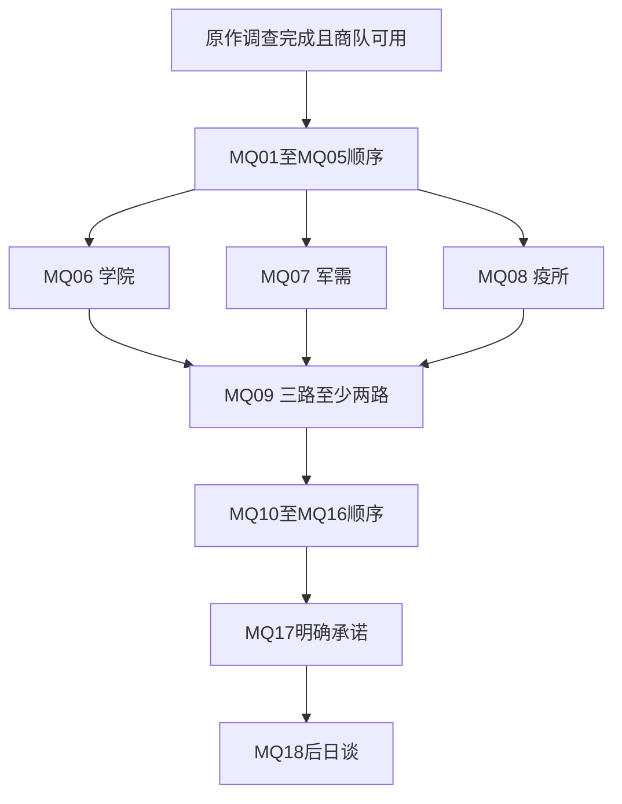

# 任务状态与依赖

<!-- NARRATIVE-S62:BEGIN -->
## S62网状叙事修订（2026-10-12，当前优先）

当前方案以[[网状叙事与条件对话规范]]、[[叙事交叉影响矩阵]]、[[人物弧光与关系转折]]为准；任务入口为[[任务台本总索引]]，本轮缺陷与修订在[[叙事逻辑校验与修订记录]]。下方S61场次与旧选择仅作素材／修订对照，不能无条件播完或同时实现两套菜单。全部仍是设计草稿，本轮没有改游戏包。
<!-- NARRATIVE-S62:END -->

## 当前完整台本状态（S61）

新N1—N18依赖、三路任二、恢复、支线入口与最终冻结位置统一见[[当前任务依赖与状态字典]]。全文见[[任务台本总索引]]。下方MQ图和旧开发键仅为历史；不会自动导入N任务或NE认证。N14只取得工具与回程，N15才验证隔离，N17安全台明确最终确认才冻结。

## 0.3当前状态优先

旧MQ01/MQ02退役，旧EAO键只保留兼容，不迁移为新任务完成。[[开篇_无钟之夜]]使用EAO_N1_stage=0..5、两处现场标记、计划与人物结果；只有两路线的实际执行后才能回访结案。独立前置、计划可改/执行后冻结及恢复见[[剧情重构与旧任务退役]]。下方18任务依赖是历史蓝图，静态可达不等于新任务依赖有效或游戏已实现。

## 状态字典

下表是大型扩展的**设计语义**，尚未整体映射到引擎真实变量。

大型扩展状态表仍属设计语义；MQ01小样已另用EAO独立键实现。0.1.6沿用EAO_MQ01=0/1/2与既有分支、E01及结算键，EAO_schema=2增加EAO_read_eao_letter/enclosure/receipt/copy。接取、登记只在实物交付成功后推进；读取三件原件且随身携带才可登记，旧状态补领不重置也不自动标为读过。具体恢复与验收见 [[信件物品与阅读驱动任务]]。

| 字段 | 类型/初值 | 写入规则 |
| --- | --- | --- |
| mq_done | 任务ID集合 / 空 | 主线事实结案后加入；不会因重访删除 |
| sq_stage | 链ID→A/B/C状态 | 阶段结案、失败与道德结果分开 |
| evidence | E01..E05→unknown/copied/verified | 登记原件来源及认证材料；不得只靠传闻升级 |
| gwynnel_state | unknown/rescued/cooperating/dead | MQ12决定；死亡不可刷新回生 |
| local_trust | F01..F08→-2..2 / 0 | 一次剧情结果有界写入；原版声望另行映射 |
| assent | MG/CO/GA→bool / false | 仅SQ01/02/03合规结案授予；已签可追溯 |
| neutral_pact | route/ferry/archive→bool / false | SQ04/05/06合规结案授予 |
| relief_sources | SQ03/SQ05/SQ07的集合 / 空 | 合规民生结案一次写入；civilian_supply=min(2,集合大小) |
| liability | undecided/accountable/settled | MQ13；私了不获得责任条款 |
| exchange_harm | bool / false | MQ11是否交出无辜者；不可用金币洗掉 |
| containment_ready | bool / false | MQ14取得工具；MQ15完成验证 |
| ending_intent | undecided/意向 | MQ16可改，不等于正式结局 |
| final_commit | bool / false | MQ17明确确认后冻结证据、承诺及救济结局快照 |
| ending | none/sealed/custody/distributed/seized | MQ17满足条件的实际操作 |
| shard_custody | 登记值 | 晶石唯一保管状态；真实原版表示待核验 |
| reward_claimed | task或instance ID集合 | 先登记、再一次性发奖 |
| civilian/safety/maintenance | 每原创地区0..3 / 1 | 只影响民用服务，不替代结局救济资格 |
| npc_state / dungeon_story_state | 固定实体状态 | 不由普通地牢刷新清空 |

命名 `civilian_supply` 表示一次性剧情救济资格，而区域 `supply` 表示日常普通供给，必须分别储存与显示，避免误刷。

## 依赖骨架

每个箭头只表达可作为依赖；汇合点按数量判断，不解释成必须三路全部完成。未做支路在MQ17前仍可完成。主线没有依赖后期支线才开放的唯一入口。

## 三路汇合与恢复

MQ06/07/08独立；任取两项都能到MQ09。若没做MQ08，MQ13以D08抄本+隔离营病例补核E04；不伪造MQ08完成，也不发其奖励。E02/E03未取齐会限制高级结局，仍可回去补。

事实目标与击杀目标分离：敌人早已死则现场物件证明目标；证人死则保留其记录，但副员不能无授权替死者新签条约。物件丢失用登记复抄；任何恢复不给第二件高价值可卖品。三方敌对仍有中立核验、普通补给和回程。

## 截止与承诺

主线没有隐藏全局倒计时。可选限时救援在玩家确认后开始，影响人命和地方结果，不删核心证据。MQ17之前可补证据、条约与救济；明确确认后使用冻结快照，未完支线以“承诺时未完成”记录，不能之后倒改结局。

若MQ17退出副本，可补普通物资继续；不能再提高冻结条件。玩家死亡、睡眠存档和重载遵循原版语义，设计不添加即时免死。

## 提交一致性

同一目标事件重复到达不得多发奖、多增信任或多算救人。证据先记录来源；任务提交验证全部前置和效果，再记唯一结算键。MQ01文书交付已有先发放成功再登记、失败撤销本轮新建物品的实现；大型扩展的保存事务及实际存读档仍待验证。

参见 [[主线任务索引]]、[[证据与结局]]、[[世界状态与商队]]。

## 0.2.0开发记录（2026-10-11）

新增封账仓与档案室两个独立房间及MQ02合法查档流程；新增许可、盐封货单、装箱记录、仓印对照四种原生可读文书。MQ01核对抄本阅读/携带前置、首次实际查档、三份档案阅读/携带提交和补领门槛分别检查，E01仍为copied；不新增金币/经验结算，不把旧渠线索视为MQ03已开放。原作世界格/房间/非EAO代码不修改。当前包与部署结果以验收报告为准，游戏内通达与读档仍待验证。详细状态、原素材引用与实施边界见 [[外港封账仓与原素材房间接入]]。

## 0.2.1测试入口（2026-10-11）

S55：用户要求可选择开启的便捷测试传送。默认关闭，通过角色附近原生测试向导点击开关，测试封账仓/档案室并返回首次出发点；不自动领取文书、完成任务或发放奖励。使用原版转场与保存接口，部署前核对报告和备份；实际运行仍待验证。开关、状态与回程规则见 [[可选测试传送与返回点]]。

## 0.2.2地图测试传送（2026-10-11）

S56：用户明确撤掉测试向导，要求F8开关、点击地图方块传送。0.2.2默认关闭，复用原生GUI聚焦与缩放/偏移坐标，源地点保存完成后提交目标世界格；地图显示开关状态。旧向导已退役，剧情NPC仍用点击对白；不自动发文书或任务奖励。操作、状态与验收边界见 [[可选测试传送与返回点]]。本节取代此前0.2.1向导操作说明，实际运行仍待验证。

