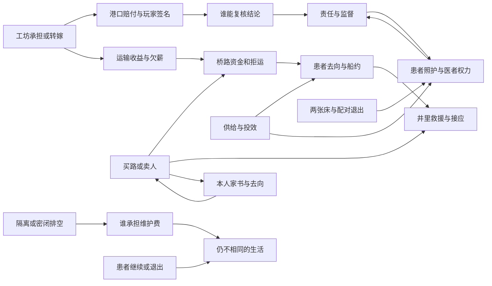

# 叙事交叉影响矩阵

当前82条边把实际方法与后续行动相连，全部Mod原创；已知、在场、授权与迟到重评规则见[[网状叙事与条件对话规范]]。这不是只在终局检查的好感表。

## 选定关系网

以下箭头表示条件影响，不是硬前置；双向影响可以在晚到消息的回访里发生，不形成任务依赖死环。

具体条件、独立解法、知识送达与延迟变化见下列X键。图不表示任一选择都会触发所有箭头，也不表示N13与SQ07可以反复完成刷资格。

## X01 N1 → N3

来源：[[台本_N1_无钟之夜]]；接收：[[台本_N3_听审前的灯]]。

条件：`{'resolve_N1': ['shelter']}`且目标已有限核验。场次：首次相关议题与后续回访。

变化：伊沃不出现在公开听审；玛拉提供自己见过家属的封存证词，不能用弟弟认罪替她免责。

**玛拉**：「我放走了那家人。这一句是我说的，不能再让伊沃替我签。」

顺序：目标未结案：重评可用路径；已结案：只追加新回应与合法补偿步骤，不回滚已执行选择。

## X02 N1 → N2

来源：[[台本_N1_无钟之夜]]；接收：[[台本_N2_灰堤没有墓碑]]。

条件：`{'resolve_N1': ['hearing']}`且目标已有限核验。场次：首次相关议题与后续回访。

变化：玛拉引荐的是可核临时担保柜；纳拉可以拒公开身份，不能把伊沃路线自动套给他。

**纳拉**：「他愿意去听审，不等于我也愿意。我这条腿今天连站起来都难。」

顺序：目标未结案：重评可用路径；已结案：只追加新回应与合法补偿步骤，不回滚已执行选择。

## X03 N1 → SQ04

来源：[[台本_N1_无钟之夜]]；接收：[[台本_SQ04_一条不卖人的路]]。

条件：`{'resolve_N1': ['mediation']}`且目标已有限核验。场次：首次相关议题与后续回访。

变化：玛拉接单能力已抵押；桥工路线不能再无偿占用她，须另雇或明确新增自愿合同。

**托曼**：「她那班绳工已经押在停追约里。修我的桥不能再拿同一班工抵一次。」

顺序：目标未结案：重评可用路径；已结案：只追加新回应与合法补偿步骤，不回滚已执行选择。

## X04 N2 → N3

来源：[[台本_N2_灰堤没有墓碑]]；接收：[[台本_N3_听审前的灯]]。

条件：`{'resolve_N2': ['protected', 'agency']}`且目标已有限核验。场次：首次相关议题与后续回访。

变化：禁用纳拉当面陈述的基准镜头；可走audit或collective，testimony仅由妮尔讲自己的经手。

**艾娜**：「他没授权到场。我能领这笔救助，不能替他坐进证人席。」

顺序：目标未结案：重评可用路径；已结案：只追加新回应与合法补偿步骤，不回滚已执行选择。

## X05 N2 → SQ01

来源：[[台本_N2_灰堤没有墓碑]]；接收：[[台本_SQ01_港税与自由]]。

条件：`{'resolve_N2': ['return']}`且目标已有限核验。场次：首次相关议题与后续回访。

变化：纳拉可自愿授权把本人工伤列入赔付；没有再确认不进入船工名单。

**纳拉**：「我把名字改回来，不是把以后每张赔付单都先签好了。」

顺序：目标未结案：重评可用路径；已结案：只追加新回应与合法补偿步骤，不回滚已执行选择。

## X06 N3 → N10

来源：[[台本_N3_听审前的灯]]；接收：[[台本_N10_没有写下的见证]]。

条件：`{'resolve_N3': ['audit']}`且目标已有限核验。场次：首次相关议题与后续回访。

变化：中立复核柜已有规则，凯姆不能以个人信誉换取消物证；减少一次口头担保环节。

**塞娜**：「你们查妮尔没有靠她的人品。查凯姆也照这套来。」

顺序：目标未结案：重评可用路径；已结案：只追加新回应与合法补偿步骤，不回滚已执行选择。

## X07 N3 → SQ01

来源：[[台本_N3_听审前的灯]]；接收：[[台本_SQ01_港税与自由]]。

条件：`{'resolve_N3': ['collective']}`且目标已有限核验。场次：首次相关议题与后续回访。

变化：工组可作独立赔付见证；伊莲须回答工组而不只向玩家承诺。

**伊莲**：「他们自己的授权在这儿。我要回的是他们的问题，不是再请你劝他们。」

顺序：目标未结案：重评可用路径；已结案：只追加新回应与合法补偿步骤，不回滚已执行选择。

## X08 N4 → SQ04

来源：[[台本_N4_第一张空白债票]]；接收：[[台本_SQ04_一条不卖人的路]]。

条件：`{'resolve_N4': ['liquidate']}`且目标已有限核验。场次：首次相关议题与后续回访。

变化：大型工具不再可借；付费工班或工人自愿转桥工可用，不能凭空补回炉具。

**塞尔**：「大炉卖了。有人愿去修桥，得问人，不能把他们写进卖炉清单里。」

顺序：目标未结案：重评可用路径；已结案：只追加新回应与合法补偿步骤，不回滚已执行选择。

## X09 N4 → SQ01

来源：[[台本_N4_第一张空白债票]]；接收：[[台本_SQ01_港税与自由]]。

条件：`{'resolve_N4': ['shift']}`且目标已有限核验。场次：首次相关议题与后续回访。

变化：公开玩家签名；必须实际撤担保、停追索、补偿才能写remedied，船工有拒合作权。

**伊莲**：「这张票上也有你。查账的人不能把自己的那一行折过去。」

顺序：目标未结案：重评可用路径；已结案：只追加新回应与合法补偿步骤，不回滚已执行选择。

## X10 N4 → DT01

来源：[[台本_N4_第一张空白债票]]；接收：[[台本_DT01_粮车的最后一段]]。

条件：`{'resolve_N4': ['installments']}`且目标已有限核验。场次：首次相关议题与后续回访。

变化：工坊分期与承运工资不能重复抵押同笔收入；工资分账须查独立可用来源。

**运货员**：「那笔运费已经答应给工坊了。再拿来保桥工，不是多担一次，是空担。」

顺序：目标未结案：重评可用路径；已结案：只追加新回应与合法补偿步骤，不回滚已执行选择。

## X11 N5 → N12

来源：[[台本_N5_渡口的三种说法]]；接收：[[台本_N12_失踪者仍有名字]]。

条件：`{'resolve_N5': ['ferry']}`且目标已有限核验。场次：首次相关议题与后续回访。

变化：已有有限船位可作井外接应，不免护理人员成本；接双路救援仍验两驻点。

**欧达**：「船位留过，不代表病房也备好了。让接人那边先答应。」

顺序：目标未结案：重评可用路径；已结案：只追加新回应与合法补偿步骤，不回滚已执行选择。

## X12 N5 → N11

来源：[[台本_N5_渡口的三种说法]]；接收：[[台本_N11_关隘外的交换]]。

条件：`{'resolve_N5': ['carrier']}`且目标已有限核验。场次：首次相关议题与后续回访。

变化：托曼提供已存在卸货点引荐，可少一道问路但仍验箱号；禁卖地址不自动签路约。

**托曼**：「卸在这儿是我知道的。谁藏在哪儿，不在我答应给你的账里。」

顺序：目标未结案：重评可用路径；已结案：只追加新回应与合法补偿步骤，不回滚已执行选择。

## X13 N6 → N10

来源：[[台本_N6_被封存的页码]]；接收：[[台本_N10_没有写下的见证]]。

条件：`{'resolve_N6': ['witness']}`且目标已有限核验。场次：首次相关议题与后续回访。

变化：莉德可先发问，而非只在凯姆对质后承认他的解释；见证资格仍须物证核。

**莉德**：「我先说我写过的。等他讲完以后只问我是不是，不是让我作证。」

顺序：目标未结案：重评可用路径；已结案：只追加新回应与合法补偿步骤，不回滚已执行选择。

## X14 N6 → SQ06

来源：[[台本_N6_被封存的页码]]；接收：[[台本_SQ06_抄本的背面]]。

条件：`{'resolve_N6': ['external']}`且目标已有限核验。场次：首次相关议题与后续回访。

变化：技术细节缺口需要独立比对，不得说玩家已见全库；两副本路线增加一次验页。

**塞娜**：「你那份认了日期，没有这段读数。我们再对这页，不能叫再交一次。」

顺序：目标未结案：重评可用路径；已结案：只追加新回应与合法补偿步骤，不回滚已执行选择。

## X15 N7 → SQ07

来源：[[台本_N7_军需账上的空名]]；接收：[[台本_SQ07_药不是赎罪券]]。

条件：`{'resolve_N7': ['withdraw']}`且目标已有限核验。场次：首次相关议题与后续回访。

变化：照护对象含原治疗者和副作用承担者；资源表不得只照顾玩家偏好的受害人。

**莫伦**：「停下来以后，两张床都要人。不能因为一人原来得过好处，就当他现在不痛。」

顺序：目标未结案：重评可用路径；已结案：只追加新回应与合法补偿步骤，不回滚已执行选择。

## X16 N7 → SQ02

来源：[[台本_N7_军需账上的空名]]；接收：[[台本_SQ02_被征用的冬粮]]。

条件：`{'resolve_N7': ['parallel']}`且目标已有限核验。场次：首次相关议题与后续回访。

变化：雷奥必须承认外部查案，不能把监督协议写成自己早已纠正；库房复查项不能省。

**雷奥**：「发现不是我们自查的。我签监督，就得把这一行留着。」

顺序：目标未结案：重评可用路径；已结案：只追加新回应与合法补偿步骤，不回滚已执行选择。

## X17 N8 → SQ05

来源：[[台本_N8_不会散去的热病]]；接收：[[台本_SQ05_渡口与姓名]]。

条件：`{'resolve_N8': ['isolate']}`且目标已有限核验。场次：首次相关议题与后续回访。

变化：留营作为正式可用解法，米娅不自动站到上船队；relief与ferry可由物资航次实现。

**米娅**：「我说过想留。这次谈船，也别把我先写上船。」

顺序：目标未结案：重评可用路径；已结案：只追加新回应与合法补偿步骤，不回滚已执行选择。

## X18 N8 → DT02

来源：[[台本_N8_不会散去的热病]]；接收：[[台本_DT02_干净的井水]]。

条件：`{'resolve_N8': ['publicworks']}`且目标已有限核验。场次：首次相关议题与后续回访。

变化：村与护理方已有共同查水权；配水条款由两方重谈而不是玩家发布新命令。

**护理者**：「阀是一起接管的，配水也得一起问。不是你上次帮过忙就替两边定。」

顺序：目标未结案：重评可用路径；已结案：只追加新回应与合法补偿步骤，不回滚已执行选择。

## X19 N9 → N13

来源：[[台本_N9_把证据摆上桌]]；接收：[[台本_N13_答案的代价]]。

条件：`{'resolve_N9': ['delegated']}`且目标已有限核验。场次：首次相关议题与后续回访。

变化：受害方代理先列问题，维伦退到采购证人席；其他群体仍可不参加。

**维伦**：「今天我先说交过什么货。你们要问的，不由我替你们排。」

顺序：目标未结案：重评可用路径；已结案：只追加新回应与合法补偿步骤，不回滚已执行选择。

## X20 N9 → N10

来源：[[台本_N9_把证据摆上桌]]；接收：[[台本_N10_没有写下的见证]]。

条件：`{'resolve_N9': ['sealedreview']}`且目标已有限核验。场次：首次相关议题与后续回访。

变化：双柜在场核印，可走forensic少一次摘要转述；不能以封存作为不问凯姆的理由。

**凯姆**：「给一柜的新版本骗不了另一柜。你们这次不是把纸藏起来就算完。」

顺序：目标未结案：重评可用路径；已结案：只追加新回应与合法补偿步骤，不回滚已执行选择。

## X21 N10 → SQ06

来源：[[台本_N10_没有写下的见证]]；接收：[[台本_SQ06_抄本的背面]]。

条件：`{'resolve_N10': ['sourcehearing']}`且目标已有限核验。场次：首次相关议题与后续回访。

变化：莉德已建立来源资格，可独立掌副本；塞娜不能再代她决定公开署名。

**塞娜**：「我替她挡过人。这不使我有权替她署名。」

顺序：目标未结案：重评可用路径；已结案：只追加新回应与合法补偿步骤，不回滚已执行选择。

## X22 N11 → SQ04

来源：[[台本_N11_关隘外的交换]]；接收：[[台本_SQ04_一条不卖人的路]]。

条件：`{'resolve_N11': ['surrender']}`且目标已有限核验。场次：首次相关议题与后续回访。

变化：托曼拒提供人身接应与路约续订；普通付费货运和主线固定路线仍可用。

**托曼**：「我运货，不替你再找一个家门。修好的桥还在，这次人手我不出。」

顺序：目标未结案：重评可用路径；已结案：只追加新回应与合法补偿步骤，不回滚已执行选择。

## X23 N11 → N12

来源：[[台本_N11_关隘外的交换]]；接收：[[台本_N12_失踪者仍有名字]]。

条件：`{'resolve_N11': ['surrender']}`且目标已有限核验。场次：首次相关议题与后续回访。

变化：twofront不能借被卖者或托曼作接应；可付费雇中立护理组或走rescue；保留伤害记录。

**护理者**：「被带走的人不能算作我们的人手。你要两路，就另找真的接应人。」

顺序：目标未结案：重评可用路径；已结案：只追加新回应与合法补偿步骤，不回滚已执行选择。

## X24 N11 → SQ08

来源：[[台本_N11_关隘外的交换]]；接收：[[台本_SQ08_逃兵的家书]]。

条件：`{'resolve_N11': ['pay']}`且目标已有限核验。场次：首次相关议题与后续回访。

变化：罗温不能再声称卖家属地址是不可替代价；路线劳务与地址报价明确分开。

**罗温**：「上次买的是路，这次要的信也可以只走邮箱。地址不必写在背面。」

顺序：目标未结案：重评可用路径；已结案：只追加新回应与合法补偿步骤，不回滚已执行选择。

## X25 N12 → N13

来源：[[台本_N12_失踪者仍有名字]]；接收：[[台本_N13_答案的代价]]。

条件：`{'resolve_N12': ['neutral']}`且目标已有限核验。场次：首次相关议题与后续回访。

变化：葛文涅尔不在商队受问，contract或中立听证可用；禁止播放商队营火对质。

**维伦**：「他不在我们的车上。问题可以送去，不能拿他回来坐这儿当核验条件。」

顺序：目标未结案：重评可用路径；已结案：只追加新回应与合法补偿步骤，不回滚已执行选择。

## X26 N12 → N15

来源：[[台本_N12_失踪者仍有名字]]；接收：[[台本_N15_回声不等于真相]]。

条件：`{'resolve_N12': ['rescue']}`且目标已有限核验。场次：首次相关议题与后续回访。

变化：可选完整参数已失；基础三方案用固定安全图照常，额外回声解读不补回。

**维护者**：「这份图够我们试断。想把那组声音说完整，还缺失掉的那页。」

顺序：目标未结案：重评可用路径；已结案：只追加新回应与合法补偿步骤，不回滚已执行选择。

## X27 N13 → SQ07

来源：[[台本_N13_答案的代价]]；接收：[[台本_SQ07_药不是赎罪券]]。

条件：`{'resolve_N13': ['private']}`且目标已有限核验。场次：首次相关议题与后续回访。

变化：护理仍可进行，但C须另有公开责任；私人款和普通护理不自动授问责或救济资格。

**莫伦**：「钱能买照护，不能替我们签愿意被查。要签，就另说清楚。」

顺序：目标未结案：重评可用路径；已结案：只追加新回应与合法补偿步骤，不回滚已执行选择。

## X28 N13 → N16

来源：[[台本_N13_答案的代价]]；接收：[[台本_N16_谁来保管余烬]]。

条件：`{'resolve_N13': ['contract']}`且目标已有限核验。场次：首次相关议题与后续回访。

变化：accountable可成立但须实际代理授权、资产可查、回执已执行；不用硬逼公开悔罪仪式。

**维伦**：「他们不肯见他，约也照样能查。别把有没有握手当资格。」

顺序：目标未结案：重评可用路径；已结案：只追加新回应与合法补偿步骤，不回滚已执行选择。

## X29 N14 → N17

来源：[[台本_N14_可以回去的路]]；接收：[[台本_N17_残光之井]]。

条件：`{'resolve_N14': ['solo']}`且目标已有限核验。场次：首次相关议题与后续回访。

变化：没有可调工班；shutdown由玩家固定支架完成，无法调用未雇的维护人手，退路仍通。

**维护者**：「你留了自己的退路。我们没签下去，别在计划里把我们也排上。」

顺序：目标未结案：重评可用路径；已结案：只追加新回应与合法补偿步骤，不回滚已执行选择。

## X30 N15 → DT15

来源：[[台本_N15_回声不等于真相]]；接收：[[台本_DT15_封存之后的巡查]]。

条件：`{'resolve_N15': ['drain']}`且目标已有限核验。场次：首次相关议题与后续回访。

变化：维护费用含实际密闭弃槽而非泛用封条；终局预算须列弃槽巡检。

**巡查员**：「读数留住了，这只槽也留下了。巡查费不是给那块纪念牌的。」

顺序：目标未结案：重评可用路径；已结案：只追加新回应与合法补偿步骤，不回滚已执行选择。

## X31 N17 → N18

来源：[[台本_N17_残光之井]]；接收：[[台本_N18_誓约之后]]。

条件：`{'resolve_N17': ['defection']}`且目标已有限核验。场次：首次相关议题与后续回访。

变化：愿退出守卫只解除当前威胁，不自动赦免旧罪；回访可有其有限证词，不强制大家原谅。

**艾娜**：「他这回没再挡你，不等于以前押人的事没了。可以听，不能替我们免。」

顺序：目标未结案：重评可用路径；已结案：只追加新回应与合法补偿步骤，不回滚已执行选择。

## X32 SQ01 → N9

来源：[[台本_SQ01_港税与自由]]；接收：[[台本_N9_把证据摆上桌]]。

条件：`{'resolve_SQ01': ['public', 'guild']}`且目标已有限核验。场次：首次相关议题与后续回访。

变化：已公开的地方赔付提供可核回执；开放被赔付者复核席，不代表NE2/3/4自动齐。

**伊莲**：「我拿的是这笔赔付的回执。别让它替另外两地的病房签字。」

顺序：目标未结案：重评可用路径；已结案：只追加新回应与合法补偿步骤，不回滚已执行选择。

## X33 SQ02 → SQ03

来源：[[台本_SQ02_被征用的冬粮]]；接收：[[台本_SQ03_没有王旗的面包]]。

条件：`{'resolve_SQ02': ['military']}`且目标已有限核验。场次：首次相关议题与后续回访。

变化：民粮站拒交家属名单给雷奥；可独立匿名核粮并谈分散券，不冻结主线。

**玛娅**：「粮先给了军营，还来要民户名字。我能给总数，不能替他们开家门。」

顺序：目标未结案：重评可用路径；已结案：只追加新回应与合法补偿步骤，不回滚已执行选择。

## X34 SQ03 → SQ07

来源：[[台本_SQ03_没有王旗的面包]]；接收：[[台本_SQ07_药不是赎罪券]]。

条件：`{'resolve_SQ03': ['voucher']}`且目标已有限核验。场次：首次相关议题与后续回访。

变化：可借已有两柜兑付普通护理材料，但患者仍逐项授权；少一处新柜手续。

**莫伦**：「那两柜能接材料，不能凭领过粮就说人也同意治疗。」

顺序：目标未结案：重评可用路径；已结案：只追加新回应与合法补偿步骤，不回滚已执行选择。

## X35 SQ03 → SQ05

来源：[[台本_SQ03_没有王旗的面包]]；接收：[[台本_SQ05_渡口与姓名]]。

条件：`{'resolve_SQ03': ['retaliation']}`且目标已有限核验。场次：首次相关议题与后续回访。

变化：米娅拒以投效名单接收迁居；改中立留营或分散安置，额外护理预算可见。

**米娅**：「那边的饭要记立场。我愿意走，也不是去让他们再替我选一次。」

顺序：目标未结案：重评可用路径；已结案：只追加新回应与合法补偿步骤，不回滚已执行选择。

## X36 SQ04 → SQ05

来源：[[台本_SQ04_一条不卖人的路]]；接收：[[台本_SQ05_渡口与姓名]]。

条件：`{'resolve_SQ04': ['sponsor']}`且目标已有限核验。场次：首次相关议题与后续回访。

变化：欧达拒把押送赞助货转船；物资路线须另雇非押送承运，人物不可按货登记。

**欧达**：「桥拿什么钱修的，我知道。这批人不跟那种箱单上我的船。」

顺序：目标未结案：重评可用路径；已结案：只追加新回应与合法补偿步骤，不回滚已执行选择。

## X37 SQ05 → N12

来源：[[台本_SQ05_渡口与姓名]]；接收：[[台本_N12_失踪者仍有名字]]。

条件：`{'resolve_SQ05': ['stay']}`且目标已有限核验。场次：首次相关议题与后续回访。

变化：有实际护理柜能接愿留者，井外移交少一场找接收点；仍须确认人员不同意不移。

**护理者**：「床有一批留着。这几位也得自己点头，不能因为上回有人点过。」

顺序：目标未结案：重评可用路径；已结案：只追加新回应与合法补偿步骤，不回滚已执行选择。

## X38 SQ06 → N15

来源：[[台本_SQ06_抄本的背面]]；接收：[[台本_N15_回声不等于真相]]。

条件：`{'resolve_SQ06': ['exclusive']}`且目标已有限核验。场次：首次相关议题与后续回访。

变化：核心图仍固定；可选完整技术解读不提供，不伪造售本再生，基础三方案可做。

**莉德**：「安全那份你登记了。卖出去的完整页，就别在要听回声时说还能借。」

顺序：目标未结案：重评可用路径；已结案：只追加新回应与合法补偿步骤，不回滚已执行选择。

## X39 SQ07 → N13

来源：[[台本_SQ07_药不是赎罪券]]；接收：[[台本_N13_答案的代价]]。

条件：`{'resolve_SQ07': ['independent']}`且目标已有限核验。场次：首次相关议题与后续回访。

变化：回头听证莫伦可以作错误证人但不主持患者问答；保护医者弧光不垄断病人。

**莫伦**：「照护已经交出去。我今天来认我的部分，不来替那几张床回答。」

顺序：目标未结案：重评可用路径；已结案：只追加新回应与合法补偿步骤，不回滚已执行选择。

## X40 SQ08 → N11

来源：[[台本_SQ08_逃兵的家书]]；接收：[[台本_N11_关隘外的交换]]。

条件：`{'resolve_SQ08': ['relocate']}`且目标已有限核验。场次：首次相关议题与后续回访。

变化：本人可授权核旧卸货点，trace少一段问路；不可把他的地址补给罗温换价。

**艾伦**：「我认这块卸货牌。新住处不是证明它的另一张牌。」

顺序：目标未结案：重评可用路径；已结案：只追加新回应与合法补偿步骤，不回滚已执行选择。

## X41 DT01 → SQ04

来源：[[台本_DT01_粮车的最后一段]]；接收：[[台本_SQ04_一条不卖人的路]]。

条件：`{'resolve_DT01': ['buyer']}`且目标已有限核验。场次：首次相关议题与后续回访。

变化：承运收益已封工资款，contract资金须另有来源；桥工要求预存。

**托曼**：「下一趟收益已经押工资。修桥我得另凑，不能再指同一袋钱。」

顺序：目标未结案：重评可用路径；已结案：只追加新回应与合法补偿步骤，不回滚已执行选择。

## X42 DT02 → DT04

来源：[[台本_DT02_干净的井水]]；接收：[[台本_DT04_收割前的空地]]。

条件：`{'resolve_DT02': ['reserve']}`且目标已有限核验。场次：首次相关议题与后续回访。

变化：菜田停灌损失进入补偿计算，不可再称佃农无投入；产量范围下降。

**农户**：「那块田这季少水是我们答应的。分收的时候，也得按少下来的算。」

顺序：目标未结案：重评可用路径；已结案：只追加新回应与合法补偿步骤，不回滚已执行选择。

## X43 DT03 → N18

来源：[[台本_DT03_无人认领的墓标]]；接收：[[台本_N18_誓约之后]]。

条件：`{'resolve_DT03': ['unnamed']}`且目标已有限核验。场次：首次相关议题与后续回访。

变化：后日谈保留未辨认墓，不能用全员归家镜头覆盖未知；两家可继续申诉。

**守墓人**：「这座还没有名字。你们的故事讲完，也别替它写一个圆满。」

顺序：目标未结案：重评可用路径；已结案：只追加新回应与合法补偿步骤，不回滚已执行选择。

## X44 DT04 → SQ03

来源：[[台本_DT04_收割前的空地]]；接收：[[台本_SQ03_没有王旗的面包]]。

条件：`{'resolve_DT04': ['share']}`且目标已有限核验。场次：首次相关议题与后续回访。

变化：两个家庭可分别登记匿名粮券；玛娅不能将流离者自动列擅占。

**玛娅**：「他们租主签了这一季的份。不能因为不是原住户，就说粮票无处可写。」

顺序：目标未结案：重评可用路径；已结案：只追加新回应与合法补偿步骤，不回滚已执行选择。

## X45 DT05 → N7

来源：[[台本_DT05_驿馆的急用药]]；接收：[[台本_N7_军需账上的空名]]。

条件：`{'resolve_DT05': ['triage']}`且目标已有限核验。场次：首次相关议题与后续回访。

变化：雷奥接受过匿名需要评估后可省一次病例姓名交涉；不省核心配对证据。

**雷奥**：「那批药按床分过。这次照样问哪张床，不先问军籍。」

顺序：目标未结案：重评可用路径；已结案：只追加新回应与合法补偿步骤，不回滚已执行选择。

## X46 DT06 → N11

来源：[[台本_DT06_迷路者的路标]]；接收：[[台本_N11_关隘外的交换]]。

条件：`{'resolve_DT06': ['choice']}`且目标已有限核验。场次：首次相关议题与后续回访。

变化：托曼有实证知道玩家尊重被找者，可给已有卸货点；仍不形成正式路约。

**托曼**：「上次你找到人，没有卖回去。这次我先把我知道的卸货牌给你看。」

顺序：目标未结案：重评可用路径；已结案：只追加新回应与合法补偿步骤，不回滚已执行选择。

## X47 DT07 → SQ01

来源：[[台本_DT07_一箱不该开封的货]]；接收：[[台本_SQ01_港税与自由]]。

条件：`{'resolve_DT07': ['quarantine']}`且目标已有限核验。场次：首次相关议题与后续回访。

变化：伊莲要求危险货限定保证金；玩家不可谎称已知内容，风险隔离作为替代审查先例。

**伊莲**：「那箱还标未知。停运可以认，不能把没打开写成验过安全。」

顺序：目标未结案：重评可用路径；已结案：只追加新回应与合法补偿步骤，不回滚已执行选择。

## X48 DT08 → N14

来源：[[台本_DT08_修好第二块桥板]]；接收：[[台本_N14_可以回去的路]]。

条件：`{'resolve_DT08': ['detour']}`且目标已有限核验。场次：首次相关议题与后续回访。

变化：浅滩小车安排成为工具运输替代，资金增加但不用强制修桥。

**维护者**：「工具拆小份能走浅滩。就是要付人手，不是非得再押桥工。」

顺序：目标未结案：重评可用路径；已结案：只追加新回应与合法补偿步骤，不回滚已执行选择。

## X49 DT09 → SQ06

来源：[[台本_DT09_药师指认的草]]；接收：[[台本_SQ06_抄本的背面]]。

条件：`{'resolve_DT09': ['credit']}`且目标已有限核验。场次：首次相关议题与后续回访。

变化：莉德援引来源署名先例，可要求自己署名；个人公开身份仍另授权。

**莉德**：「给教采法的人写了来源，这里也可以。名字写多少，由我选。」

顺序：目标未结案：重评可用路径；已结案：只追加新回应与合法补偿步骤，不回滚已执行选择。

## X50 DT10 → SQ04

来源：[[台本_DT10_别让狼靠近夜岗]]；接收：[[台本_SQ04_一条不卖人的路]]。

条件：`{'resolve_DT10': ['source']}`且目标已有限核验。场次：首次相关议题与后续回访。

变化：清运责任由造成者承担，托曼桥工预算不能把肉商日常费用转给工人。

**修桥工**：「那笔清运写肉商的。别在桥账里又按我们人头摊一次。」

顺序：目标未结案：重评可用路径；已结案：只追加新回应与合法补偿步骤，不回滚已执行选择。

## X51 DT11 → SQ06

来源：[[台本_DT11_两份抄本的交接]]；接收：[[台本_SQ06_抄本的背面]]。

条件：`{'resolve_DT11': ['consent']}`且目标已有限核验。场次：首次相关议题与后续回访。

变化：允许自愿有限实名来源，不强制每人匿名；第三柜必须遵守授权范围。

**塞娜**：「有人愿署真名。这不让柜里别的人也自动署出来。」

顺序：目标未结案：重评可用路径；已结案：只追加新回应与合法补偿步骤，不回滚已执行选择。

## X52 DT12 → N16

来源：[[台本_DT12_旧钟站的检修]]；接收：[[台本_N16_谁来保管余烬]]。

条件：`{'resolve_DT12': ['stop']}`且目标已有限核验。场次：首次相关议题与后续回访。

变化：维护代表要求将非核心停工权入约，不同意则只能用其他实际维护方案。

**维护者**：「这回能说停，不是以后谁让开就开。那一条写进维护约，我们再签。」

顺序：目标未结案：重评可用路径；已结案：只追加新回应与合法补偿步骤，不回滚已执行选择。

## X53 DT13 → SQ03

来源：[[台本_DT13_一锅够分的热汤]]；接收：[[台本_SQ03_没有王旗的面包]]。

条件：`{'resolve_DT13': ['plural']}`且目标已有限核验。场次：首次相关议题与后续回访。

变化：玛娅可接受不同自愿服务点而不以同桌参与计资格；记录两点有限库存。

**玛娅**：「两张桌也能给饭。公议不是把所有吃饭的人都算成在场。」

顺序：目标未结案：重评可用路径；已结案：只追加新回应与合法补偿步骤，不回滚已执行选择。

## X54 DT14 → SQ02

来源：[[台本_DT14_锈印章与假凭证]]；接收：[[台本_SQ02_被征用的冬粮]]。

条件：`{'resolve_DT14': ['separate']}`且目标已有限核验。场次：首次相关议题与后续回访。

变化：雷奥认可护理证与军籍分开，粮监督不用民户先认军籍；固定征发量仍核。

**雷奥**：「那张是去看病的，不是入营的。领补粮也别逼他们换身份。」

顺序：目标未结案：重评可用路径；已结案：只追加新回应与合法补偿步骤，不回滚已执行选择。

## X55 DT15 → N18

来源：[[台本_DT15_封存之后的巡查]]；接收：[[台本_N18_誓约之后]]。

条件：`{'resolve_DT15': ['budget']}`且目标已有限核验。场次：首次相关议题与后续回访。

变化：纪念展示暂不启用，回访说预算用于排水；不是临时改终局处置。

**维伦**：「牌没挂，是因为钱给了排水。这也算答复，不必补成无人反对的庆典。」

顺序：目标未结案：重评可用路径；已结案：只追加新回应与合法补偿步骤，不回滚已执行选择。

## X56 DT16 → N18

来源：[[台本_DT16_愿意继续治疗的人]]；接收：[[台本_N18_誓约之后]]。

条件：`{'resolve_DT16': ['stop']}`且目标已有限核验。场次：首次相关议题与后续回访。

变化：退出患者有舒适护理镜头；禁止继续治疗或治愈镜头，不判其拒绝为坏结局。

**护理者**：「他没继续那一项。这里还有他的水和被子，不是空出来等下一个人的床。」

顺序：目标未结案：重评可用路径；已结案：只追加新回应与合法补偿步骤，不回滚已执行选择。

## X57 D02 → N2

来源：[[台本_D02_旧渠检修墓室]]；接收：[[台本_N2_灰堤没有墓碑]]。

条件：`{'resolve_D02': ['dry']}`且目标已有限核验。场次：主线进入现场时的方法回应。

变化：入口采用已选环境方法与现场损益：保存现场完整程度；不擅写本人同意。主线仍需独立完成本人授权与处置。

**纳拉**：「你从梯上来，就不用先把这里冲空。」

顺序：目标未结案：重评可用路径；已结案：只追加新回应与合法补偿步骤，不回滚已执行选择。

## X58 D02 → N2

来源：[[台本_D02_旧渠检修墓室]]；接收：[[台本_N2_灰堤没有墓碑]]。

条件：`{'resolve_D02': ['drain']}`且目标已有限核验。场次：主线进入现场时的方法回应。

变化：入口采用已选环境方法与现场损益：接人较快，不删除关键资料。不得用环境方法冒称主线已结案。

**纳拉**：「路快了。被冲走的记号，不能算从没在过。」

顺序：目标未结案：重评可用路径；已结案：只追加新回应与合法补偿步骤，不回滚已执行选择。

## X59 D03 → N5

来源：[[台本_D03_断桥税栈]]；接收：[[台本_N5_渡口的三种说法]]。

条件：`{'resolve_D03': ['permit']}`且目标已有限核验。场次：主线进入现场时的方法回应。

变化：入口采用已选环境方法与现场损益：保留看守合作，仅本案有效。主线仍需独立完成本人授权与处置。

**税栈看守**：「这门开的是这批货，不是以后你的每只箱。」

顺序：目标未结案：重评可用路径；已结案：只追加新回应与合法补偿步骤，不回滚已执行选择。

## X60 D03 → N5

来源：[[台本_D03_断桥税栈]]；接收：[[台本_N5_渡口的三种说法]]。

条件：`{'resolve_D03': ['ford']}`且目标已有限核验。场次：主线进入现场时的方法回应。

变化：入口采用已选环境方法与现场损益：独立取证，看守不能卖唯一通行。不得用环境方法冒称主线已结案。

**税栈看守**：「你能从桥底看见的，我没法收成开门钱。」

顺序：目标未结案：重评可用路径；已结案：只追加新回应与合法补偿步骤，不回滚已执行选择。

## X61 D04 → N6

来源：[[台本_D04_曼恩封存书库]]；接收：[[台本_N6_被封存的页码]]。

条件：`{'resolve_D04': ['inside']}`且目标已有限核验。场次：主线进入现场时的方法回应。

变化：入口采用已选环境方法与现场损益：完整技术参照，本案来源独立认证。主线仍需独立完成本人授权与处置。

**塞娜**：「你看哪几页，我们先说清。不借这一回打开所有人的名字。」

顺序：目标未结案：重评可用路径；已结案：只追加新回应与合法补偿步骤，不回滚已执行选择。

## X62 D04 → N6

来源：[[台本_D04_曼恩封存书库]]；接收：[[台本_N6_被封存的页码]]。

条件：`{'resolve_D04': ['outside']}`且目标已有限核验。场次：主线进入现场时的方法回应。

变化：入口采用已选环境方法与现场损益：外部来源可用，不伪造藏书人信任。不得用环境方法冒称主线已结案。

**塞娜**：「柜门不开，日期也不是我能改的。」

顺序：目标未结案：重评可用路径；已结案：只追加新回应与合法补偿步骤，不回滚已执行选择。

## X63 D05 → N10

来源：[[台本_D05_学院弃置试验庭]]；接收：[[台本_N10_没有写下的见证]]。

条件：`{'resolve_D05': ['isolate']}`且目标已有限核验。场次：主线进入现场时的方法回应。

变化：入口采用已选环境方法与现场损益：安全技术核验，不销毁固定回执。主线仍需独立完成本人授权与处置。

**莉德**：「停掉演示，不会把写过的墨也停掉。」

顺序：目标未结案：重评可用路径；已结案：只追加新回应与合法补偿步骤，不回滚已执行选择。

## X64 D05 → N10

来源：[[台本_D05_学院弃置试验庭]]；接收：[[台本_N10_没有写下的见证]]。

条件：`{'resolve_D05': ['perimeter']}`且目标已有限核验。场次：主线进入现场时的方法回应。

变化：入口采用已选环境方法与现场损益：拒幻象也可核凯姆经手。不得用环境方法冒称主线已结案。

**莉德**：「那间屋可以不进。我写过哪页，外面也有一份。」

顺序：目标未结案：重评可用路径；已结案：只追加新回应与合法补偿步骤，不回滚已执行选择。

## X65 D06 → N7

来源：[[台本_D06_柏石军需地窖]]；接收：[[台本_N7_军需账上的空名]]。

条件：`{'resolve_D06': ['order']}`且目标已有限核验。场次：主线进入现场时的方法回应。

变化：入口采用已选环境方法与现场损益：官方现场可验。主线仍需独立完成本人授权与处置。

**莫伦**：「来查柜的令，不能拿去要求病人重新躺上去。」

顺序：目标未结案：重评可用路径；已结案：只追加新回应与合法补偿步骤，不回滚已执行选择。

## X66 D06 → N7

来源：[[台本_D06_柏石军需地窖]]；接收：[[台本_N7_军需账上的空名]]。

条件：`{'resolve_D06': ['side']}`且目标已有限核验。场次：主线进入现场时的方法回应。

变化：入口采用已选环境方法与现场损益：敌对或官员缺席仍可取证。不得用环境方法冒称主线已结案。

**莫伦**：「缺一个肯开门的人，不等于缺一条留下的管。」

顺序：目标未结案：重评可用路径；已结案：只追加新回应与合法补偿步骤，不回滚已执行选择。

## X67 D07 → N8

来源：[[台本_D07_灰烬疫所]]；接收：[[台本_N8_不会散去的热病]]。

条件：`{'resolve_D07': ['branch']}`且目标已有限核验。场次：主线进入现场时的方法回应。

变化：入口采用已选环境方法与现场损益：留营可行，患者自选去向。主线仍需独立完成本人授权与处置。

**米娅**：「水还进来，但不是那条管。你听见我们说要留了。」

顺序：目标未结案：重评可用路径；已结案：只追加新回应与合法补偿步骤，不回滚已执行选择。

## X68 D07 → N8

来源：[[台本_D07_灰烬疫所]]；接收：[[台本_N8_不会散去的热病]]。

条件：`{'resolve_D07': ['evacuate']}`且目标已有限核验。场次：主线进入现场时的方法回应。

变化：入口采用已选环境方法与现场损益：迁居过程可见，不把留下者抛弃。不得用环境方法冒称主线已结案。

**米娅**：「上来的人不是你这回的全部成绩。下面还有愿意留的人。」

顺序：目标未结案：重评可用路径；已结案：只追加新回应与合法补偿步骤，不回滚已执行选择。

## X69 D08 → N12

来源：[[台本_D08_沉水档案井]]；接收：[[台本_N12_失踪者仍有名字]]。

条件：`{'resolve_D08': ['people']}`且目标已有限核验。场次：主线进入现场时的方法回应。

变化：入口采用已选环境方法与现场损益：人先脱险；不自动免责或入队。主线仍需独立完成本人授权与处置。

**葛文涅尔**：「先开那扇门。我的纸……高处还留一份。」

顺序：目标未结案：重评可用路径；已结案：只追加新回应与合法补偿步骤，不回滚已执行选择。

## X70 D08 → N12

来源：[[台本_D08_沉水档案井]]；接收：[[台本_N12_失踪者仍有名字]]。

条件：`{'resolve_D08': ['parallel']}`且目标已有限核验。场次：主线进入现场时的方法回应。

变化：入口采用已选环境方法与现场损益：可保两目标，研究者不能继续独占阀。不得用环境方法冒称主线已结案。

**葛文涅尔**：「你们先核自己的出口，再动我的阀。我现在懂为什么。」

顺序：目标未结案：重评可用路径；已结案：只追加新回应与合法补偿步骤，不回滚已执行选择。

## X71 D09 → N15

来源：[[台本_D09_无名修院回声厅]]；接收：[[台本_N15_回声不等于真相]]。

条件：`{'resolve_D09': ['physical']}`且目标已有限核验。场次：主线进入现场时的方法回应。

变化：入口采用已选环境方法与现场损益：NE5认证由N15提交，不能副本重复发。主线仍需独立完成本人授权与处置。

**维护者**：「少听一段，也能把关断的读数做完。」

顺序：目标未结案：重评可用路径；已结案：只追加新回应与合法补偿步骤，不回滚已执行选择。

## X72 D09 → N15

来源：[[台本_D09_无名修院回声厅]]；接收：[[台本_N15_回声不等于真相]]。

条件：`{'resolve_D09': ['outer']}`且目标已有限核验。场次：主线进入现场时的方法回应。

变化：入口采用已选环境方法与现场损益：拒听回声仍可安全认证。不得用环境方法冒称主线已结案。

**维护者**：「不进去，不是少一个人的勇气。是同一张图还有另一条路。」

顺序：目标未结案：重评可用路径；已结案：只追加新回应与合法补偿步骤，不回滚已执行选择。

## X73 D10 → N17

来源：[[台本_D10_残光之井]]；接收：[[台本_N17_残光之井]]。

条件：`{'resolve_D10': ['arena']}`且目标已有限核验。场次：主线进入现场时的方法回应。

变化：入口采用已选环境方法与现场损益：威胁解除，安全桌仍未冻结。主线仍需独立完成本人授权与处置。

**赫斯**：「这场打完以后，你还得出去回答他们。」

顺序：目标未结案：重评可用路径；已结案：只追加新回应与合法补偿步骤，不回滚已执行选择。

## X74 D10 → N17

来源：[[台本_D10_残光之井]]；接收：[[台本_N17_残光之井]]。

条件：`{'resolve_D10': ['systems']}`且目标已有限核验。场次：主线进入现场时的方法回应。

变化：入口采用已选环境方法与现场损益：减少部分战斗，终局同样独立提交。不得用环境方法冒称主线已结案。

**赫斯**：「给他们路，和给我退路，是两件事。你得看我接下来做什么。」

顺序：目标未结案：重评可用路径；已结案：只追加新回应与合法补偿步骤，不回滚已执行选择。

## X75 N5 → N9

来源：[[台本_N5_渡口的三种说法]]；接收：[[台本_N9_把证据摆上桌]]。

条件：`{'resolve_N5': ['inspect']}`且目标已有限核验。场次：首次相关议题与后续回访。

变化：公开复核沿用外部副联与实物痕迹的对照法；拼接摘要的跨页日期在公共桌上被当场指出。不替代本案物证认证。

**维伦**：「渡口对箱号的那套，搬到了这张桌上。拼日期的人没算到副联人人可翻。」

顺序：目标未结案：重评可用路径；已结案：只追加新回应与合法补偿步骤，不回滚已执行选择。

## X76 N9 → N13

来源：[[台本_N9_把证据摆上桌]]；接收：[[台本_N13_答案的代价]]。

条件：`{'resolve_N9': ['openreview']}`且目标已有限核验。场次：首次相关议题与后续回访。

变化：公开听证有先例可循：受害代表按公开编号规则先列问题，维伦不得以程序生疏压缩议程；不代签任何赔偿条款。

**受害代表**：「编号那回我们上过桌。这回问题单还是我们排，别替我们删。」

顺序：目标未结案：重评可用路径；已结案：只追加新回应与合法补偿步骤，不回滚已执行选择。

## X77 N13 → N16

来源：[[台本_N13_答案的代价]]；接收：[[台本_N16_谁来保管余烬]]。

条件：`{'resolve_N13': ['hearing']}`且目标已有限核验。场次：首次相关议题与后续回访。

变化：公开听证记录成为托管讨论的公开底稿；sealed与custody方案须回应其中已列明的监督条款，不得另立私账。不改变ending冻结规则。

**伊莲**：「听证那本记录还在。想另立一本私账，先把这本读完。」

顺序：目标未结案：重评可用路径；已结案：只追加新回应与合法补偿步骤，不回滚已执行选择。

## X78 SQ04 → N12

来源：[[台本_SQ04_一条不卖人的路]]；接收：[[台本_N12_失踪者仍有名字]]。

条件：`{'resolve_SQ04': ['cooperative']}`且目标已有限核验。场次：首次相关议题与后续回访。

变化：共担维修的桥工班可作井外志愿接应，与托曼的商业人手分开记账；仍验两驻点，不替代本人确认。

**维伦**：「桥班的人自己来报名，井口抬人这桩他们包一段。这回没人拿它抵债。」

顺序：目标未结案：重评可用路径；已结案：只追加新回应与合法补偿步骤，不回滚已执行选择。

## X79 SQ07 → N16

来源：[[台本_SQ07_药不是赎罪券]]；接收：[[台本_N16_谁来保管余烬]]。

条件：`{'resolve_SQ07': ['community']}`且目标已有限核验。场次：首次相关议题与后续回访。

变化：共同日程的护理接续班表成为托管方案板可核项；sealed与custody须交代退出研究者的照护由谁承接，不撤既有班表。

**玛娅**：「他们自己排的班，比我们抄的名册顶用。接手的人别把班表撤了。」

顺序：目标未结案：重评可用路径；已结案：只追加新回应与合法补偿步骤，不回滚已执行选择。

## X80 SQ08 → N11

来源：[[台本_SQ08_逃兵的家书]]；接收：[[台本_N11_关隘外的交换]]。

条件：`{'resolve_SQ08': ['anonymous']}`且目标已有限核验。场次：首次相关议题与后续回访。

变化：匿名邮箱已证信件可不写住址送达；trace与pay投递信物走邮箱，不暴露家属地址；内容真伪仍核，不因匿名降核验。

**罗温**：「邮箱那条道走通了。往后别拿只有我知道住址这句，跟我抬价。」

顺序：目标未结案：重评可用路径；已结案：只追加新回应与合法补偿步骤，不回滚已执行选择。

## X81 SQ08 → N13

来源：[[台本_SQ08_逃兵的家书]]；接收：[[台本_N13_答案的代价]]。

条件：`{'resolve_SQ08': ['surrender']}`且目标已有限核验。场次：首次相关议题与后续回访。

变化：军事运输段多一名自愿到场人证；证词只覆盖本人经手，不替代凯姆或葛文涅尔答辩，缺席不阻塞听证。

**维伦**：「逃兵自己走上证人席，比我们押谁上去都硬。他只说他运过什么。」

顺序：目标未结案：重评可用路径；已结案：只追加新回应与合法补偿步骤，不回滚已执行选择。

## X82 SQ07 → N16

来源：[[台本_SQ07_药不是赎罪券]]；接收：[[台本_N16_谁来保管余烬]]。

条件：`{'resolve_SQ07': ['patron']}`且目标已有限核验。场次：首次相关议题与后续回访。

变化：方案板救济来源列标注私人款无公开监督记录；sealed与custody不得把私人款计入公开救济承诺，缺口留格不填。

**伊莲**：「有笔钱查不到来路，就别写进公开账。缺的那格先留着。」

顺序：目标未结案：重评可用路径；已结案：只追加新回应与合法补偿步骤，不回滚已执行选择。

## 参数约束

- C01：{'resolve_N11': ['surrender']} → [[台本_N12_失踪者仍有名字]] / twofront / 接应来源：不得使用被捕搬运者或托曼人手；仍可从中立护理点有限雇人。
- C02：{'resolve_N4': ['liquidate']} → [[台本_SQ04_一条不卖人的路]] / cooperative / 工具与人员：不得凭空借回已售炉具；可用桥工自己的普通工具，工人须重新自愿转岗。
- C03：{'resolve_N14': ['solo']} → [[台本_N17_残光之井]] / shutdown / 执行主体：固定机械支架由玩家操作；不生成未签约维护班。
- C04：{'resolve_SQ03': ['retaliation']} → [[台本_SQ05_渡口与姓名]] / move / 迁居目的地：米娅不进投效站；使用另一个已有中立服务点或选择stay/dispersed，不强制她改口。
- C05：{'resolve_SQ06': ['exclusive']} → [[台本_N15_回声不等于真相]] / drain / 资料范围：只用固定安全维护图认证，不调用已售可选完整解读页。
- C06：{'resolve_DT01': ['buyer']} → [[台本_SQ04_一条不卖人的路]] / contract / 资金来源：不能支用已封工资的下一趟收益，查独立资金或用cooperative；金币不足不强制卖人。

[[人物弧光与关系转折]] · [[区域叙事反馈与场景差异]] · [[任务台本总索引]]。

<!-- BRYNN-CONTINUATION-S85:BEGIN -->
## S85布林新增六案（当前登记）

[[布林续篇任务与伏笔回收总表]] · [[布林背景复核与续篇创作边界]] · [[布林续篇逻辑与人物弧光审查]]。布林追加6支线，原1主章+10支线保留，现共17篇；城市总计基线73+扩展6=79篇；原314单方法回执与新增15组回收桥/45方法版本分别计；71篇逐角色草稿，8篇待深化。原51篇晶石任务另计。原作神秘夜船/旧市长案不揭底，六案独立入口，不是N16/主线前置；本轮不部署。
<!-- BRYNN-CONTINUATION-S85:END -->
