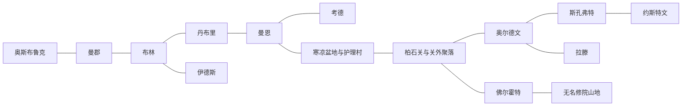

# 城市篇章与跨区域任务网

晶石主线保持N1—N18。城市CM是地方篇章；支线CS可提前、随后、拒做。PAS/ASH/HIG的CM是现有任务的地域编排，不新增第二次晶石证据、奖励或终局。没有“完成全部73任务”前置。

## 交通和叙事分别计账

下面仅为Mod拟定双向交通接入，具体全球方向、里程、种子与原生房间映射均待验证。交通可达不代表双方互知秘密；所有剧情交叉另走有限回执。

## 回执规则

实际选择并完成行动后，来源任务记唯一resolve与receipt事实；玩家可拒传。接收者存活/在场、本人允许传达且有这条有限事实，才作具体回应。死亡优先、再拒绝/保密、再到场、最后才选回应；代理只能传已有记录，不能替当事人新授权。晚到只能改未来安排或回访报价，不能回滚已完成方法。控制与伤害历史不可被新服务或高声望抹平。

## 跨地域实质影响

|ID|来源与方案→目标|实际变化|限定回应|
|---|---|---|---|
|CX01|[[台本_CM-EED_林线以外]]（oldstock）→[[台本_CS-BRY-09_谁关上水门]]|水门可用有限旧梁；城市原有工班与费用仍须核。|米罗：「这批梁能接上。我还得问，装梁的工钱有没有接上。」；只知可合法使用的旧梁数量|
|CX02|[[台本_CM-EED_林线以外]]（localfirst）→[[台本_CS-BRY-09_谁关上水门]]|水门改租有限支架，工期多一班，不把退款算偷窃。|米罗：「林子保了，桥这边缺的就该我们另外认。」；只知本案退款与未履约量|
|CX03|[[台本_CM-BRY_城墙之内]]（civic）→[[台本_CM-EED_林线以外]]|可委托独立工组核木料，不索全家名单。|黎恩：「他们能在城里说不。林边的人也不能一开门就被当投诚。」；只知本案工人有独立席位|
|CX04|[[台本_CM-OSB_留到来年的一袋]]（seed）→[[台本_CS-BRY-05_盐穗没有余粮]]|采购量降低，盐穗优先本地有限粮，市内货赔后置。|米罗：「他们留下的是明年的田，不是拿我们今天当敌人。」；只知村户实际保种底量|
|CX05|[[台本_CS-BRY-05_盐穗没有余粮]]（limit）→[[台本_CM-OSB_留到来年的一袋]]|减少预售量；不是免费粮。|芙朵：「他们少要了这一份，我们才敢把这袋留到春天。」；只知城市接受限量粮的实际支付|
|CX06|[[台本_CM-MNS_没有年份的酒]]（newlabel）→[[台本_CS-YOS-02_徒弟要走的那天]]|师徒可用独立新批商标，需另问织工授权。|地方染工：「承认新的一批，不会把老的每一批都烧掉。」；只知新年份署名与退错价款|
|CX07|[[台本_CM-YOS_最后一匹家纹]]（sharedmark）→[[台本_CS-MNS-02_师傅的第二条刻线]]|增加双来源续作方式，不把材料工艺认作同源。|提奥：「他那枚还在，我的也不必压在桶底。」；只知限定双署名而非永久家印|
|CX08|[[台本_CM-ALD_护甲里面的名字]]（open）→[[台本_CS-BRY-03_学徒的印]]|工伤赔付与续作分别签，不能只以卖得好抵账。|奥辛：「甲是真的，伤也是真的。一种真不能替另一种闭嘴。」；只知已复核的事故与来源段|
|CX09|[[台本_CM-ALD_护甲里面的名字]]（seal）→[[台本_CS-BRY-03_学徒的印]]|须用地方固定卡扣替代检查，拒把赞助作问责资格。|奥辛：「这只封不让我查里边。好看不够让我替人点头。」；只知赞助限制外部复核的事实|
|CX10|[[台本_CS-BRY-03_学徒的印]]（shared）→[[台本_CM-YOS_最后一匹家纹]]|染工可要求相同分署；仍保拒续作方法。|染工：「旁边那枚小印，终于没被说成忘恩的证据。」；只知本案署名独立于师徒赊款|
|CX11|[[台本_CM-SKO_第二次赎回]]（repay）→[[台本_CM-ALD_护甲里面的名字]]|订单延期一班或改本地旧坯，不硬锁技术主线。|师傅：「少开的炉不能把少掉的那批甲装成已经做完。」；只知缩产后实际可售合格坯量|
|CX12|[[台本_CM-ALD_护甲里面的名字]]（distributed）→[[台本_CS-SKO-02_回来以后]]|返乡工人可分批接工，归人去留另问。|博赫：「不在一间屋里，也不用先变成一家才认工钱。」；只知分批责任不以一名师傅代表全部|
|CX13|[[台本_CM-KOR_不是你的姓]]（limited）→[[台本_CM-MAE_留下来的城]]|身份与护理柜分钥，不索全体真实姓名。|玛娅：「一个柜能开，不让整个家都跟着被打开。」；只知限定取物代理，未授权姓名不出柜|
|CX14|[[台本_CM-MAE_留下来的城]]（separate）→[[台本_CS-KOR-01_留灯的人]]|缺席者限期保物，不自动冒签住宿与家属权。|诺妲：「灯能留着。不能因为留着就替他签今后每个夜晚。」；只知不同用途编号不自动合并|
|CX15|[[台本_CM-FOR_金价之外]]（workerstop）→[[台本_CS-HIG-01_回风驿的停牌]]|停牌方法需托柜实付；未到账只保绕行。|维护者：「他敢在塌之前说停，是因为停以后还有那份工钱。」；只知付停班底薪且确有停工权|
|CX16|[[台本_CS-HIG-01_回风驿的停牌]]（a）→[[台本_CM-FOR_金价之外]]|引入局部停井复测，不以维护者牺牲证明。|艾珀：「多走了一段，不会少认这口井危险的那一段。」；只知已验证危险段停用与独立检查|
|CX17|[[台本_CM-RAT_兽死之后]]（addendum）→[[台本_CS-BRY-02_围城时的房间]]|支持不同记忆并存，拒替受害者签原谅。|薇特：「多那一块，不会让原来守城的每个人都变成骗子。」；只知同碑并存的有限旧见证|
|CX18|[[台本_CS-BRY-02_围城时的房间]]（dual）→[[台本_CM-RAT_兽死之后]]|附碑可保分歧，不造爵士新证词。|阿莉：「两种声音都留下，他们没有被写成最后都点头。」；只知同门两见证且未和解|
|CX19|[[台本_CM-DEN_潮水退去以后]]（leases）→[[台本_CS-ASH-01_安息村的旧钥匙]]|允许有限自愿代取与短宿，班次不可重复占用。|护理者：「那里有床，仍先问他想不想去。」；只知实际两间短租与另一有限接收点|
|CX20|[[台本_CS-ASH-02_陪护者也会累]]（a）→[[台本_CM-DEN_潮水退去以后]]|护理者可租有限短屋，不从第三户挤床。|卡蕾：「换人接不是没人管。屋里也不用一直只守同一个人。」；只知已经到位的一班护理|
|CX21|[[台本_CM-PAS_关口两边]]（joint）→[[台本_CS-FOR-01_旧骑卫的杯]]|历史杯只说明出处，不授新军事身份。|玛诺：「记过责任，不让旧骑卫每个杯子都成了一份命令。」；只知军民病例分柜而可问责|
|CX22|[[台本_CM-FOR_金价之外]]（external）→[[台本_CM-PAS_关口两边]]|可用独立技术检查，药与名单不转交检查者。|接收员：「给外人一笔检查费，不是把开关和病人全给他。」；只知第三方检查费与真实支付|
|CX23|[[台本_CM-ASH_不是空床的村庄]]（localcare）→[[台本_CS-DEN-03_苇背的新邻居]]|本案租住与仪式分列；接收上限仍两床。|瑟芬：「不愿去仪式，不能让那张床突然也不愿收人。」；只知患者拒研究仍获基本护理|
|CX24|[[台本_CM-DEN_潮水退去以后]]（shared）→[[台本_CM-ASH_不是空床的村庄]]|留营可谈有限轮班，不强制病人互为家属。|护理者：「有人肯合住，是他们这次愿意，不是以后必须愿意。」；只知逐户同意轮住而非强迫一家|
|CX25|[[台本_CM-HIG_回程也是答案]]（minimal）→[[台本_CS-MAE-06_冷窗不等于空城]]|留城者无需为证明获救而迁走，核心安全不重算。|玛娅：「少一处可展示的地方，也不是少救了一座城的人。」；只知停止非必需展示，核心安全已验|
|CX26|[[台本_CM-MAE_留下来的城]]（evacuate）→[[台本_CS-HIG-03_留下的人]]|续约逐人问；离去者工资结清，预算缺口保守缩便利。|维护者：「走的是这一班。不能用这班的人替留下的签全年。」；只知实际有限迁出名单及去留授权|
|CX27|[[台本_CM-YOS_最后一匹家纹]]（independent）→[[台本_CS-ASH-02_陪护者也会累]]|护理布保有明确有限来源，普通照护不附工场契。|普通护理者：「布已经付清，不让穿它的人也欠上一份未来。」；只知无永久家印限制的有限保暖布|
|CX28|[[台本_CS-ASH-02_陪护者也会累]]（b）→[[台本_CM-YOS_最后一匹家纹]]|续作同样限期，轮班者可拒后续不失已做工资。|染工：「那一班愿意，不会让下一班连问都不用问。」；只知逐人有限轮班的实际执行|
|CX29|[[台本_CM-OSB_留到来年的一袋]]（advance）→[[台本_CS-MNS-03_葡影的种枝]]|试种合约限一季并列失败损失，不改领主全镇法律。|罗莎：「枝能借一季，也不能把下个春天全写成欠。」；只知预售限一季不抵永久地|
|CX30|[[台本_CM-MNS_没有年份的酒]]（limited）→[[台本_CS-OSB-01_父亲没说的价格]]|父女各认有限旧债，贷款不得绑定全部未来劳动。|瓦森：「瓶外那个名字，不替喝它的人欠谁一辈子。」；只知有限旧名出货不购买未来归属|

## 同城支线与主章

每条CS路线分别回到本地CM，CM已执行的方法也回流CS：现存安排与独立方法可用，已占资源不重复承诺、额外费用另记；影响的是实际已执行的结果，而非“完成计数”。例如布林工艺分署与学徒离坊为不同地方事实；同主章都能继续，但来源、工具、发言人不同。未做时保本地独立固定核验。每个同城边的回访台词及传达范围见两端台本的交叉影响节。

## 原51篇的归属映射

|旧任务|接入城市／地域|原所有者保留|
|---|---|---|
|[[台本_N2_灰堤没有墓碑]]|[[聚落_BRY_布林]]|NE、唯一物件、paid和结局资格仍由该旧任务记账|
|[[台本_N3_听审前的灯]]|[[聚落_BRY_布林]]|NE、唯一物件、paid和结局资格仍由该旧任务记账|
|[[台本_N4_第一张空白债票]]|[[聚落_BRY_布林]]|NE、唯一物件、paid和结局资格仍由该旧任务记账|
|[[台本_SQ01_港税与自由]]|[[聚落_BRY_布林]]|NE、唯一物件、paid和结局资格仍由该旧任务记账|
|[[台本_DT03_无人认领的墓标]]|[[聚落_BRY_布林]] · [[聚落_RAT_拉滕]]|NE、唯一物件、paid和结局资格仍由该旧任务记账|
|[[台本_DT07_一箱不该开封的货]]|[[聚落_BRY_布林]]|NE、唯一物件、paid和结局资格仍由该旧任务记账|
|[[台本_N1_无钟之夜]]|[[聚落_DEN_丹布里]]|NE、唯一物件、paid和结局资格仍由该旧任务记账|
|[[台本_N5_渡口的三种说法]]|[[聚落_DEN_丹布里]]|NE、唯一物件、paid和结局资格仍由该旧任务记账|
|[[台本_N9_把证据摆上桌]]|[[聚落_DEN_丹布里]]|NE、唯一物件、paid和结局资格仍由该旧任务记账|
|[[台本_N18_誓约之后]]|[[聚落_DEN_丹布里]] · [[聚落_RAT_拉滕]]|NE、唯一物件、paid和结局资格仍由该旧任务记账|
|[[台本_SQ04_一条不卖人的路]]|[[聚落_DEN_丹布里]] · [[聚落_EED_伊德斯]]|NE、唯一物件、paid和结局资格仍由该旧任务记账|
|[[台本_SQ05_渡口与姓名]]|[[聚落_DEN_丹布里]] · [[聚落_ASH_寒凉盆地与护理村]]|NE、唯一物件、paid和结局资格仍由该旧任务记账|
|[[台本_DT01_粮车的最后一段]]|[[聚落_DEN_丹布里]]|NE、唯一物件、paid和结局资格仍由该旧任务记账|
|[[台本_DT06_迷路者的路标]]|[[聚落_DEN_丹布里]]|NE、唯一物件、paid和结局资格仍由该旧任务记账|
|[[台本_DT08_修好第二块桥板]]|[[聚落_DEN_丹布里]]|NE、唯一物件、paid和结局资格仍由该旧任务记账|
|[[台本_DT13_一锅够分的热汤]]|[[聚落_DEN_丹布里]] · [[聚落_OSB_奥斯布鲁克]]|NE、唯一物件、paid和结局资格仍由该旧任务记账|
|[[台本_DT04_收割前的空地]]|[[聚落_OSB_奥斯布鲁克]] · [[聚落_MAE_曼恩]]|NE、唯一物件、paid和结局资格仍由该旧任务记账|
|[[台本_SQ06_抄本的背面]]|[[聚落_MNS_曼郡]] · [[聚落_YOS_约斯特文]] · [[聚落_MAE_曼恩]]|NE、唯一物件、paid和结局资格仍由该旧任务记账|
|[[台本_DT09_药师指认的草]]|[[聚落_MNS_曼郡]] · [[聚落_YOS_约斯特文]] · [[聚落_ASH_寒凉盆地与护理村]]|NE、唯一物件、paid和结局资格仍由该旧任务记账|
|[[台本_N7_军需账上的空名]]|[[聚落_ALD_奥尔德文]] · [[聚落_PAS_柏石关与关外聚落]]|NE、唯一物件、paid和结局资格仍由该旧任务记账|
|[[台本_N14_可以回去的路]]|[[聚落_ALD_奥尔德文]] · [[聚落_SKO_斯孔弗特]] · [[聚落_YOS_约斯特文]] · [[聚落_EED_伊德斯]] · [[聚落_FOR_佛尔霍特]] · [[聚落_HIG_无名修院山地]]|NE、唯一物件、paid和结局资格仍由该旧任务记账|
|[[台本_N15_回声不等于真相]]|[[聚落_ALD_奥尔德文]] · [[聚落_HIG_无名修院山地]]|NE、唯一物件、paid和结局资格仍由该旧任务记账|
|[[台本_SQ02_被征用的冬粮]]|[[聚落_ALD_奥尔德文]] · [[聚落_SKO_斯孔弗特]] · [[聚落_PAS_柏石关与关外聚落]]|NE、唯一物件、paid和结局资格仍由该旧任务记账|
|[[台本_SQ08_逃兵的家书]]|[[聚落_SKO_斯孔弗特]] · [[聚落_KOR_考德]] · [[聚落_PAS_柏石关与关外聚落]]|NE、唯一物件、paid和结局资格仍由该旧任务记账|
|[[台本_SQ07_药不是赎罪券]]|[[聚落_YOS_约斯特文]] · [[聚落_ASH_寒凉盆地与护理村]]|NE、唯一物件、paid和结局资格仍由该旧任务记账|
|[[台本_DT11_两份抄本的交接]]|[[聚落_KOR_考德]] · [[聚落_MAE_曼恩]]|NE、唯一物件、paid和结局资格仍由该旧任务记账|
|[[台本_DT10_别让狼靠近夜岗]]|[[聚落_EED_伊德斯]] · [[聚落_MAE_曼恩]]|NE、唯一物件、paid和结局资格仍由该旧任务记账|
|[[台本_N16_谁来保管余烬]]|[[聚落_FOR_佛尔霍特]] · [[聚落_HIG_无名修院山地]]|NE、唯一物件、paid和结局资格仍由该旧任务记账|
|[[台本_DT12_旧钟站的检修]]|[[聚落_FOR_佛尔霍特]] · [[聚落_HIG_无名修院山地]]|NE、唯一物件、paid和结局资格仍由该旧任务记账|
|[[台本_DT15_封存之后的巡查]]|[[聚落_FOR_佛尔霍特]] · [[聚落_HIG_无名修院山地]]|NE、唯一物件、paid和结局资格仍由该旧任务记账|
|[[台本_N11_关隘外的交换]]|[[聚落_PAS_柏石关与关外聚落]]|NE、唯一物件、paid和结局资格仍由该旧任务记账|
|[[台本_DT05_驿馆的急用药]]|[[聚落_PAS_柏石关与关外聚落]]|NE、唯一物件、paid和结局资格仍由该旧任务记账|
|[[台本_DT14_锈印章与假凭证]]|[[聚落_PAS_柏石关与关外聚落]]|NE、唯一物件、paid和结局资格仍由该旧任务记账|
|[[台本_N8_不会散去的热病]]|[[聚落_ASH_寒凉盆地与护理村]]|NE、唯一物件、paid和结局资格仍由该旧任务记账|
|[[台本_N12_失踪者仍有名字]]|[[聚落_ASH_寒凉盆地与护理村]]|NE、唯一物件、paid和结局资格仍由该旧任务记账|
|[[台本_N13_答案的代价]]|[[聚落_ASH_寒凉盆地与护理村]]|NE、唯一物件、paid和结局资格仍由该旧任务记账|
|[[台本_DT02_干净的井水]]|[[聚落_ASH_寒凉盆地与护理村]]|NE、唯一物件、paid和结局资格仍由该旧任务记账|
|[[台本_DT16_愿意继续治疗的人]]|[[聚落_ASH_寒凉盆地与护理村]]|NE、唯一物件、paid和结局资格仍由该旧任务记账|
|[[台本_N17_残光之井]]|[[聚落_HIG_无名修院山地]]|NE、唯一物件、paid和结局资格仍由该旧任务记账|
|[[台本_N6_被封存的页码]]|[[聚落_MAE_曼恩]]|NE、唯一物件、paid和结局资格仍由该旧任务记账|
|[[台本_N10_没有写下的见证]]|[[聚落_MAE_曼恩]]|NE、唯一物件、paid和结局资格仍由该旧任务记账|
|[[台本_SQ03_没有王旗的面包]]|[[聚落_MAE_曼恩]]|NE、唯一物件、paid和结局资格仍由该旧任务记账|
|[[台本_D02_旧渠检修墓室]]|[[聚落_BRY_布林]]|NE、唯一物件、paid和结局资格仍由该旧任务记账|
|[[台本_D03_断桥税栈]]|[[聚落_DEN_丹布里]]|NE、唯一物件、paid和结局资格仍由该旧任务记账|
|[[台本_D04_曼恩封存书库]]|[[聚落_MAE_曼恩]]|NE、唯一物件、paid和结局资格仍由该旧任务记账|
|[[台本_D05_学院弃置试验庭]]|[[聚落_MAE_曼恩]]|NE、唯一物件、paid和结局资格仍由该旧任务记账|
|[[台本_D06_柏石军需地窖]]|[[聚落_PAS_柏石关与关外聚落]]|NE、唯一物件、paid和结局资格仍由该旧任务记账|
|[[台本_D07_灰烬疫所]]|[[聚落_ASH_寒凉盆地与护理村]]|NE、唯一物件、paid和结局资格仍由该旧任务记账|
|[[台本_D08_沉水档案井]]|[[聚落_ASH_寒凉盆地与护理村]]|NE、唯一物件、paid和结局资格仍由该旧任务记账|
|[[台本_D09_无名修院回声厅]]|[[聚落_HIG_无名修院山地]]|NE、唯一物件、paid和结局资格仍由该旧任务记账|
|[[台本_D10_残光之井]]|[[聚落_HIG_无名修院山地]]|NE、唯一物件、paid和结局资格仍由该旧任务记账|

## 冻结与预算边界

N17终局安全快照独立冻结；回风驿停非必需捷径与维护者拒续约不推翻已验证安全，仍要认地方失约。床位、工班、材料与钱先占用再承诺，实际交接才有接收；口头愿意不解锁archive/托管。新增CM控制路线有便利也有排除与监督缺口，不虚标优选；不同城政治代理不能给全国进口许可、赦免或正式王位。

[[城市与聚落设计总索引]] · [[网状叙事与条件对话规范]] · [[当前任务依赖与状态字典]] · [[当前证据链与结局条件]] · [[叙事交叉影响矩阵]]

<!-- BRYNN-CONTINUATION-S85:BEGIN -->
## S85布林新增六案（当前登记）

[[布林续篇任务与伏笔回收总表]] · [[布林背景复核与续篇创作边界]] · [[布林续篇逻辑与人物弧光审查]]。布林追加6支线，原1主章+10支线保留，现共17篇；城市总计基线73+扩展6=79篇；原314单方法回执与新增15组回收桥/45方法版本分别计；71篇逐角色草稿，8篇待深化。原51篇晶石任务另计。原作神秘夜船/旧市长案不揭底，六案独立入口，不是N16/主线前置；本轮不部署。
<!-- BRYNN-CONTINUATION-S85:END -->
