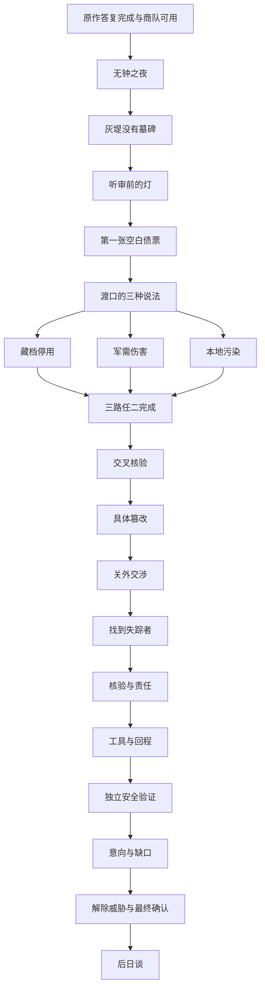

# 当前任务依赖与状态字典

<!-- CITY-S63:BEGIN -->
## S63城市扩展（当前范围）

新增resolve_CM/CS与paid是设计命名，详见[[城市篇章与跨区域任务网]]及各台本；本地菜单预览不写，实际确认才写唯一方案，回执范围与费用占用先核。 所有新增稿仍draft；本轮未更新游戏包。
<!-- CITY-S63:END -->

<!-- NARRATIVE-S62:BEGIN -->
## S62网状叙事修订（2026-10-12，当前优先）

当前方案以[[网状叙事与条件对话规范]]、[[叙事交叉影响矩阵]]、[[人物弧光与关系转折]]为准；任务入口为[[任务台本总索引]]，本轮缺陷与修订在[[叙事逻辑校验与修订记录]]。下方S61场次与旧选择仅作素材／修订对照，不能无条件播完或同时实现两套菜单。全部仍是设计草稿，本轮没有改游戏包。 主线完成前置骨架保留；新增encountered、resolve_ID、target_receipt、分项consent与callback_seen见新规范。地点已可达可先听需要，不预结算。旧字段投影按执行核验写；投影不等于真实存档自动迁移。
<!-- NARRATIVE-S62:END -->

按S61完成全任务台本的设计语义。本页优先于[[任务状态与依赖]]下方历史MQ图，不向角色档自动迁移旧EAO_MQ键。[[台本_N1_无钟之夜]]沿用已部署N1的独立命名空间；N2以后所有字段尚未映射引擎。稳定主线ID采用N1..N18，文档ID采用SCRIPT-N1..SCRIPT-N18，两者不是引擎资源索引。

## 当前主线图

N9要求N5完成且N6/N7/N8至少两项完成。第三项直到N17明确最终确认前可补做。N13补NE4不写N8完成，不发N8奖励。高级结局可能需要补全三路；基础封存只需安全验证及当前物理威胁解除，不需要任何支线签约。

## 分支汇合与人物状态

| 字段 | 初值与合法取值 | 写入与后续 |
| --- | --- | --- |
| n_done | 空集合，N1..N18 | 实际目标＋提交满足后增加；不导入MQ完成 |
| EAO_N1_stage / rope / cots / plan | 已部署独立N1键 | 现有逻辑参见[[开篇_无钟之夜]]；新增台词另待编入 |
| EAO_N1_ivo / families | escaped或held／hidden或registered | N2分别由伊沃或蕾雅引荐，不锁任何路线 |
| worker_status | unknown/protected/public/dead | N2；公开必须本人同意；死亡不重生，事实仍能核 |
| nell_status | unknown/protected_accountable/public_accountable/exposed/dead | N3；保护与问责可同时成立，住址曝光不能复原为未曝光 |
| workshop_result | none/installments/liquidated/shifted | N4；维修服务保持一个基本渠道 |
| n4_shift_harm / n4_shift_remedied | false / false | 转嫁写harm；SQ01明确撤销担保＋受害补偿完成才写remedied；过去发生过的harm不删 |
| evidence_current | NE1..NE5→unknown/copied/verified | 与旧E01..05分开；材料有来源再核验 |
| archive_names / case_names | 未决定／protected或exposed；coded或public | 隐私与事实认证分别写，不把公开姓名当认证条件 |
| patients_n8 / research_extra | 未决定／prioritized或delayed；lost或preserved | N8/N12分别记，固定核心记录不因可选损失消失 |
| kaem_result | unknown/accountable/unpublished/dead | N10；公布与否不删除已核出的篡改 |
| exchange_harm / carrier_state | false／unknown | N11明确交出藏身人写true/captured，不靠日常洗掉 |
| transport_harm / passengers_free | false／unknown | SQ04强运单独记；不能混作N11事实 |
| gwynnel_state / gwynnel_cooperation | unknown/rescued/cooperating/dead／false | N12人身与协作分开；拒绝随车可以由中立营接收 |
| liability | undecided/accountable/settled | N13；明确补公开责任可在最终确认前改变settled，不靠给钱直接变 |
| tools_ready / return_route_tested | false / false | N14实际取得借用工具且走通回程；不等于隔离已验证 |
| containment_ready / evidence_current.NE5 | false / unknown | 仅N15三读数＋复测通过才true/verified |
| ending_intent / final_commit / ending | none／false／none | N16意向可改；N17安全台最终确认冻结；实际操作完成才ending |
| final_snapshot | null | 冻结证据、承诺、救济、责任、伤害与人物结果；之后不倒改 |
| epilogue_seen / visited_places | false／空集合 | N18可用有来源的回访记录完成，实地只加已看集合 |
| reward_claimed | 空集合 | 主线N号；支线SQ-A/B/C；日常模板＋instance_id；副本不双算主线费 |

这是**设计字典**，不声称存档已有这些字段。实现应将接取、观察、执行、结案分别事务化；实体交付失败不能先完成，奖励领取后重访不能复发。工具和证据同号恢复，不产生第二件可卖高价物。

## 支线、日常与副本入口

SQ01在N3后；SQ02/03/05/08在N5后；SQ04在N4后；SQ06在N6或N10后；SQ07在N8或N12后。每链A→B→C；承诺只在C实际执行后取得。

日常不是所有主线必经箭头。DT03改为N2旧渠已查；DT08需road_open；DT12需N15；DT15/16需N18及对应服务状态；其余按各模板的N前置与地方有效条件。日常不会增加最终政治资格，未来增供给也不改final_snapshot。

D02故事段随N2，D03随N5与SQ04对应阶段，D04随N6，D05随N10；允许已公开道路后的外围探索。D06随N7或对应支线。D07随N8。D08外围可先查，找人内段仅N11位置核实后；D09需N14，D10需N16。故事NPC、关键记录和机构承诺不参加普通副本再生。

## 可达性、恢复与截止

全局无隐藏倒计时。已接受日常与额外紧急救援按显式游戏时间期限失败，影响局部结果；不能删除核心线索或主线唯一出口。所有原创区域有固定基本服务、敌对替代路径和步行回程，低阵营信任不锁主线。

N17改稿：先解除当前敌人与装置威胁，再在安全台**明确最终确认**，此前可退出补证；战斗清场本身不冻结政治方案。确认后仍可补普通操作物资，不能提升冻结资格；最终操作失败不得重复发奖或复制晶石。旧D10“进场便冻结”的口径以此为准。

[[任务台本总索引]] · [[新区域设计与任务总表]] · [[当前证据链与结局条件]] · [[世界状态与商队]]。

<!-- BRYNN-CONTINUATION-S85:BEGIN -->
## S85布林新增六案（当前登记）

[[布林续篇任务与伏笔回收总表]] · [[布林背景复核与续篇创作边界]] · [[布林续篇逻辑与人物弧光审查]]。布林追加6支线，原1主章+10支线保留，现共17篇；城市总计基线73+扩展6=79篇；原314单方法回执与新增15组回收桥/45方法版本分别计；71篇逐角色草稿，8篇待深化。原51篇晶石任务另计。原作神秘夜船/旧市长案不揭底，六案独立入口，不是N16/主线前置；本轮不部署。
<!-- BRYNN-CONTINUATION-S85:END -->
