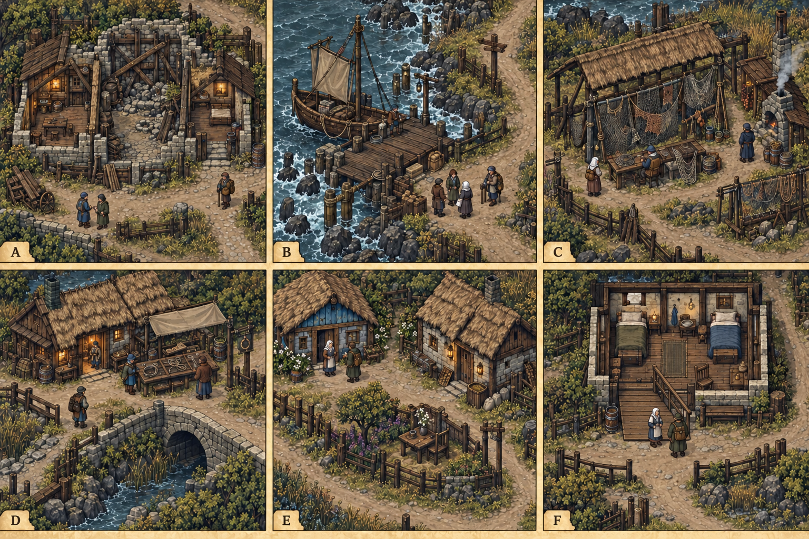

# 丹布里任务场所概念与台本映射

所属 [[聚落_DEN_丹布里]]，空间依据 [[空间_DEN_丹布里]]，逐角色对白见 [[丹布里与曼郡人物演出审查]]，总览见 [[原素材参考与城市概念图]]。

主题：回迁不是回到从前；修屋、捕鱼、接收和信仰不能互相变成服从条件。

> [!info] 当前美术草稿
> A—F是画板位置，不是实际相邻关系、游历顺序或必须访问清单。参考已查看的城市总览与用户原素材；图集只读，未复制入库。床、桶、船、工班和款项仍按台本真实单账，画中数量不是库存或奖励。人物只是匿名比例，不据脸像替任务分配身份。

## 图文映射

|面板|稳定空间ID／地点|关联任务|矛盾与人物弧线|互动边界与制作要求|
|---|---|---|---|---|
|A|`DEN-D01-A` 旧屋承重厅|[[台本_CM-DEN_潮水退去以后]]|两处安全空间与三户旧居经历不能自然合成第三床。|后段封闭，暂住由真实接收点承担；门痕只是近景待绘提示，不证明任何一户资格。|
|B|`DEN-D04-A` 车船分装棚|[[台本_CS-DEN-01_船上的第四个人]]|家船第三位家人有自己的去留；帮助第四人不等于忘记他的旧告密。|车船分装棚外侧干岸与接船地点；图中船型和站位不定载重，三位成人逐人许可，伤者出发前留原岸。|
|C|`DEN-D03-A` 晾网破口棚|[[台本_CS-DEN-02_渔网留下的洞]]|擅借渔网与割网救人同时成立，迁来身份不能代替责任。|旧磨毛和新割口需独立近景；烟灶靠石墙离网，保绕网陆路，不用危险重演或收集材料推进。|
|D|`DEN-S02-3` 结线比样檐|[[台本_CS-DEN-02_渔网留下的洞]]|熟悉自己的结法不等于能指认所有陌生补法为破坏。|结线比样檐在桥边干地；普通住宿朝陆路，不以过危险桥、搜旅人包袱或强制归返为前置。|
|E|`DEN-S01-3` 两种生活院|[[台本_CS-DEN-01_船上的第四个人]] · [[台本_CS-DEN-03_苇背的新邻居]]|户主的失亲仪式对她有意义，住户也能拒绝参加。|两种生活院把侧院礼桌、取水、患者独立门和村路分开；伤者未移交时不在此出现，伊蕾只知已授权范围。|
|F|`DEN-D02-B` 短宿安置室|[[台本_CM-DEN_潮水退去以后]] · [[台本_CS-DEN-03_苇背的新邻居]]|短宿与照护各有有限位置；不参加仪式不取消已签基本居住。|两张床单账占用，侧坡回普通村路；实际移住须接收、费用和照护交接，不能凭切图结算。|

## 周边与回程

[[聚落_DEN-S01_苇背村]] · [[聚落_DEN-S02_绳口驿]]。周边接收和工坊会面以当地具名住户真实在场或有限授权回执为准；出入普通村路不能依附某个任务选项。图中桥、水和装卸区域不直接决定世界坐标。

## 多解与后果

实际退款、交还、接收、有限签约或专业处置执行后，才按对应台本确认分支；观察、问话和图片预览不结案。拒绝同船、合住、共署或仪式各保独立出口，不强迫和解。缺席、死亡、拒绝与私密范围优先于跨城回访，不能由买方订单得知他人的病史。晚到只改变未来可做的事，旧伤害、欠款和损失保留；不追加奖励、不回滚N17。

## 目视核对与下一步制作

已目视查看v1/v2六面板：A有两处可用隔间与未修后段，B人物留干岸，C网架与旁路、D结线檐与陆路、E礼桌侧院和F两床可区分。v2在F入口增加侧边带扶手坡面，原台阶仍可见；坡宽、坡度、门槛和担架转弯需比例图独立核验，不能由画面宣称无障碍验收。A三户旧门痕、C新割与旧磨毛细节仍不够可读，需另制近景。

后续须另制比例平面、近景可观察物、原点、遮挡与安全距离，按原生地图保存和出入口生命周期实现。此图不是逐格地表、室内碰撞、可直接打包的精灵或游戏运行证据。

## 来源与版本

使用内置 image_gen 生成并作一次定向编辑，保留v1/v2及原缓存。完整生成／编辑提示词：`research/denbrie-task-art-prompt-s81-20261012.txt`、`research/denbrie-task-art-edit-s81-20261012.txt`。输入参考、输出SHA256、尺寸、生成时台本指纹与候选版本登记于 `research/shore-vine-task-art-20261012.json`。

[[任务空间与地点关联审查]] · [[城市美术与图片目录]] · [[城市与聚落设计总索引]]
