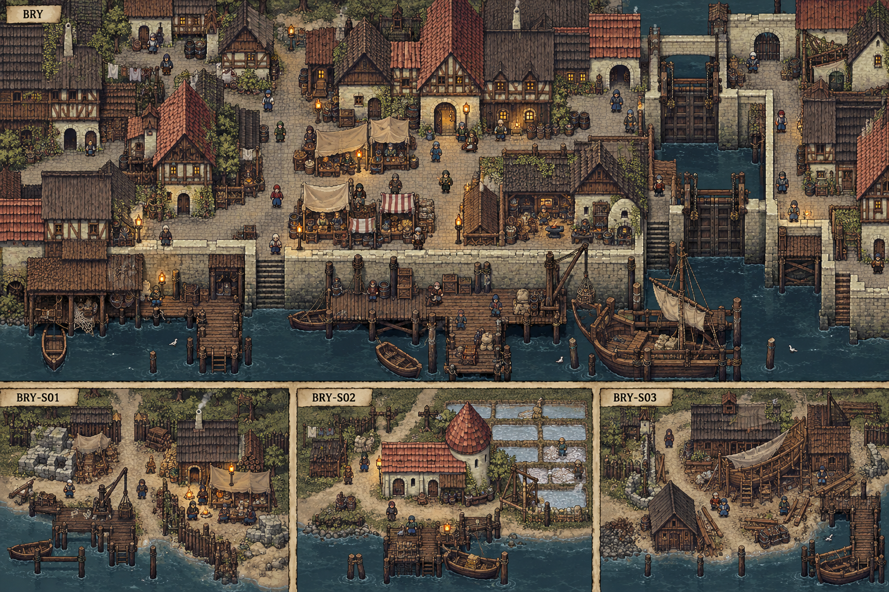
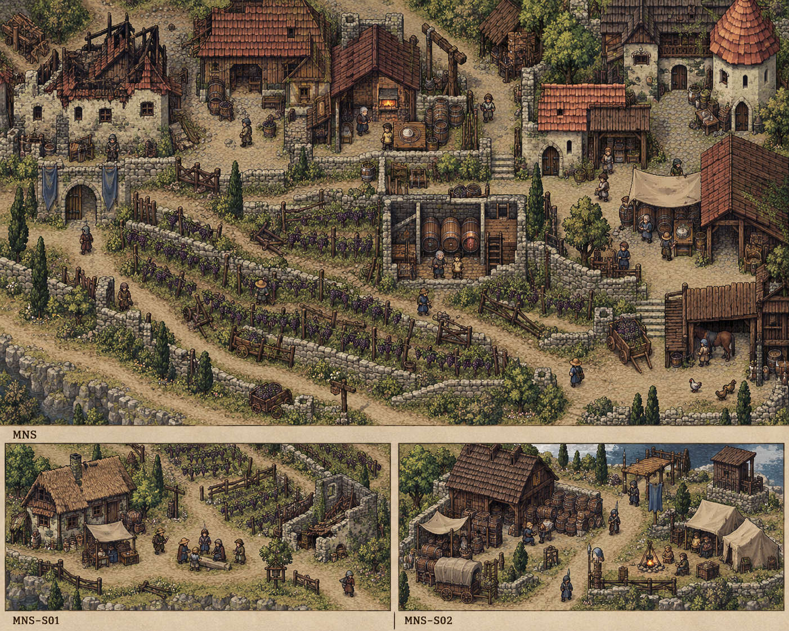
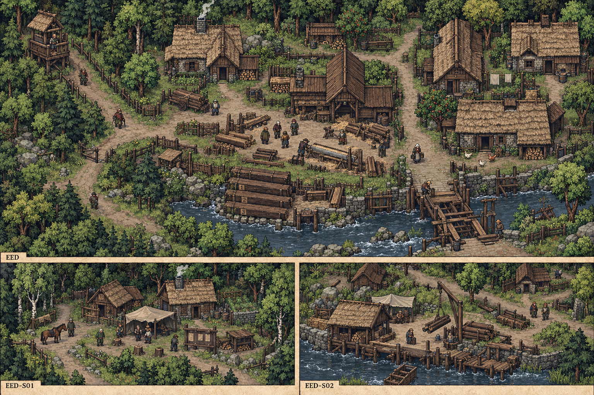
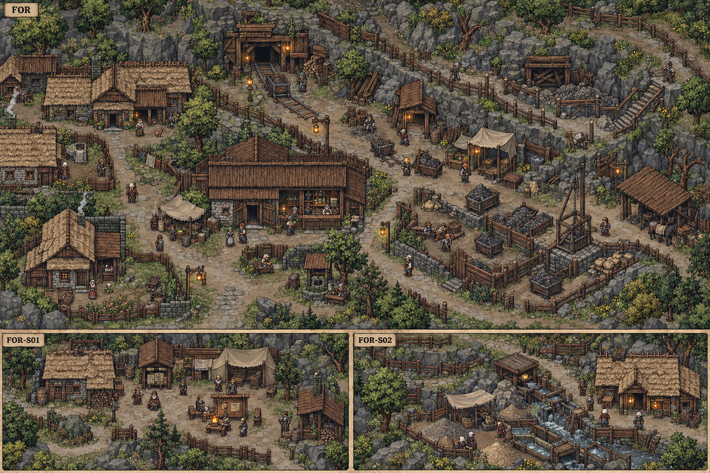
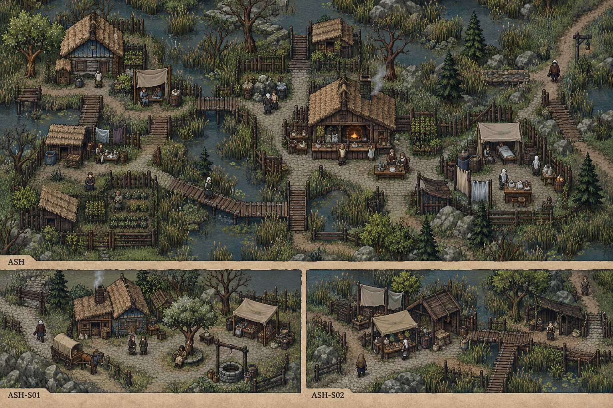
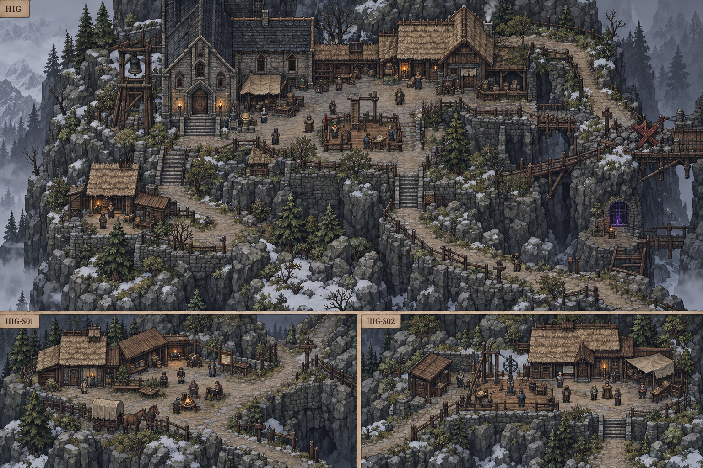
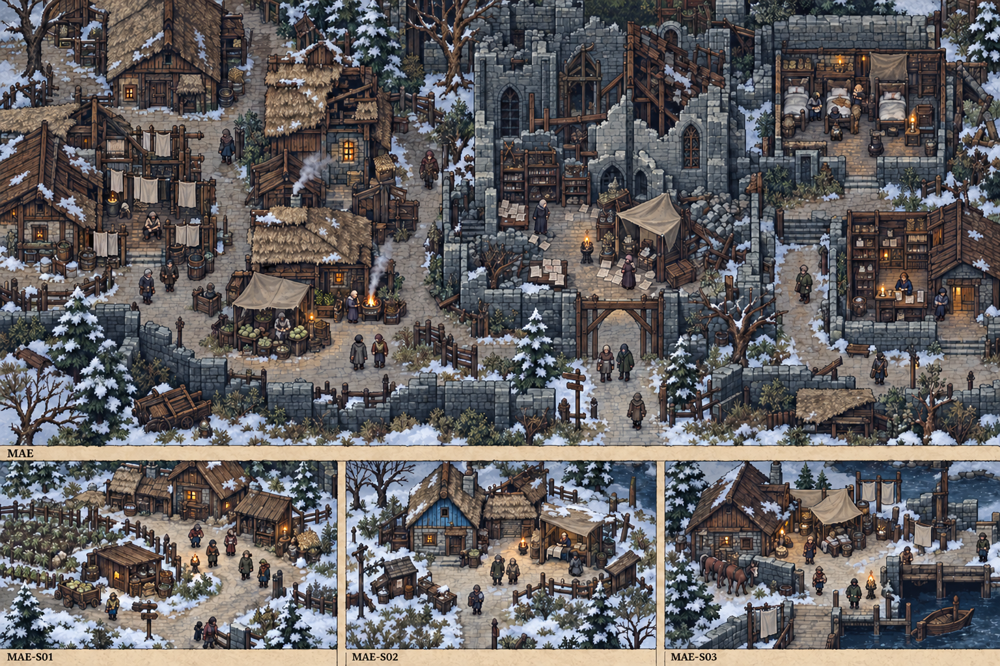

# 原素材参考与城市概念图

本轮按用户要求，使用内置image_gen，以用户提供的原素材为视觉参考；没有绘画CLI/API调用。十五个城市／地域各有独立概念板，下方共三十三个周边聚落构图。每板是代表性片区与卫星面板，不是全城地理图、逐格地图或碰撞数据。全部仍为Mod原创美术提案，未导入.sml或更新游戏。

原参考：stoneshard-assets-sample/atlas-020.png（城市外观）、atlas-083.png（村路/酒业外观）、atlas-088.png（渔村与木屋）、atlas-060.png（林地、枯树/寒地植被）、atlas-099.png（普通工坊/室内）。已逐页目视；atlas-003.png为技术小页，未作生图参考。图集只读，未复制进设计库；输出保留在城市概念/。sprites.json定位只证明样本定义，不能确认当前安装包索引、资源可复用范围或城市原布局。

## 材质与尺度参考

使用石基、木骨架、瓦/草顶的清晰轮廓，泥路/石街和季节植被的低饱和颜色，原素材俯视斜角与小比例人物。数字画板分辨率不是原游戏格尺寸；真正制作需核角色/门原点、瓦片网格、碰撞、遮挡与动画。十项候选名称和首帧坐标登记在research/city-art-reference-catalog.json，不存完整原图集或对白。

|原精灵|样本画布|首帧图集与定位|可参考部分|
|---|---|---|---|
|`s_brynn_03_house22`|433×239，原点140,220|atlas-020.png；1294,1142；356×239|材质、轮廓或局部室内尺度，实际资源接入待核|
|`s_brynn_03_grocerypart01`|145×199，原点76,192|atlas-020.png；333,1124；145×199|材质、轮廓或局部室内尺度，实际资源接入待核|
|`s_brynn_04blacksmith_part06`|349×272，原点167,241|atlas-020.png；1465,256；349×272|材质、轮廓或局部室内尺度，实际资源接入待核|
|`s_vinery01`|449×321，原点2,228|atlas-083.png；1620,361；389×321|材质、轮廓或局部室内尺度，实际资源接入待核|
|`s_Denbrie_FisherHouse_pt01`|134×89，原点63,76|atlas-088.png；2,1114；134×89|材质、轮廓或局部室内尺度，实际资源接入待核|
|`s_AppleTree_03`|170×110，原点52,90|atlas-060.png；2,1467；127×110|材质、轮廓或局部室内尺度，实际资源接入待核|
|`s_drytree_1`|135×145，原点42,112|atlas-060.png；178,2；101×118|材质、轮廓或局部室内尺度，实际资源接入待核|
|`s_oldforge01`|279×208，原点144,174|atlas-099.png；892,428；242×204|材质、轮廓或局部室内尺度，实际资源接入待核|
|`s_millinteriorbgpart01`|286×234，原点0,0|atlas-099.png；2,2；286×234|材质、轮廓或局部室内尺度，实际资源接入待核|
|`s_millbarninteriorbg`|286×208，原点0,0|atlas-099.png；1607,2；286×208|材质、轮廓或局部室内尺度，实际资源接入待核|

## 当前概念板

所有图已目视检查主景/卫星区分、标签、地域用途与明显设定冲突。图中人物只作场景占位，不是新NPC最终脸像；所有库存、床数、机关、物证与通路以任务稿及后续制作验证为准。

## BRY 布林

[[聚落_BRY_布林]] · [[台本_CM-BRY_城墙之内]]

**画面任务用途与制作修订**：码头、水门与富裕市集的相邻关系可作为构图依据；租屋巷仍须增加私下会面退路。水门的实际数量与高低水位要按CS-BRY-09另作机制平面，不能逐像素照搬画面。

**周边面板（从左至右）**：

- `BRY-S01` [[聚落_BRY-S01_灰堤工营]]：活人登记与欠薪由本人授权；关联[[台本_CS-BRY-01_一年之后]] · [[台本_CS-BRY-02_围城时的房间]] · [[台本_CS-BRY-03_学徒的印]] · [[台本_CS-BRY-06_一个没被授勋的人]] · [[台本_CS-BRY-07_药瓶上的商标]]。
- `BRY-S02` [[聚落_BRY-S02_盐穗小镇]]：市内先买粮与镇内留种冲突；关联[[台本_CS-BRY-04_报纸上没有这条街]] · [[台本_CS-BRY-05_盐穗没有余粮]] · [[台本_CS-BRY-09_谁关上水门]]。
- `BRY-S03` [[聚落_BRY-S03_旧帆村]]：修船利润与未归家水手的家庭权利；关联[[台本_CS-BRY-08_旧帆村的空船位]] · [[台本_CS-BRY-10_夜会之前]]。

**城内支线**：[[台本_CS-BRY-01_一年之后]] · [[台本_CS-BRY-02_围城时的房间]] · [[台本_CS-BRY-03_学徒的印]] · [[台本_CS-BRY-04_报纸上没有这条街]] · [[台本_CS-BRY-05_盐穗没有余粮]] · [[台本_CS-BRY-06_一个没被授勋的人]] · [[台本_CS-BRY-07_药瓶上的商标]] · [[台本_CS-BRY-08_旧帆村的空船位]] · [[台本_CS-BRY-09_谁关上水门]] · [[台本_CS-BRY-10_夜会之前]]

## DEN 丹布里

[[聚落_DEN_丹布里]] · [[台本_CM-DEN_潮水退去以后]]

**画面任务用途与制作修订**：渔屋、破屋与驻点分别表现；三户两房争议只用两个已验住所，画面中的其余屋不计作免费床。海浪与浅滩是视觉提案，通路需重新核碰撞。

**周边面板（从左至右）**：

- `DEN-S01` [[聚落_DEN-S01_苇背村]]：收留者是否可要求新住户改原来的生活方式；关联[[台本_CS-DEN-01_船上的第四个人]] · [[台本_CS-DEN-03_苇背的新邻居]]。
- `DEN-S02` [[聚落_DEN-S02_绳口驿]]：地方接应不能成为强制归返；关联[[台本_CS-DEN-02_渔网留下的洞]]。

**城内支线**：[[台本_CS-DEN-01_船上的第四个人]] · [[台本_CS-DEN-02_渔网留下的洞]] · [[台本_CS-DEN-03_苇背的新邻居]]

## OSB 奥斯布鲁克

[[聚落_OSB_奥斯布鲁克]] · [[台本_CM-OSB_留到来年的一袋]]

**画面任务用途与制作修订**：留种粮棚与生活粮分开，家门距离短；磨坊轮与农田仅作新侧场参考，不替换原作磨坊/啤酒作坊布局，原村仍非战毁村。

**周边面板（从左至右）**：

- `OSB-S01` [[聚落_OSB-S01_麦根庄]]：镇里采购价与来年种粮；关联[[台本_CS-OSB-01_父亲没说的价格]] · [[台本_CS-OSB-03_那一口井不是嫁妆]]。
- `OSB-S02` [[聚落_OSB-S02_三篱户]]：共同围地与各自退出；关联[[台本_CS-OSB-02_三篱的门]]。

**城内支线**：[[台本_CS-OSB-01_父亲没说的价格]] · [[台本_CS-OSB-02_三篱的门]] · [[台本_CS-OSB-03_那一口井不是嫁妆]]

## MNS 曼郡

[[聚落_MNS_曼郡]] · [[台本_CM-MNS_没有年份的酒]]

**画面任务用途与制作修订**：葡架断层、新苗与旧封酒桶支持新酒来源争议；酒窖需新增独立通风出口，不能复用原工具铺锁梯反转。

**周边面板（从左至右）**：

- `MNS-S01` [[聚落_MNS-S01_葡影村]]：谁能取旧藤，谁承担失败；关联[[台本_CS-MNS-03_葡影的种枝]]。
- `MNS-S02` [[聚落_MNS-S02_桶石驿]]：同一批旧桶用于酒或护理清水；关联[[台本_CS-MNS-01_空桶有两个名字]] · [[台本_CS-MNS-02_师傅的第二条刻线]]。

**城内支线**：[[台本_CS-MNS-01_空桶有两个名字]] · [[台本_CS-MNS-02_师傅的第二条刻线]] · [[台本_CS-MNS-03_葡影的种枝]]

## ALD 奥尔德文

[[聚落_ALD_奥尔德文]] · [[台本_CM-ALD_护甲里面的名字]]

**画面任务用途与制作修订**：使用v2干燥料场与工艺街区，v1意外水岸仅留历史对照。甲外展示与衬布/工伤核验是不同空间，宗教侧院不等于王宫或全城官署。

**周边面板（从左至右）**：

- `ALD-S01` [[聚落_ALD-S01_铜灯镇]]：不能把伤痕抛光后当新军械；关联[[台本_CS-ALD-04_旧墙不是新围城]]。
- `ALD-S02` [[聚落_ALD-S02_白缝村]]：对技术价值的署名也涉及身份风险；关联[[台本_CS-ALD-01_白缝的姓]] · [[台本_CS-ALD-05_师傅没有失去的手]]。
- `ALD-S03` [[聚落_ALD-S03_石礼驿]]：私人信仰与公共护理不互作代价；关联[[台本_CS-ALD-02_两种送别]] · [[台本_CS-ALD-03_一件太合身的礼]] · [[台本_CS-ALD-06_往布林的空箱]]。

**城内支线**：[[台本_CS-ALD-01_白缝的姓]] · [[台本_CS-ALD-02_两种送别]] · [[台本_CS-ALD-03_一件太合身的礼]] · [[台本_CS-ALD-04_旧墙不是新围城]] · [[台本_CS-ALD-05_师傅没有失去的手]] · [[台本_CS-ALD-06_往布林的空箱]]

## SKO 斯孔弗特

[[聚落_SKO_斯孔弗特]] · [[台本_CM-SKO_第二次赎回]]

**画面任务用途与制作修订**：炉火、有限炭堆、冷却沟与晾衣并置；赎回者会面处不能锁在作坊后间。概念未确定冶炼产能，不能从满料堆推无限库存。

**周边面板（从左至右）**：

- `SKO-S01` [[聚落_SKO-S01_炭背镇]]：开炉用的预付款已抵赎金；关联[[台本_CS-SKO-01_炭背的预付款]] · [[台本_CS-SKO-03_冷沟的护符]]。
- `SKO-S02` [[聚落_SKO-S02_归火村]]：返回者是否必须替家人继续作战还账；关联[[台本_CS-SKO-02_回来以后]]。

**城内支线**：[[台本_CS-SKO-01_炭背的预付款]] · [[台本_CS-SKO-02_回来以后]] · [[台本_CS-SKO-03_冷沟的护符]]

## YOS 约斯特文

[[聚落_YOS_约斯特文]] · [[台本_CM-YOS_最后一匹家纹]]

**画面任务用途与制作修订**：羊毛、织机、晒布与分开的工位表现师徒来源；冷风为视觉氛围。羊群数量与布色不作真实可收割奖励。

**周边面板（从左至右）**：

- `YOS-S01` [[聚落_YOS-S01_缓梭镇]]：来者技术被写成无名代工；关联[[台本_CS-YOS-02_徒弟要走的那天]] · [[台本_CS-YOS-03_水堰上的颜色]]。
- `YOS-S02` [[聚落_YOS-S02_羊坡村]]：卖料与留冬毛；关联[[台本_CS-YOS-01_冬毛的最后一捆]]。

**城内支线**：[[台本_CS-YOS-01_冬毛的最后一捆]] · [[台本_CS-YOS-02_徒弟要走的那天]] · [[台本_CS-YOS-03_水堰上的颜色]]

## KOR 考德

[[聚落_KOR_考德]] · [[台本_CM-KOR_不是你的姓]]

**画面任务用途与制作修订**：此寄存院、门牌与住棚均明确原创，不能据此推断考德官方产业、规模与地形。相似门牌可服务身份误认，但取物/住门不可共享全权钥匙。

**周边面板（从左至右）**：

- `KOR-S01` [[聚落_KOR-S01_双门里]]：同姓人不是同一家；关联[[台本_CS-KOR-02_双门里的孩子]]。
- `KOR-S02` [[聚落_KOR-S02_留灯驿]]：谁有权为缺席者签入住；关联[[台本_CS-KOR-01_留灯的人]] · [[台本_CS-KOR-03_寄存的陌生画]]。

**城内支线**：[[台本_CS-KOR-01_留灯的人]] · [[台本_CS-KOR-02_双门里的孩子]] · [[台本_CS-KOR-03_寄存的陌生画]]

## EED 伊德斯

[[聚落_EED_伊德斯]] · [[台本_CM-EED_林线以外]]

**画面任务用途与制作修订**：旧梁料场在公共空间、住户门留在林缘内侧，强调物料核验不等于搜家。河岸是Mod局部提案，原作出口贸易限制仍有效。

**周边面板（从左至右）**：

- `EED-S01` [[聚落_EED-S01_桦阴村]]：不愿再以森林保护为由搜所有住户；关联[[台本_CS-EED-01_最后一株不是最后一单]] · [[台本_CS-EED-03_护林岗的口哨]]。
- `EED-S02` [[聚落_EED-S02_沉木驿]]：拆旧屋木还是伐新林；关联[[台本_CS-EED-02_沉木驿的梁]]。

**城内支线**：[[台本_CS-EED-01_最后一株不是最后一单]] · [[台本_CS-EED-02_沉木驿的梁]] · [[台本_CS-EED-03_护林岗的口哨]]

## FOR 佛尔霍特

[[聚落_FOR_佛尔霍特]] · [[台本_CM-FOR_金价之外]]

**画面任务用途与制作修订**：支井、通风与家属院分别构图；画面小轨道、矿车和称场是原创器材提案，需对照可用资源/时代感再选，不作为已核原矿设备。金矿不是北疆犯人石场。

**周边面板（从左至右）**：

- `FOR-S01` [[聚落_FOR-S01_风口镇]]：停井会失工资，开井会迫人冒险；关联[[台本_CS-FOR-01_旧骑卫的杯]] · [[台本_CS-FOR-03_矿份传给谁]]。
- `FOR-S02` [[聚落_FOR-S02_洗砂村]]：金价不补污染家庭的同意；关联[[台本_CS-FOR-02_洗砂村没有金色的水]]。

**城内支线**：[[台本_CS-FOR-01_旧骑卫的杯]] · [[台本_CS-FOR-02_洗砂村没有金色的水]] · [[台本_CS-FOR-03_矿份传给谁]]

## RAT 拉滕

[[聚落_RAT_拉滕]] · [[台本_CM-RAT_兽死之后]]

**画面任务用途与制作修订**：旧兽只在纪念浮雕中出现，雕刻是地方纪念者诠释，不代表原作怪物官方造型。新足迹/响绳需单独可观察物证，不能做复活旧兽首领。

**周边面板（从左至右）**：

- `RAT-S01` [[聚落_RAT-S01_鹿栅村]]：旧赔偿名册漏下迁来者；关联[[台本_CS-RAT-01_鹿栅之外]]。
- `RAT-S02` [[聚落_RAT-S02_静铃驿]]：参加仪式不是领援助条件；关联[[台本_CS-RAT-02_一枚仿的纪念章]] · [[台本_CS-RAT-03_静铃的沉默]]。

**城内支线**：[[台本_CS-RAT-01_鹿栅之外]] · [[台本_CS-RAT-02_一枚仿的纪念章]] · [[台本_CS-RAT-03_静铃的沉默]]

## PAS 柏石关与关外聚落

[[聚落_PAS_柏石关与关外聚落]] · [[台本_CM-PAS_关口两边]]

**画面任务用途与制作修订**：卸货中轴与民用旁路分别服务军需核对、普通回程；关口只处理本地个案，视觉规模不授王廷全国代理权。

**周边面板（从左至右）**：

- `PAS-S01` [[聚落_PAS-S01_冬秤镇]]：军民同限与各家不一样的缺口；关联[[台本_CS-PAS-02_两份点名]] · [[台本_CS-PAS-03_关外的最后一封]]。
- `PAS-S02` [[聚落_PAS-S02_石角驿]]：欠工钱不能借边关需要无限拖延；关联[[台本_CS-PAS-01_石角的停工]]。

**城内支线**：[[台本_CS-PAS-01_石角的停工]] · [[台本_CS-PAS-02_两份点名]] · [[台本_CS-PAS-03_关外的最后一封]]

## ASH 寒凉盆地与护理村

[[聚落_ASH_寒凉盆地与护理村]] · [[台本_CM-ASH_不是空床的村庄]]

**画面任务用途与制作修订**：护理、公共厨房与观察桌分离，病人可留村或离开；不同桶色是原创标记，不能读图判所有病因/治愈。栈道应有防滑与返回陆路。

**周边面板（从左至右）**：

- `ASH-S01` [[聚落_ASH-S01_安息村]]：留村还是去护理营由本人选；关联[[台本_CS-ASH-01_安息村的旧钥匙]]。
- `ASH-S02` [[聚落_ASH-S02_冷苇集]]：照护资源不交换试验同意；关联[[台本_CS-ASH-02_陪护者也会累]] · [[台本_CS-ASH-03_冷苇的空碗]]。

**城内支线**：[[台本_CS-ASH-01_安息村的旧钥匙]] · [[台本_CS-ASH-02_陪护者也会累]] · [[台本_CS-ASH-03_冷苇的空碗]]

## HIG 无名修院山地

[[聚落_HIG_无名修院山地]] · [[台本_CM-HIG_回程也是答案]]

**画面任务用途与制作修订**：山地冷石、旧钟、停用危险段与可回走台体现维护责任。紫光仅作少量封存介质氛围，不扩成第二处官方晶石真相；修院与序章保持独立。

**周边面板（从左至右）**：

- `HIG-S01` [[聚落_HIG-S01_回风驿]]：谁能说停工；关联[[台本_CS-HIG-01_回风驿的停牌]] · [[台本_CS-HIG-03_留下的人]]。
- `HIG-S02` [[聚落_HIG-S02_三刻站]]：读数与政治支持不等价；关联[[台本_CS-HIG-02_三刻里少的一格]]。

**城内支线**：[[台本_CS-HIG-01_回风驿的停牌]] · [[台本_CS-HIG-02_三刻里少的一格]] · [[台本_CS-HIG-03_留下的人]]

## MAE 曼恩

[[聚落_MAE_曼恩]] · [[台本_CM-MAE_留下来的城]]

**画面任务用途与制作修订**：使用去旗帜v2；寒地雪景是美术选择，不宣称全年降雪。档案残庭、根菜厨房与护理房有人使用，但不代表恢复正常学院；名册与病史柜需分钥。

**周边面板（从左至右）**：

- `MAE-S01` [[聚落_MAE-S01_根灯镇]]：留城者不该被当成没被救的人；关联[[台本_CS-MAE-01_被留下的那件袍]] · [[台本_CS-MAE-03_根灯最后的座位]] · [[台本_CS-MAE-04_旧织街的归人]]。
- `MAE-S02` [[聚落_MAE-S02_雪页村]]：保存来源与家门风险；关联[[台本_CS-MAE-02_烧掉之前]] · [[台本_CS-MAE-05_凯姆没能改掉的字]]。
- `MAE-S03` [[聚落_MAE-S03_冷窗驿]]：安置名册不能变追索名单；关联[[台本_CS-MAE-06_冷窗不等于空城]]。

**城内支线**：[[台本_CS-MAE-01_被留下的那件袍]] · [[台本_CS-MAE-02_烧掉之前]] · [[台本_CS-MAE-03_根灯最后的座位]] · [[台本_CS-MAE-04_旧织街的归人]] · [[台本_CS-MAE-05_凯姆没能改掉的字]] · [[台本_CS-MAE-06_冷窗不等于空城]]

## 生成记录与实施边界

完整初始提示词与输入路径/哈希：research/city-art-briefs.json；追加约束和ALD/MAE定向编辑：research/city-art-prompt-additions.json。选择的输出、SHA256、原缓存路径、相应城市/卫星笔记和目视结论：research/city-art-manifest.json。旧三联画保留为早期绘画风格对照，ALD/MAE v1保留历史，不作当前选稿。

本轮只生成概念与补文档。后续按原生地图生命周期制作，现有资源按名称引用；新绘资产需拆层、定原点/遮挡、配碰撞、核可走格与回程。任何可见房门和病床都未因此具备游戏交互。这里不设置全国阵营新真相、不移动原角色存档、不覆盖data.win。

[[城市美术与图片目录]] · [[城市与聚落设计总索引]] · [[城市设计与原作避让审查]] · [[城市扩展验收记录]]

## 布林任务场所细化（S77）

[[布林任务场所概念与台本映射]]补租屋、纪念、工艺、护理、水门与旧帆六处独立场所；沿用原素材风格，不替换本页十五张城市／地域总览。

## 斯孔弗特与约斯特文任务场所（2026-10-12）

[[斯孔弗特任务场所概念与台本映射]]：赎款寄柜、归乡棚、旧坯料廊、炭份台、冷沟与暖手屋。

[[约斯特文任务场所概念与台本映射]]：家纹对色、离坊收包、代工排管、留冬称捆、洗毛分流与师徒分署。两板十二处原创构图已保存；原总览和YOS旧稿保留，逐角色初稿以现行台本为准。图片不证明地图通达、实际库存、授权或任务完成。来源与提示词见research/city-task-art-20261012.json。

## 丹布里与曼郡任务场所（S81）

[[丹布里任务场所概念与台本映射]]：旧屋承重、干岸接船、晾网破口、结线比样、两种生活院与短宿安置。

[[曼郡任务场所概念与台本映射]]：封桶通风、旧枝辨芽、新酒小售、双名保桶、刻线试箍与两期葡架。两板十二处已保存，v1/v2与输入输出来源见research/shore-vine-task-art-20261012.json；任务遵当前台本，坡度、容量、近景与运行仍待制作。
