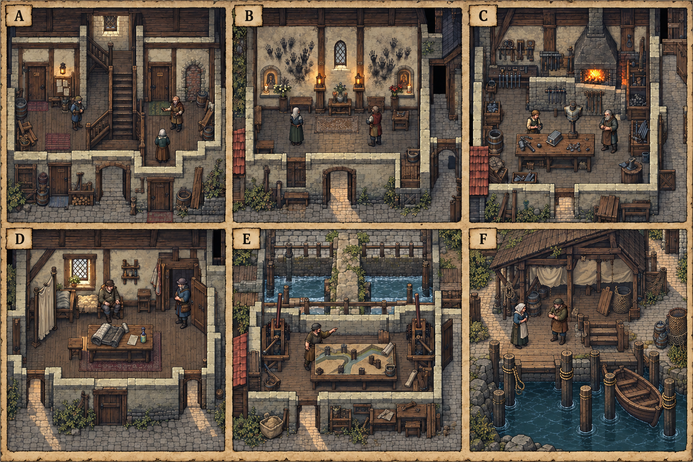

# 布林任务场所概念与台本映射

所属 [[聚落_BRY_布林]]，接续 [[原素材参考与城市概念图]]。本页将 [[空间_BRY_布林]] 的六处空间意图变成独立场所构图，配合 [[布林人物对白与网状演出审查]] 中的台本。A—F只是画板位置，不是任务顺序，也不表示这些房间彼此相邻。

> [!info] 原素材参考与使用范围
> atlas-020参考布林木骨架、石基、瓦顶及人物尺度；atlas-099参考普通工坊、室内地板和隔墙；atlas-088参考渔屋与木岸。已有BRY总览仅参考配色。四张参考均已查看，原图集只读，不复制进设计库。生成画面是Mod原创空间草稿；剧情物证、人物立场、门数和通达性仍按文字稿，图片不证明可走格、碰撞、库存或原作地理。

## 逐场所的叙事目的

|画板|稳定空间ID／设计|任务关联|画面应传达的矛盾|交互与制作约束|
|---|---|---|---|---|
|A|`BRY-D02-A` 共梯租屋厅|[[台本_CS-BRY-01_一年之后]] · [[台本_CM-BRY_城墙之内]]|有人确实持续住过，房东也确实承担修理；连续居住不能被一次搬巷抹去，修理付出也不能凭玩家一句话消失。|年刻、补钉租牌、封旧门可比较；不能搜遍住户。公开楼梯与回巷不穿私卧房；付费、入住和隐私授权各自核验。|
|B|`BRY-D02-B` 围城壁龛屋|[[台本_CS-BRY-02_围城时的房间]] · [[台本_CS-BRY-06_一个没被授勋的人]]|两家的围城记忆都留下痕迹，共存不等于一方原谅另一方；救人见证也不赋予救人者独占纪念的权利。|两组手印与可分开的灯表达不同记忆，不自动证明全屋产权。可分时、另设纪念或保留分开见证；不能用画面中握手姿态代替本人同意。|
|C|`BRY-D04-A` 副工场试铆厅|[[台本_CS-BRY-03_学徒的印]] · [[台本_CM-BRY_城墙之内]]|老师真实教过，学徒也真实改出自己的作品；恩情、署名、工具所有权与继续控制是不同问题。|脱体扣样和空支架用于安全比较，不强迫真人试伤。访客绕开炉区；拒绝共署仍留独立方案。工具不是可无限领取的免费战利品。|
|D|`BRY-D04-B` 工伤衬布间|[[台本_CS-BRY-07_药瓶上的商标]] · [[台本_CM-BRY_城墙之内]]|资助确有用途，患者也有决定展示范围的权利；资助者不能把一次许可解释为全部身体和往后病史都可用。|脱体衬布、普通药瓶、空说明签供限定观察。人物完整着衣，屏风保护隐私，不封出口。没有治愈动画或玩家代患者签字。|
|E|`BRY-D05-B` 双闸维护间|[[台本_CS-BRY-09_谁关上水门]] · [[台本_CS-BRY-05_盐穗没有余粮]] · [[台本_CM-BRY_城墙之内]]|保货、保低屋和分时排放各有有限能力与受损者，粮食损失也会改变下一场可兑现的承诺。|先操作干砂模型讨论，实际操闸由维护者执行；不能先淹人取证。两支沟与中堤只示局部意图，不作布林官方总水系。模型推演不写resolve、不生成粮。|
|F|`BRY-S03-3` 旧席船骨棚／岸上泊位|[[台本_CS-BRY-08_旧帆村的空船位]] · [[台本_CS-BRY-10_夜会之前]] · [[聚落_BRY-S03_旧帆村]]|家属留名字抵抗遗忘，别的家庭也靠有限泊位生活；允许合租不等于停止等候，独留席位则需要承担真实费用。|空席板、绳结和靠泊差异供协商；不生成尸体或暗示未归者已死／已归。保名与实际泊位占用分别记，始终保岸上退路，不强迫坐船。|

## 画面与台本的衔接

主章第二场的工场只表现空椅、脱体样和见过的动作，不在C／D同时生成赫林。第三场接触本人须按其实际位置与意愿处理；F的等待者故事属于米蕾与未归弟弟，不把他并作赫林。画中小人物仅作比例和站位参考，不是演员表或最终头像。

进入房间、看到物件只记录观察。对白须核说话者亲历、允许披露的范围及已收有限回执；预览和安全模型均不结案。款项、物料、责任安排实际发生并再次确认后，才提交本案方法；城市章已结后的回执只改未来回应，不倒改旧伤害、奖励、库存或N17快照。

这些场所可沿不同路径到达，不要求玩家为了主线把A—F全看完。支线结果通过原有回执影响布林主章或后续场景，房间本身不另发一份奖励。晚到内容、缺席、死亡与拒绝规则见各台本。

## 生成与目视记录

使用内置image_gen，完整提示词：`research/brynn-task-space-art-prompt-s77.txt`。输入哈希、输出来源、尺寸、SHA256及目视限制单独登记到`research/brynn-task-space-art-s77.json`，不替换S74十五张总览记录。

已查看v1与v2：六处场所可区分，标签A—F清晰。v1的泊位被船占据，v2仅针对F补出空泊位与另侧停船；v1保留作修订对照。小刻痕、扣样、两扇返街门及实际水位不据画面认定已完成。制作前仍须逐项核出入口、角色原点、瓦片比例、隔墙遮挡、闸门几何和道具可识别性；画面上的纸张或雕痕不能当作可读文字物证。

[[任务空间与地点关联审查]] · [[城市美术与图片目录]] · [[城市与聚落设计总索引]]
