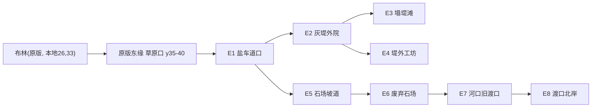

# 大地图扩充方案（草案，待用户拍板）

日期：2026-10-16（Asia/Shanghai）｜分支：`code/map-plan`（基于 `code/c1-a3`）｜作者：代码
性质：只出方案，不改游戏代码、不做具体场景、未发给绘图。

用户规则：扩展地图 = 外扩原版世界地图的外围（新增边缘格子/区域）；嵌套区域只能是建筑、副本、地牢（门或过场进入），不能把一张地图嵌进现有地图。

---

## 1. 原版世界地图结构（只读调研结论）

证据来源：xzh 上 `D:\SteamLibrary\steamapps\common\Stoneshard\vanilla.win`（SHA256 `99965AB8…19444`，见 `research/art-map-direction-correction-20261015.md`），用仓库已有 `tools/GameProbe`（构建产物 `artifacts/probe-inspect/GameProbe.exe`）的反编译/`--function-asm`，加一个只读的临时探针（UndertaleModLib 读房间图层，放在 xzh `%TEMP%\mapq`，不在仓库内）。未写游戏文件和存档。

### 1.1 世界地图是一张编辑器房间，原版只裁出其中一块

| 事实 | 证据 |
|---|---|
| 世界地图房间 `r_GlobalMap`，6188×4108 px，每格 52 px → **119×79 格** | 探针：`ROOM r_GlobalMap 6188x4108 cells=119x79` |
| 地貌由该房间的 Tile 图层决定：`Biomes`（1 中原/r_field，2 草原/r_steppe，3 松林/r_pinefield，4 苔原，5/6 雪，7 山，8 海）、`Sea`（海岸 16 向）、`Steppe`、`Snow`、`RoadCollision`、`ThreePresetLayer`、`LocalBorders`、`Borders`、`mountain_1..4`、纸图图层 `map_osbrook / map_mannshire / map_brynn / map_rottenwillow / map_abbey / map_oldhomestead / map_freevalley / map_plaguevillage / map_aldor`，以及每个卫星地点一层（Denbrie、Mannshire、AbadonedQuarry…） | 探针图层清单；`gml_Object_o_globalmap_controller_Create_0` 第 51–58、90–124 行（biome→房间映射） |
| 可玩区域由两个标记对象裁出：`o_border_top_left` 在格 (77,22)，`o_border_down_right` 在格 (118,66) | 探针 `INST o_border_top_left px=4004,1144`、`o_border_down_right px=6136,3432`；`gml_Object_o_border_top_left_Create_0` 设 `global.border_tl / glmapStartX/Y = x div 52` |
| 生成循环只遍历 `glmapStartX..glmapEndX × glmapStartY..glmapEndY`，每格建一个 ds_map（Biome、Type、room_type、seed 等，`irandom` 按 x 外层、y 内层顺序取随机数，种子 `global.seed`） | `o_globalmap_controller_Create_0` 第 24–25、59–224 行 |
| 之后 `ResizeGrid(tl..dr)` 把网格裁成可玩块，**坐标整体平移为以 (77,22) 为原点的本地坐标**，并设 `glmapStartX/Y=2`、`glmapEndX/Y=worldWidth/Height-3` | `o_globalmap_controller_Other_15` 第 1391–1426 行 |
| 原版可玩块 ≈ 42×45 格（房间格 x 77–118、y 22–66）。`LocalBorders` 纸边框和 `map_aldor` 纸图图层正好覆盖这一块 | 探针 `LocalBorders`/`map_aldor` 图层 dump |
| **房间其余部分也已画了地貌**：整张 119×79 有 `Borders` 外框；西侧 x 0–76 是中原/草原/松林，北侧 y 0–21 是山地/松林/苔原/雪，南侧 y≥67 基本是海；还摆了约 16 个 `o_globalmap_editor_village`（如 (9,10)、(18,39)、(50,43)、(43,64)、(61,60)），全部在裁剪区外，原版不生成 | 探针 Biomes 全图 dump、INST 列表 |
| 东缘 x=118 已是房间最右一列，无现成画面可外扩；x=118、y 44–60 的 `RoadCollision` 值为 2（含义待查） | 同上 |
| 边界判定：本地 x≤1、y≤1、x≥W-2、y≥H-2 为边界不可进 | `gml_Script_scr_globalmapIsBorder`（asm） |
| 每格的房间：`scr_globaltile_get_room` → 读格 map 的 `room_type` 字符串 → `asset_get_index`。格坐标键为 `"x_y"`（本地坐标） | `gml_Script_scr_globaltile_get_room`、`scr_globaltile_get_tile_tag`（asm） |
| 原版本身就有“单格指定专用房间”的写法：`ds_map_set(ds_grid_get(global.terrainGrid, 26, 35), "room_type", room_get_name(r_SeaShore_WestBrynn))`；同处还有 (28,32)、(22,32) 硬编码本地坐标 | `o_globalmap_controller_Other_12` 第 936–938 行 |
| 地点（城镇、卫星、副本）由 `o_globalmap_editor_*` 实例在房间里的位置决定，`event_user(0)` 写入格 Type/Location/room_type | `Other_15` 第 1381–1390 行；`Other_12` 第 917–928 行 |
| 野外格之间的走动：野外房间四边生成 `o_tile_transition`（`scr_transition_left/right/up/down`，每 26 px 一个，带 dX/dY），玩家踩上后 `scr_playerTileborderTransition` → `scr_smoothRoomChange(target)` | `gml_GlobalScript_scr_transition_left`、`scr_playerTileborderTransition` |
| 存档：`globalmapDataMap` 存 `locationsDataMap`（键 `"x_y"`）、`fogString`、`paperString`、`mountainsList`、`userMarksList`、`randomSequenceList`；地形网格每次读档按种子重新生成 | `gml_Script_scr_globalmapMapInit`（asm）；`Create_0` 每次运行 |
| 迷雾/纸图存成长度 W×H 的字符串，按 **x 外层、y 内层** 逐字符读（下标 = x·H + y） | `gml_GlobalScript_scr_globalmapFogInit`、`scr_globalmapPaperInit` |
| 纸图区域按 `map_*` 图层名分组，用 `border_tl_paper` 偏移读取 | `scr_globalmapPaperInit` |

原版地标（房间格 → 本地格 = 房间格 − (77,22)）：Osbrook (109,32)→(32,10)；Mannshire (103,45)→(26,23)；Brynn (103,55)→(26,33)，`map_brynn` 覆盖 x 96–114、y 50–59；Denbrie (91,59)→(14,37)；BridgeCamp (87,60)；RunicStone (80,59)；原版已有 `AbadonedQuarry` (81,61)；BrokenShip (93,64)。

### 1.2 对扩图最关键的三个推论

1. **往西、往北外扩 = 移动 `o_border_top_left`**：地貌已画好，但本地坐标原点会变，所有存档里的 `"x_y"` 键、`playerGridX/Y`、迷雾/纸图字符串、山地表、用户标记、原版硬编码的 (26,35)/(28,32)/(22,32) 全部错位，必须做旧档迁移。
2. **往东外扩 = 加宽房间 + 移动 `o_border_down_right`**：原点不变；因为字符串下标是 x·H+y，只加列时旧字符串正好是新字符串的前缀，补零即可；生成循环 x 在外层，新列排在最后，原版格的随机序列不变（循环之后其他事件的随机消耗是否受影响，待测）。代价是东侧没有现成地貌，整列图层都要新画。
3. **往南外扩**基本是海；改高度会让 x·H+y 下标全乱，兼容性最差，不推荐。

---

## 2. 现有 mod 房间与“图中图”

依据 `docs/review/图中图清单-20261016.md`：10 个 `r_eao_*` 房间都没有世界格坐标，全靠门接入。违规 3 个（`n1_yard`、`n2_sites`、`fx_quarry`），存疑 2 个（`n2_camp`、`n2_winch`），合规 5 个（`n1_bellhouse`、`n1_underpass`、`n2_side`、`d01_warehouse`、`d01_archive`）。设计地理（文案负责，只读）：R01 布林外港与旧渠（灰堤工营、旧渠、盐车道），R02 丹布里西路与渡口（旧渡口三子场景），见 `design/02_世界与地图/区域_R01_*`、`区域_R02_*`、`旧渡口_场景与通路.md`。设计稿已声明“功能节点不等于世界格、全球坐标待核”。

---

## 3. 外扩方向（待拍板）

| 方案 | 做法 | 优点 | 缺点/风险 |
|---|---|---|---|
| **A 东扩（推荐）** | `r_GlobalMap` 加宽（119→约 127 格），`o_border_down_right` 右移；新地块贴在布林东侧（本地 x≥41，y 约 22–40） | 原点不动，旧档坐标全部有效；迷雾/纸图只需补尾；原版格随机序列基本不变；紧挨布林，适合 R01 外港、灰堤、石场 | 要新画整列地貌和全部 Tile 图层；改房间宽度需验证 MSL/UndertaleModLib 写回；东缘原是山脊（x113–118、y47–56）和一段草原出口（y57–62），需在山脊开口 |
| B 西扩 | `o_border_top_left` 左移约 6–8 列（x 69–76），用原版已画好的中原/草原/海岸；贴着丹布里、桥营、符文石 | 地貌现成，绘图工作最少；贴近丹布里，正合 R02 西路与渡口 | 原点平移 → 必须写旧档迁移（所有 `x_y` 键、玩家坐标、迷雾/纸图、标记、山地、副本表、原版硬编码坐标 +dx）；原版生成随机序列整体改变，旧档里野外格的种子/地点会变；风险最高 |
| C 只开新档 | 方案 A 或 B，但不兼容旧档，只支持新开局 | 实现最简单 | 用户现有存档（含 MAHIR）不能进新区域 |

建议先选 A：灰堤（R01）、石场本就在布林城外，放布林东侧合乎设计；旧渡口（R02）原设计在丹布里西路，A 方案下需文案同意改成“布林东侧旧渡口”，或者先放 A 的北段，等以后做 B 再迁（见拍板项 2）。

## 4. 方案 A 的新格子（第一期 8 格）

坐标为本地格（原点不变）。原版最东可走列为本地 x=39（W=42 时边界为 x≥40），新可走列 x=40–47；裁剪框外再留 2 列边界缓冲。示意：

```
本地 y   x: 36 37 38 39 | 40   41   42   43   44   45   46   47   (48-49 边界)
  26        .  .  ^  ^  |  ^    ^    ^    ^    ~    ~    #    #
  28        .  .  ^  ^  |  ^   [E7] [E8]  ^    ~    ~    #    #
  30        .  .  ^  ^  |  ^    .   [E6]  .    ~    ~    #    #
  32       Bryn ...  ^  |  .   [E5]  .    .    ~    ~    #    #
  34       Bryn ...  .  -[E1]-[E2]  [E3]  .    ~    ~    #    #
  36        .  .  .  .  |  .    .   [E4]  .    ~    ~    #    #
  38        ~  ~  ~  ~  |  ~    ~    ~    ~    ~    ~    #    #
图例: Bryn=布林城格  ^=山脊  .=可走野外  ~=海/河口  #=新纸图边缘  |=原版东缘
```



（具体格坐标要等实际新画地貌后定；上图只表示相对位置与连通。）

| 格 | 名称 | 地貌/生态 | 承载任务 | 进出方式 | 格内用门进入的建筑/地牢 |
|---|---|---|---|---|---|
| E1 | 盐车道口 | 草原 + 碎石路，海风，低危 | R01 盐车道连接；DT 普通旅人 | 从布林东侧原版草原出口步行跨格 | 路边岗亭（可选，室内） |
| E2 | 灰堤外院 | 海堤/盐滩，湿草，泥 | N2 主场景（原 `n2_sites` 外景） | 与 E1/E3/E4 原生跨格 | 雇工棚（`n2_camp` 改室内）、绞盘作业棚（`n2_winch` 改室内）、旧渠检修口 → 旧渠侧间（`n2_side`，地牢） |
| E3 | 塌堤滩 | 断堤、浅滩、潮线 | N2 塌堤外景（原 `n2_winch` 室外部分） | 原生跨格 | 无（纯地表） |
| E4 | 堤外工坊 | 堤外作业院 | R01 工坊/N4 预留 | 原生跨格 | 工坊室内（后期） |
| E5 | 石场坡道 | 山脚丘陵、灌木 | FX-QRY 前段 | 从 E1 往北 | 无 |
| E6 | 废弃石场 | 露天采石坑、碎石土 | FX-QRY 主场景（原 `fx_quarry` 外景） | 原生跨格 | 矿坑坑道（可选地牢） |
| E7 | 河口旧渡口 | 河口、断桥、芦苇 | N1 主场景（原 `n1_yard` 外景）——需文案确认地理改动 | 原生跨格 | 无声钟房（`n1_bellhouse`，建筑）→ 渡口暗渠（`n1_underpass`，地牢） |
| E8 | 渡口北岸 | 河岸林地 | N1 撤离/后续 R02 连接预留 | 原生跨格 | 无 |

D01 外港封账仓、档案室维持现状（原版建筑内楼层，合规）。

### 4.1 违规/存疑房间去向

| 房间 | 现状 | 去向 |
|---|---|---|
| `n1_yard` 旧渡口断桥 | 图中图 | 改为 E7 地表格的专用房间（加四边跨格过渡）；商队旁随机刷门撤掉 |
| `n2_sites` 灰堤外院 | 图中图 | 改为 E2 地表格专用房间；野外随机刷门撤掉；三座建筑门保留 |
| `fx_quarry` 废弃石场 | 图中图 | 改为 E6 地表格专用房间；布林城内刷门撤掉，改从 E1/E5 步行 |
| `n2_camp` 雇工棚 | 存疑 | 重做为棚屋室内（铺位、灶台）；露天营地部分并入 E2 |
| `n2_winch` 塌堤 | 存疑 | 拆成“绞盘作业棚”室内 + E3 塌堤滩地表 |

旧存档里人已在旧房间：保留旧房间资源和 `home` 门作为退出通路一个版本（对应 TODO GEO-07），不强移人物。

---

## 5. 技术可行性与改动点

| 改动 | 内容 | 状态 |
|---|---|---|
| 世界地图房间 | `r_GlobalMap` 加宽；所有 119 列宽的 Tile 图层同步加宽；新列画 Biomes/Sea/RoadCollision/ThreePresetLayer/Borders/LocalBorders；新增纸图图层 `map_eao_east`；移动 `o_border_down_right` | 未验证 MSL 能否改房间尺寸和图层，可能要在 GameProbe 打包流程里直接用 UndertaleModLib 改 |
| 格内容 | 新格的 `room_type` 指向 mod 房间：照原版 `r_SeaShore_WestBrynn` 写法，在世界生成后（`o_globalmap_controller` 某个 User 事件之后）对新格 `ds_map_set(..., "room_type", ...)`；或在房间里放 `o_globalmap_editor_*` 风格的新对象 | 有原版先例，挂钩时机待定 |
| 地表房间 | mod 房间加四边 `o_tile_transition`（调用 `scr_transition_*`），落点按 dX/dY；验证与原版野外格互通 | 未验证；`r_eao_*` 现是复制 DockStore 室内房间，没有边缘过渡 |
| 也可走原版生成 | 新格用原版 `r_steppe/r_field` 随机生成，故事场景再用 `scr_locationRoomPresetBiomeCreate` 预设 | 反编译有递归警告，未确认调用约定 |
| 世界地图 UI | 新纸图区、迷雾瓦片、地点图标、悬浮名称、危险度（`scr_globalmapGetDangerLevel`/MapZone） | 待查 |
| 旧档兼容 | 读档时若 fog/paper 字符串长度 = 旧 W×H，补 (新W−旧W)×H 个 '0'；`border_tl_paper` 不变；新格 `locationsDataMap` 按需创建 | 推导自 `scr_globalmapFogInit`/`PaperInit`，需实测 |
| 寻路 | `astarCaravanGrid`/`astarCartGrid`/`roadCollisionGrid` 按 W×H 建，自动跟随 | 商队/车夫是否会走进新区、路网是否连上，待测 |
| 原版其他硬编码坐标 | 东扩不受影响；西/北扩必须全部 +dx/+dy | 仅找到 Other_12 三处，未全量扫描 |

### 主要风险与未知

1. 改 `r_GlobalMap` 房间尺寸/图层是否会被 MSL 合并逻辑或其他 mod 冲突（与原版更新也会冲突）。
2. 世界生成后段（道路 `BuildRoad`、区域划分 `zoneWidthMod`、森林、遭遇）用随机数和 `worldWidth`，加宽后原版格的森林/道路/遭遇布局可能变，影响旧档“熟悉的地图”；格内实体保存在 `locationsDataMap`，预计不丢，但要实测。
3. `RoadCollision` 东缘值 2 的作用未知，可能和地图边缘道路出口有关。
4. 世界地图 UI 的缩放/滚动范围是否按 worldWidth 自适应，未查。
5. 地表专用房间的跨格落点、敌人跨格追击（`o_enemyTransitionsController`）、商队停驻判定。
6. 新格迷雾/纸图是否需要买地图解锁（纸图按 `map_*` 区域）。
7. 方案 B 的全量坐标迁移难以穷举，出错会损坏存档。

### 分阶段实施（对应 TODO GEO-01–07）

1. **GEO-01 收尾（只读）**：查清 worldWidth 实值（41 还是 42）、Other_12/13/14 调用顺序、UI 缩放、东缘 RoadCollision=2、全量硬编码坐标。产出补充记录。
2. **GEO-02 小样（2 格）**：房间加宽 2 列，只开 E1、E2 两格，用原版 `r_steppe` 随机生成，验证“原东缘 → E1 → E2 → 原路返回”、世界地图显示和迷雾。新档 + 旧档各测一次（先备份）。
3. **GEO-03/04**：读档迁移补字符串、保存/重载、商队/车夫路网。
4. **GEO-06 迁移场景**：把 `n2_sites`、`fx_quarry`、`n1_yard` 做成 E2/E6/E7 的地表房间（加边缘过渡），camp/winch 改室内；撤掉随机刷门。
5. **GEO-07 兼容**：旧独立房间保留一个版本的退出通路。
6. 再扩 E3–E8 和纸图、地点图标；之后再考虑方案 B 的西扩。

每阶段都在独立分支，合入 main 等用户拍板。

---

## 6. 给绘图的交付清单（草稿，未发送）

| 项 | 内容 | 尺寸/规格 | 风格 |
|---|---|---|---|
| 世界地图地貌瓦片 | 新增列的地貌：草原、盐滩/海堤、山脊开口、石场丘陵、河口芦苇；尽量复用原版 `t_glmap_biome / t_glmap_sea / t_glmap_steppe` 瓦片，只补缺的过渡块 | 52×52 每格；整片 8 列 × 45 行范围的拼接预览图 | 与原版纸质世界地图一致的手绘墨线 + 淡彩，不加 HD2D 光效 |
| 纸图边框 | `LocalBorders`/`Borders` 新东缘的边框瓦片（原版 `t_glmap_borders` 风格） | 52×52 | 同上 |
| 地点图标 | 灰堤外院、废弃石场、旧渡口三个地点图标，及盐车道路标 | 参照原版 `o_globalmap_editor_*` 图标尺寸（待从原版取样） | 与原版地点图标一致 |
| 地表 tileset | E2 灰堤（湿泥、盐壳、木堤）、E6 石场（碎石土、开采面）、E7 河口（浅滩、断桥墩、芦苇）的地面与过渡；能在格边缘与原版 r_steppe/r_field 无缝接 | 26×26 格（游戏内地面），房间与原版野外格同尺寸（待从 `r_steppe` 取尺寸） | 沿用 0.3.x HD2D 地面风格，色调对齐原版野外 |
| 室内 | 雇工棚、绞盘作业棚两个小室内 | 约 20×15 格 | 与钟房/侧间同风格 |

先等用户定方向，再把清单细化后发给绘图。

---

## 7. 需要用户拍板

1. **外扩方向**：A 东扩（推荐，旧档安全，新画地貌多）/ B 西扩（地貌现成，贴丹布里，旧档迁移风险高）/ C 只支持新开局。
2. **旧渡口（N1）放哪**：随 A 放到布林东侧河口（需文案改地理），还是先保持现状，等以后西扩再落到丹布里西路。
3. **第一期规模**：先 2 格小样（推荐）还是直接 8 格。
4. **旧存档**：是否要求旧档能进入新区域（影响是否做读档迁移）。
5. **新格生成**：故事格用固定专用房间（可控，美术量大），还是原版随机野外 + 预设（省美术，可控性差）。
