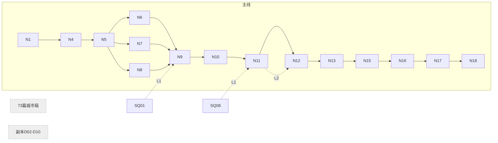
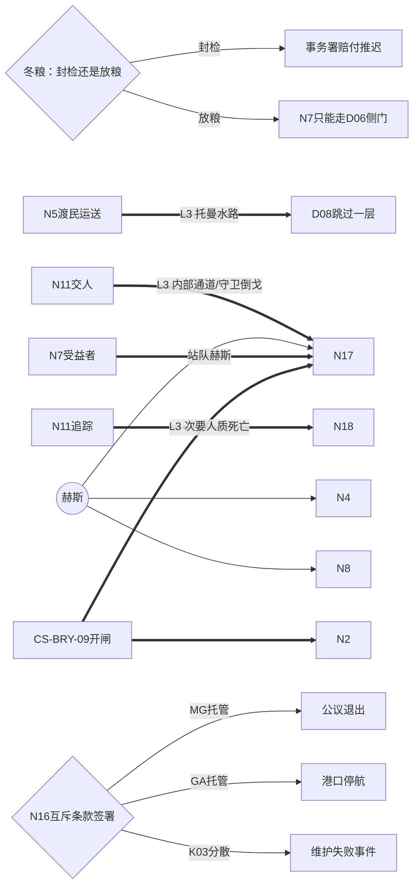

# 剧情结构审查（2026-10-15）

## 一、结论先行

**一句话：规则严谨，但网缺少张力。** 选择很少真正改变后面的盟友、地图和结局；阵营不互相冲突；反派出场太晚；城市篇和主线互不相连。

优点要保留：知识边界、缺席/死亡替代、不回滚历史、奖励去重、伤害留痕都定得很细。73 篇城市稿都有“先做/后做”和“NPC 缺席”两种变体，这比多数 Mod 扎实。

问题在于，大量兜底规则（“仍可”“不自动”“不锁主线”“可付费替代”）把后果中和掉了。博德之门3（下称 BG3）、神界原罪（下称 DOS）的网状感，来自选择改变**谁站在你身边、哪扇门开着、谁能活到下一章**。

**最该先做的三件事**（详见第四节）：
1. 把终局托管方案改成互斥条款（P2）。
2. 补阵营关系矩阵，制造合法利益冲突（P3）。
3. 让反派赫斯提前出场，并给他的论点真实分量（P4）。

## 二、阅读说明

**范围**：只读审查 `design/`，包括主线 N1—N18 台本、支线 SQ01—08、副本 D02—D10 台本、势力卡、人物弧光、证据链与结局、交叉影响矩阵、网状叙事深度审计。未修改任何设计文件。

**对标作品**：BG3、DOS1/2、Drova。

**分析方式**：Codex 辅助分析，引用已逐条抽查；GLM-5.3 因余额不足未能使用。最终判断由本人负责。

**常用编号**：

| 编号 | 含义 |
| --- | --- |
| N1—N18 | 主线 18 章（如 N11“关隘外的交换”、N16“谁来保管余烬”、N17“残光之井”终局、N18“誓约之后”回访） |
| SQ01—08 | 主线相关支线 |
| CS-城市-序号 | 城市支线（如 CS-BRY-09 = 布林第 9 篇） |
| D02—D10 | 副本（D10 = 残光之井终局副本） |
| X01—X74 | 交叉影响边：前一个任务的选择对后一个任务的影响，登记在《叙事交叉影响矩阵》 |
| NE1—NE5 | 五项核心证据 |
| K01—K04 | 四种结局方案：K01 封存、K02 有条件托管、K03 分散保管、K04 强夺 |
| MG / CO / GA | 托管方：城市联盟边地事务署 / 王廷封印特使团 / 灰色军团地方公议 |

**后果分级**（本报告提出，用于建议）：
- **L1**：只换台词。
- **L2**：改变路线或代价。
- **L3**：改变盟友、场景或任务本身。

## 三、结构问题（按严重程度排序）

### P1【严重】选择后果太轻，多数交叉边只换台词或省一步手续

- **问题**：前事对后事的影响，大多是“少问一次路”。玩家感觉不到选择的重量。
- **依据**：
  - `叙事交叉影响矩阵.md` X06：“减少一次口头担保环节”。
  - `台本_N11_关隘外的交换.md` X12：“可少一道问路但仍验箱号”；X40：“trace少一段问路”。
  - `台本_N12_失踪者仍有名字.md`：“井外移交少一场找接收点”。
  - 矩阵 74 条边都附带“已结案：只追加新回应与合法补偿步骤，不回滚已执行选择”。
- **对标**：BG3 第一幕救不救林地，决定第二幕整批 NPC、商人和任务是否存在。DOS2 杀或放一个 NPC，会让后续整条任务换解法或消失。
- **建议**：给 74 条边按 L1/L2/L3 分级，规定每幕至少 3 条 L3 边。
- **改写示例**：
  - X12（N5 选“渡民运送” → N11）：托曼亲自带玩家走一条只有渡民知道的水路进 D08，绕过第一层守卫。N5 选了别的路线，就只能从正门打进去。
  - X06（N3 选“审计” → N10）：妮尔获得当场质疑凯姆印鉴的权力，N10 多一条“由妮尔当众拆穿”的路线。没选审计时，只能私下对质，凯姆会趁机销毁一份副本（可选信息永久丢失，核心证据不受影响）。

### P2【严重】结局像一份补齐清单，做满就能全拿

- **问题**：善良路线不需要取舍。做满内容的玩家同时满足 K02 的三种托管和 K03，最后只是从奖励菜单里挑一项。K01 又始终兜底。
- **依据**：
  - `当前证据链与结局条件.md` K02：“NE1..5全verified；救济来源≥2；liability=accountable；exchange_harm=false……承诺≥2方”。K03：“全证据与上述民生责任”。
  - 同页 K01：“无声望／支线／葛文涅尔生还门槛”；“三方全部敌对仍可基础封存，没有随机概率结局”。
  - `当前任务依赖与状态字典.md`：“第三项直到N17明确最终确认前可补做”。
- **对标**：BG3 终局的“主脑”抉择、DOS2 神格归属，都是互斥的：给了一方，另一方就离开或成为敌人。
- **建议**：证据仍作安全门槛，但托管方案之间加入互斥代价。同一笔维护资金只能写进一份协议，不能靠补做把三方都签满。
- **改写示例**：
  - K02-MG（事务署托管）：航路维修最快，但公议失去地方否决权；N18 里 SQ03 的公议代表公开退出监督。
  - K02-GA（公议托管）：民户获得退出权，但事务署撤资；N18 回访出现布林港停航和失业镜头。
  - K03（分散保管）：没有一方能独占，三方承诺各降一级；N18 必然发生一次维护失败事件。
  - N16 新增一场“签哪份、撕哪份”的确认戏。

### P3【严重】阵营之间没有合法利益的冲突

- **问题**：只有违法行为才会得罪阵营。守规矩的玩家可以讨好所有人，政治冲突就消失了。
- **依据**：
  - `势力关系总览.md`：“玩家可以同时承担不同组织的一般任务……支持合法调查不自动增加其他阵营敌意；偷窃、征发或泄露匿名名单才有具体后果。”
  - 所有势力卡中没有互斥、敌意、对立类条款（全文检索为零）。
  - 总览只有约 2.8KB，表格只列“筹码”和“区域”，没写势力之间的关系。
- **对标**：DOS2 的猎人与术士、Drova 的 Nemeton 与 Remnants（只能二选一加入）、BG3 的地精营地与林地。冲突来自各方都有道理的诉求。
- **建议**：
  1. 补一张“势力 × 势力”关系矩阵：盟友/竞争/敌对、争夺对象、引爆任务。
  2. 在 SQ01—SQ03 设一个共享资源（例如同一座渡口仓）：事务署要通航收入，特使团要封锁检疫，公议要地方否决权。
  3. 允许跨阵营合作，但每次合作留下一个没解决的争议，在 N18 兑现。
- **改写示例**：SQ02“被征用的冬粮”新增选项：
  - **封存检疫**（冬粮交特使团封检）：SQ01 港口赔付推迟，事务署承诺降一级。
  - **开仓放粮**：特使团认为隔离失守，N7 进入军需地窖时只能走侧门（D06 侧门路线）。

### P4【高】反派存在感太弱：赫斯只在终章出场

- **问题**：玩家整整 16 章没见过主要反派，终局时设计又直接驳倒了他的论点，对抗没有分量。
- **依据**：
  - 主线台本检索人名：“赫斯”只出现在 N17；“罗温”只出现在 N11。
  - `台本_D10_残光之井.md`：赫斯说“拿走这些，他们就再也等不到答应的药。”紧接着就是“出口与执行：谈判仅争取操作窗口，完整安全方案已有N15。”
  - `势力_苍白债契.md`：“不成为长期可加入阵营”；“可谈判拖延或选择掠夺结局”。
- **对标**：BG3 的奥林、凯瑟里克从第一幕起就通过化身、手下、信件持续施压；DOS2 的达拉斯多次当面出现。
- **建议**：
  1. 赫斯在 N4 亲自收走一张空白债票，在 N8 疫所提供一剂真实有效的缓解药（玩家可以接受）。
  2. 新增一名 N7 配对病例中的“受益者”NPC：他知道另一个人为此受伤，仍反对停机，N17 站在赫斯一边。
  3. 修改 D10：断源仍然安全，但这名受益者会永久失去能力，N18 必然回访他。反派被打败了，他利用的问题仍在。

### P5【高】城市篇和主线是两张互不相连的网

- **问题**：73 篇城市稿占了大部分内容，但城市里的选择不影响主线，主线人物也不知道。玩家会觉得在玩两个游戏。
- **依据**：
  - `网状叙事深度审计.md`：城市稿 73 篇，“无入向边 73、无出向边 73”。
  - `剧情总纲.md`：“地方章不能重新结算NE或N17终局”。
  - N4、N11 等主线台本的城市接入段：“关联地域章（无直接回执边，不自动读旧案状态）”。
- **对标**：BG3 第三幕的城市支线都会影响终战援军和对白；Drova 城镇的选择决定后期派系是否接纳你。
- **建议**：核心证据和 N17 结局快照不动，只加 L2/L3 回流。主线经过的布林、柏石关、寒凉盆地、曼恩、修院山地，每座城市选 1—2 篇支线，各加一条入向边和一条出向边。
- **改写示例**：CS-BRY-09“谁关上水门”以“开闸”结局时，N2 灰堤多一条水路入口；N17 中布林援工可作为“停机”路线的维护班（对应 N17“没有可调工班”分支）。

### P6【高】关系破裂能花钱抹平

- **问题**：失去盟友的代价只是一笔钱，结果和原来一样。
- **依据**：
  - `台本_N12_失踪者仍有名字.md`：“twofront不能借被卖者或托曼作接应；可付费雇中立护理组或走rescue”。
  - `台本_N11_关隘外的交换.md`：“罗温死亡仍保留卸货木牌……拒交易不锁主线”。
  - 设计库总规则：“声望负值不得锁死主线”。
- **建议**：保留“不锁主线”，取消“结果相同”。替代方案只给基础出口。
- **改写示例**：雇来的护理组不熟悉井道。N12 的“双路救援”只能保住一个目标；想保两个，玩家要亲自守第二个驻点，并多打一场遭遇战。

### P7【高】诱惑选项不诱人：N11“交人”只有代价，没有好处

- **问题**：坏选项没有独有收益，玩家不会动心，选择也就不成立。
- **依据**：`台本_N11_关隘外的交换.md`：
  - “追踪”路线的代价只是“较长旅程；不制造拒绝交易的隐藏死亡计时”。
  - “交人”路线：“伤害事实永久留痕”“路线仍须实物核验”，换来的只有“罗温更愿供应情报”。
- **对标**：BG3 交出提夫林难民、DOS2 吞噬灵魂，坏选择都能换来真实且独有的强力收益。
- **建议**：两边都要有代价，也都要有收益。
- **改写示例**：
  - **交人**：换得追索者内部通道（D08 跳过一层），或一笔可夺取的债契资金，或 N17 一名赫斯守卫倒戈。
  - **追踪**：明确告知的时间代价，井下一名次要人质会因此死亡（事先说明，不做隐藏计时）。

### P8【中高】14 组人物弧光共用同一套模板

- **问题**：所有人都是“被事实纠正，然后交出控制”，人物职业不同，转变方式却一样。
- **依据**：`人物弧光与关系转折.md` 中，“三阶段：初遇时用该说法争取控制→现场独立事实使它不足以解释→回访中交出控制或继续逃避并遭他人拒绝”逐字出现 14 次。
- **对标**：BG3 同伴的张力来自立场稳定、与玩家冲突，而不是被事实纠正。
- **建议**：弧光分型：堕落型、固执型（人不变，世界变了）、半转变型（一个议题进步，另一个议题更难合作）、盟友反目型。
- **改写示例**：雷奥越承认失职，越坚持集中调度；凯姆承认篡改，却拒绝放弃危险知识。

### P9【中】主线和副本缺少“先做/后做”与“缺席”变体，副本只用来取证

- **问题**：主线第二幕允许自由顺序，但顺序不同，内容没有变化。副本也不读取前面的选择。
- **依据**：
  - `网状叙事深度审计.md`：主线、副本、日常的“先后变体”和“缺席变体”都是 0；全库 57 篇没有先后变体。
  - D02—D10 台本都写着同一句：“这是新冲突的起点，不假定玩家已完成其他支线”。
  - D06 只有两条路线（检查令 / 侧门副联）。
- **建议**：先在 N6/N7/N8（第二幕三路调查，顺序自由）补先后变体，副本先试点 D06、D08、D10。
- **改写示例**：最后做的那一路，赫斯已提前清理现场：少一份副本证据，但多一名可以策反的守卫。副本按前事调整看守站位、通道和接应人数。

### P10【中】每章的主要动作都是“核对材料”，节奏单调

- **问题**：总纲承诺“先接触绳、工钱、病床”，实际每章都在比对文书。
- **依据**：
  - `剧情总纲.md`：“玩家首先接触的是绳、工钱、病床和回家的路”。
  - N6 要核页孔、裁边与收讫；N7 要核配对病例与器具入量；N10 要验封蜡、晚墨与回执。
  - 几乎每条路线都套用同一句执行守卫模板（“目标前置已满足；本路线现场核验完成；费用来源不同笔抵押……”）。
- **建议**：核验放到后台，每章给一个现场动作作为核心。台本正文删去重复的守卫模板，统一放在规范文档。
- **改写示例**：N6 护送正在撤离的抄写者；N7 现场停机并处理病人退出；N10 在凯姆私下交易时抢下正在移交的印模（限时对峙）。

## 四、任务关联网络

### 现状

主干是 N1→N18 的直线，支线只挂着几条弱边；城市篇和副本基本是孤岛。

### 建议改造

加入 L3 边、阵营互斥节点，并让反派贯穿全线。

## 五、优先级行动清单

| 优先级 | 行动 | 对应问题 |
| --- | --- | --- |
| P0 | 把 N16 的托管方案（K02/K03）改为互斥条款；在《当前证据链与结局条件》加入“同一笔资金只能写进一份协议” | P2 |
| P0 | 补势力关系矩阵；在 SQ01—03 设一处共享资源冲突（渡口仓） | P3 |
| P0 | 赫斯在 N4/N8 提前出场；新增 N7 受益者 NPC；修改 D10“完整安全方案已有N15”的处理 | P4 |
| P1 | 74 条交叉边按 L1/L2/L3 分级，每幕至少 3 条 L3（先改 X06、X12、X40、X23） | P1 |
| P1 | N11“交人”加独有收益，“追踪”加明示代价 | P7、P6 |
| P1 | 每座主线城市选 1—2 篇城市支线与主线双向连接（先改 CS-BRY-09） | P5 |
| P2 | N6/N7/N8 补先后变体；D06/D08/D10 试点读取前事 | P9 |
| P2 | 人物弧光分型，打破 14 组共用模板 | P8 |
| P2 | N6/N7/N10 改为以现场动作为核心；精简台本里的守卫模板 | P10 |

改动后，按设计库规则运行三项检查：`Validate-StoryScripts.py`、`Validate-NarrativeNetwork.py`、`Test-DesignVault.ps1`。
